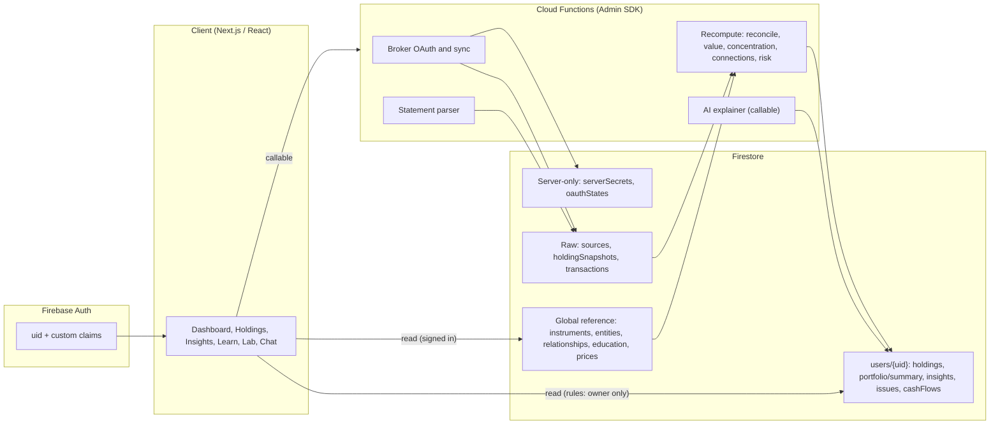

# DhanDrishti: Firebase Schema (Firestore + Auth)

> Database design for the DhanDrishti / OneView read-only investment dashboard, built on **Cloud Firestore (Native mode)** and **Firebase Authentication**. Optimized for **low document reads**, cheap writes and a strict "client reads, server writes" trust model.

| Item | Value |
|---|---|
| Companion to | `DhanDrishti_Solution.md` (Section 10, Data Model) |
| Database | Cloud Firestore, Native mode, region `asia-south1` (Mumbai) recommended for Indian financial data |
| Auth | Firebase Authentication (+ custom claims) |
| Server logic | Cloud Functions (2nd gen) using the Admin SDK |
| Files | Cloud Storage (statement uploads only, deleted after parsing) |
| Schema version | `1` (every document carries `schemaVersion`) |

> **Why this differs from Section 10 of the solution doc:** that section sketched relational entities for PostgreSQL. Firestore has no joins and charges **per document read**, so the same entities are reshaped here: heavy computations (reconciliation, concentration, Hidden Connections, risk) are **precomputed on the server and stored as ready-to-render documents**. The client reads a handful of documents instead of assembling the view itself.

---

## Table of Contents

1. [Design Principles](#1-design-principles)
2. [Architecture: Who Reads, Who Writes](#2-architecture-who-reads-who-writes)
3. [Conventions](#3-conventions)
4. [Firebase Auth](#4-firebase-auth)
5. [Collection Map](#5-collection-map)
6. [Global Reference Collections](#6-global-reference-collections)
7. [User Collections](#7-user-collections)
8. [Server-Only Collections](#8-server-only-collections)
9. [Read Optimization Playbook](#9-read-optimization-playbook)
10. [Read Budget per Screen](#10-read-budget-per-screen)
11. [Composite Indexes and Exemptions](#11-composite-indexes-and-exemptions)
12. [Security Rules](#12-security-rules)
13. [Write Flows and Cloud Functions](#13-write-flows-and-cloud-functions)
14. [Privacy, Retention and Deletion](#14-privacy-retention-and-deletion)
15. [Limits and Scaling Notes](#15-limits-and-scaling-notes)
16. [Feature-to-Collection Mapping](#16-feature-to-collection-mapping)
17. [Seeding and Build Order](#17-seeding-and-build-order)
18. [Appendix A: Enums](#appendix-a-enums)

---

## 1. Design Principles

| # | Principle | Consequence in the schema |
|---|---|---|
| 1 | **Read-path first** | Model documents around screens, not around normalized entities. |
| 2 | **Precompute, don't compute on read** | `portfolio/summary` and `insights/*` hold finished results. |
| 3 | **Deterministic document IDs** | Holdings are keyed by **ISIN**, so `getDoc` replaces a query. Re-running a job overwrites the same document (idempotent). |
| 4 | **Denormalize display data** | A holding carries the instrument name, sector, price and account breakdown, so no joins are needed to render a row. |
| 5 | **Bounded arrays only** | Arrays embedded in a document have a stated cap. Anything unbounded becomes a subcollection. |
| 6 | **Preserve observations** | Raw `holdingSnapshots` are never overwritten. The consolidated `holdings` are derived from them. (Solution doc, Section 7: "Never silently overwrite an observation".) |
| 7 | **Client reads, server writes** | Every derived number is written by Cloud Functions. Clients can write only their own preferences, scenarios and understanding-check answers. |
| 8 | **Secrets never reach the client** | Broker tokens live in a server-only collection with `allow read, write: if false`. |
| 9 | **Code for facts, AI for explanation** | Stored numbers come from deterministic code. AI output is stored separately, labeled, and cached. |
| 10 | **Provenance everywhere** | Every number links to a `sourceId`, an `asOfDate` and a verification flag. |

---

## 2. Architecture: Who Reads, Who Writes



**Trust model:** the browser can read `users/{uid}/**` (owner only) and the global reference data. It cannot write derived data, and it can never see `serverSecrets`.

---

## 3. Conventions

### 3.1 Naming and IDs

| Item | Rule |
|---|---|
| Collection names | `camelCase`, plural (`holdings`, `cashFlows`) |
| Field names | `camelCase` |
| Holding doc ID | the **ISIN** (e.g. `INE000A01AB1`) |
| Account / source / connection IDs | Firestore auto-ID, prefixed in code (`acc_`, `src_`, `con_`) for readability |
| Snapshot doc ID | `{sourceId}_{accountId}_{isin}_{settlement}` (deterministic, idempotent import) |
| Reconciliation issue ID | `{isin}_{issueType}` (deterministic, so recompute upserts instead of duplicating) |
| Insight doc IDs | fixed names: `concentration`, `hiddenConnections`, `risk` |
| Avoid | Sequential or monotonically increasing IDs in high-write collections (hotspotting). Auto-IDs are fine. |

### 3.2 Data types

| Kind | Type | Rule |
|---|---|---|
| **Money** | `number` (integer) | Stored in **paise**, field suffix `Paise` (₹412.50 = `41250`). Avoids float drift. Rounded once, at valuation: `valuePaise = round(quantity x pricePaise)`. |
| **Quantity** | `number` | Up to 4 decimal places (mutual fund units). |
| **Percentages** | `number` (integer) | Stored in **basis points**, suffix `Bps` (42.5% = `4250`). |
| **Instants** | `Timestamp` | `createdAt`, `updatedAt`, `importedAt`, `lastSyncAt`. |
| **Business dates** | `string` `YYYY-MM-DD` (IST) | `asOfDate`, `priceDate`, `dueDate`, `tradeDate`. Sortable, timezone-safe, index-friendly. |
| **Translatable text** | `map` | `{ en: "...", hi: "..." }`. One document serves all languages (fewer reads). |
| **Enums** | `string` | Listed in [Appendix A](#appendix-a-enums). |
| **Nullable** | explicit `null` | Use `null` for "unknown", never `0`. Unknown price is not a zero price. |

### 3.3 Standard fields (on every user-owned document unless noted)

| Field | Type | Notes |
|---|---|---|
| `schemaVersion` | number | Enables lazy migrations. |
| `createdAt` | Timestamp | Server timestamp. |
| `updatedAt` | Timestamp | Server timestamp. |
| `isSample` | boolean | `true` for data created from a sample portfolio, so the UI can label it **unverified / synthetic**. |

### 3.4 Modeling rules

- **Embed** when data is read together and bounded (account breakdown inside a holding).
- **Subcollection** when unbounded or rarely read (`messages`, `holdingSnapshots`).
- **Flatten** any field used in `where` / `orderBy` to the top level (`assetType`, `valuePaise`), and keep display-only structure nested.
- **Never store** full PAN, full demat/client IDs, CAS PDF passwords, broker passwords or OTPs. Store **masked** IDs (last 4) only.
- **Underlying assets are explanations, not value.** Data under `instrumentGraphs` is never summed into portfolio value.

---

## 4. Firebase Auth

### 4.1 Providers

| Provider | Why |
|---|---|
| **Phone (OTP)** | Most common sign-in for Indian users; no password to store. |
| **Google** | Fastest path for demo and web users. |
| Email link (optional) | Passwordless fallback. |

Enable **Firebase App Check** (reCAPTCHA Enterprise on web) so only your app can call Firestore and your callable functions.

### 4.2 Custom claims

| Claim | Type | Used for |
|---|---|---|
| `admin` | boolean | Seeding and editing global reference data (instruments, relationships, education). |
| `reviewer` | boolean | Content reviewers who mark Hindi / English educational content as `reviewed`. |

Claims are read from `request.auth.token` in rules, which costs **no extra document reads** (unlike a `get()` of a roles document).

### 4.3 User bootstrap

An Auth `onCreate` trigger creates `users/{uid}` with defaults so the client never has to. Until then the client shows a short loading state.

```text
Auth user created
   -> trigger creates users/{uid} { preferredLanguage: "en", dataMode: "empty", ... }
```

**Auth holds:** email/phone, display name, provider IDs. **Firestore `users/{uid}` holds:** app preferences and state. Email and phone are **not duplicated** into Firestore.

---

## 5. Collection Map

```text
appConfig/                                   (global, tiny, cache-friendly)
  public                                     brokers list, languages, thresholds, disclaimers, flags
  scenarioTemplates                          What-if / stress-test templates

instruments/{isin}                           master data for every security
prices/{isin}                                latest price (one doc per instrument)
  daily/{yyyy-MM-dd}                         optional price history (charts only)
entities/{entityId}                          companies, trusts, properties, projects, funds
relationships/{relationshipId}               trusted, source-linked relationships
relationshipProposals/{proposalId}           AI-proposed, pending human review (admin only)
instrumentGraphs/{isin}                      precomputed "Follow my money" chain (1 read per instrument)
events/{eventId}                             announcements (real or clearly simulated)
education/{contentId}                        reit, invit, bond, stock, comparison, glossary, lessons
samplePortfolios/{sampleId}                  "Try sample portfolio" metadata + fixtures
  insights/{docId}                           same shape as users/{uid}/insights/* (Learn view)

users/{uid}                                  profile + preferences
  portfolio/summary                          DASHBOARD DOC (totals, split, accounts, coverage, issues, top risks)
  holdings/{isin}                            consolidated, deduplicated holding (one per ISIN)
  insights/concentration                     concentration map data
  insights/hiddenConnections                 Hidden Connections + event impacts
  insights/risk                              risk observations
  accounts/{accountId}                       demat accounts and MF folios (masked)
  connections/{connectionId}                 broker connection state (no tokens)
  sources/{sourceId}                         each import / sync event (provenance)
  holdingSnapshots/{snapshotId}              raw per-source observations (audit trail)
  transactions/{txnId}                       buys, sells, corporate actions
  cashFlows/{cashFlowId}                     scheduled / announced / estimated / received
  reconciliationIssues/{issueId}             discrepancies with evidence
  scenarios/{scenarioId}                     saved What-if / stress-test scenarios
  chats/{chatId}                             explainer conversations
    messages/{messageId}
  understandingChecks/{checkId}              post-simulation comprehension answers
  consents/{consentId}                       consent records
  syncJobs/{jobId}                           import / sync / recompute progress (TTL)

serverSecrets/{connectionId}                 SERVER ONLY: encrypted broker tokens
oauthStates/{state}                          SERVER ONLY: OAuth state + PKCE (TTL)
deletionJobs/{uid}                           SERVER ONLY: erase-my-data tracking
```

---

## 6. Global Reference Collections

Read-only for clients (any signed-in user). Written only by admin scripts and Cloud Functions. This data is **shared by all users**, so one write serves everyone and reads are highly cacheable.

### 6.1 `appConfig/public`

One document with everything the app needs at startup. **1 read, cached for the session.**

| Field | Type | Notes |
|---|---|---|
| `languages` | array of string | `["en","hi"]` |
| `brokers` | array of map, max ~20 | `{ brokerId, name, integrationStatus, authType, capabilities[], logoKey, note }`. `integrationStatus` drives honest UI: `live`, `mock`, `statement_only`, `partner_pending`. |
| `riskThresholds` | map | Displayed, transparent thresholds, e.g. `{ singleIssuerBps: 2000, singleSectorBps: 3000, singleAccountBps: 6000 }`. |
| `disclaimers` | map | `{ educationOnly: {en,hi}, illustrative: {en,hi}, version }` |
| `featureFlags` | map | e.g. `{ whatIfLab: true, hindi: true }` |
| `updatedAt` | Timestamp | |

### 6.2 `appConfig/scenarioTemplates`

| Field | Type | Notes |
|---|---|---|
| `templates` | array of map | `{ templateId, type, label:{en,hi}, params:[{key,min,max,step,default,unit}], assumptionKeys[], lessonId }` |

Kept in one document (5 to 10 templates) so the What if? lab needs **1 read**, not one per scenario.

### 6.3 `instruments/{isin}`

The master record. ISIN is the primary key across brokers and statements.

| Field | Type | Notes |
|---|---|---|
| `isin` | string | Same as doc ID. |
| `name`, `shortName` | string | Display names. |
| `aliases` | array of string, max 20 | Names seen in statements/brokers. Used for `array-contains` name matching when a statement has no ISIN. |
| `symbols` | map | `{ NSE: "SECX", BSE: "500001" }` |
| `assetType` | `AssetType` | `equity`, `etf`, `mutual_fund`, `reit`, `invit`, `bond`, `unknown`. |
| `assetSubType` | string | e.g. `corporate_bond`, `government_bond`, `ncd`, `sgb`. |
| `issuerEntityId` | string | Link to `entities`. |
| `issuerName` | string | Denormalized. |
| `sector`, `industry` | string or null | `null` shows as "unclassified" (never guessed). |
| `sectorSource` | map | `{ name, version, asOf }` (documented classification source). |
| `faceValuePaise` | number or null | |
| `terms` | map | Type-specific. Bond: `{ couponBps, couponFrequency, maturityDate, seniority, redemptionType }`. REIT/InvIT: `{ trustEntityId, sponsorEntityId, distributionFrequency }`. |
| `rating` | map or null | `{ agency, rating, asOf, sourceUrl }` shown only with source and date. |
| `liquidityInfo` | map or null | `{ avgDailyVolumeUnits, asOf, sourceUrl }`, disclosed data only. |
| `lookThrough` | map | `{ available: bool, sourceDocId }`. Funds/ETFs only. |
| `educationKey` | string | `reit`, `invit`, `bond`, `stock`, links to `education/{id}`. |
| `isCurated` | boolean | `true` for instruments shown in the Learn view and curated demo set. |
| `metadataSource` | map | `{ name, url, asOf }` |
| `isActive` | boolean | |
| `schemaVersion`, `updatedAt` | | |

### 6.4 `prices/{isin}`

One **latest** price per instrument. Kept out of `instruments` so a daily price refresh rewrites a tiny document.

| Field | Type | Notes |
|---|---|---|
| `isin` | string | |
| `pricePaise` | number or null | `null` means "no dependable price". The app shows units/face amount and never invents a value. |
| `priceType` | string | `close`, `last`, `nav`. |
| `currency` | string | `"INR"` |
| `priceDate` | string `YYYY-MM-DD` | |
| `source` | string | |
| `fetchedAt` | Timestamp | |

Optional history: `prices/{isin}/daily/{YYYY-MM-DD}` with `{ pricePaise, source }`. Read **only** by chart views, never on the dashboard.

### 6.5 `entities/{entityId}`

Legal entities and real-world nodes of the relationship graph.

| Field | Type | Notes |
|---|---|---|
| `entityType` | `EntityType` | `company`, `reit_trust`, `invit_trust`, `property`, `project`, `sponsor`, `fund`. |
| `legalName`, `displayName` | string | |
| `aliases` | array of string, max 20 | |
| `identifiers` | map | `{ cin, lei }` where public. |
| `sector` | string or null | |
| `isins` | array of string, max 50 | Securities issued by this entity. |
| `isActive`, `updatedAt` | | |

### 6.6 `relationships/{relationshipId}`

Only **documented, trusted** relationships live here. Direction is `from -> to`.

| Field | Type | Notes |
|---|---|---|
| `fromEntityId`, `toEntityId` | string | |
| `fromName`, `toName` | string | Denormalized for display. |
| `type` | `RelationshipType` | e.g. `tenant_of` (company -> property), `purchases_power_from` (company -> project), `owns_property` (trust -> property). |
| `source` | map | `{ docTitle, docType, url, pageOrSection, disclosureDate }`. Required. |
| `disclosed` | map or null | `{ pct, pctBasis, asOf }`, present **only where disclosed**. Kept separate from any invested amount. |
| `instrumentIsins` | array of string | Securities this relationship is relevant to. |
| `status` | `RelationshipStatus` | `trusted`, `retired`. |
| `verifiedBy`, `verifiedAt` | string, Timestamp | |
| `createdAt`, `updatedAt` | | |

> A relationship that gives only a tenant **sector** with no named tenant is stored as a sector-level entity link. The company is never guessed.

### 6.7 `relationshipProposals/{proposalId}` (admin only)

AI proposes; deterministic rules and a human decide what enters `relationships`.

| Field | Type | Notes |
|---|---|---|
| All fields of `relationships` | | Same shape. |
| `status` | `ProposalStatus` | `pending`, `approved`, `rejected`. |
| `proposedBy` | string | `"ai"` or a user ID. |
| `modelRef` | string | Model/version that proposed it. |
| `evidenceSnippet` | string | Short excerpt supporting the proposal. |
| `reviewerId`, `reviewerNote`, `reviewedAt` | | |
| `promotedRelationshipId` | string or null | Set on approval. |

### 6.8 `instrumentGraphs/{isin}`

The **precomputed Follow my money chain** for an instrument. Built by an admin pipeline from `entities` + `relationships`. Rendering a full explanation costs **1 read**.

| Field | Type | Notes |
|---|---|---|
| `isin`, `instrumentName`, `assetType` | | |
| `chain` | array of map, max 30 | Ordered: instrument, issuer or trust, disclosed underlying assets, revenue sources, distribution or repayment terms, supporting documents. Each `{ level, nodeId, label, sublabel, disclosedPct, docIds[] }`. |
| `views` | map | Node ID lists per tab: `{ assetsAndIssuers: [...], cashFlows: [...] }`. (The *Accounts* tab comes from the user's own `holdings/{isin}.accounts`.) |
| `docs` | array of map | `{ docId, title, url, disclosureDate }` |
| `accuracyNotes` | array of string | Keys to reviewed notes, e.g. `reit_units_not_direct_ownership`, `underlying_not_added_to_value`. |
| `builtFrom` | map | `{ relationshipIds[], builtAt }` |

### 6.9 `events/{eventId}`

| Field | Type | Notes |
|---|---|---|
| `entityId`, `entityName` | string | The company the event concerns. |
| `eventType` | string | `payment_delay`, `rating_change`, `announcement`, ... |
| `headline` | map | `{ en, hi }` |
| `isSimulated` | boolean | **Must be `true`** for demo events. The UI always labels them. |
| `eventDate` | string | |
| `directIsins` | array of string | Instruments the event directly concerns (e.g. the bond). |
| `source` | map or null | Real document reference, if any. |
| `createdAt` | Timestamp | |

### 6.10 `education/{contentId}`

IDs: `reit`, `invit`, `bond`, `stock`, `comparison`, `glossary`, and `lesson_{name}`. Both languages live in **one document**, so switching language costs 0 extra reads.

| Field | Type | Notes |
|---|---|---|
| `contentType` | string | `instrument`, `comparison`, `glossary`, `lesson`. |
| `version` | number | |
| `i18n` | map | `{ en: {...}, hi: {...} }` |
| `reviewStatus` | map | `{ en: "reviewed", hi: "draft" }` with `reviewedBy`, `reviewedAt`. Only `reviewed` languages are shown as authoritative. |
| `sources` | array of map | `{ title, url }` (SEBI investor material, issuer documents). |
| `explainerKey` | string or null | Connects to an interactive explainer. |

`i18n.{lang}` for `contentType: "instrument"`:

```text
{ definition, howReturnsArise, benefits[], risks[], liquidity, questionsToAsk[], whatToInspect[] }
```

Benefits and risks are in the same object so the UI always renders them on the **same card**.

`glossary` is a single document holding all terms (`coupon`, `yield`, `distribution`, `ISIN`, ...) so the consistent glossary needs **1 read**.

`lesson_*` documents carry `{ scenarioTemplateId, expectedConcepts[], misconceptionCatalog[] }` for the Understanding check.

### 6.11 `samplePortfolios/{sampleId}`

| Field | Type | Notes |
|---|---|---|
| `name`, `description` | map | `{ en, hi }` |
| `isSynthetic` | boolean | Always `true`. |
| `fixturePath` | string | Path to the JSON fixture (Hosting or Storage). A function copies it into the user's collections. |
| `accountCount`, `holdingCount` | number | |

`samplePortfolios/{sampleId}/insights/{concentration|hiddenConnections|risk}` holds the **same shapes** as the user insight documents. The Learn view for stock-only users reuses the same UI components with zero extra logic.

---

## 7. User Collections

Everything under `users/{uid}` is owner-readable. Writes are server-side except where explicitly marked **client-writable**.

### 7.1 `users/{uid}`

| Field | Type | Notes |
|---|---|---|
| `displayName` | string or null | **Client-writable.** |
| `preferredLanguage` | `Language` | **Client-writable.** |
| `dataMode` | `DataMode` | `empty`, `sample`, `live`. |
| `knownMissingAccounts` | array of map, max 10 | **Client-writable.** `{ brokerId, label, addedAt }`. Powers "Groww account not connected". |
| `onboarding` | map | **Client-writable.** `{ completedSteps: [...] }` |
| `consent` | map | `{ termsVersion, acceptedAt }` (server-set through callable). |
| `lastActiveAt` | Timestamp | Throttled to **once per day** to avoid write churn. |
| `schemaVersion`, `createdAt`, `updatedAt` | | |

### 7.2 `users/{uid}/portfolio/summary`: the dashboard document

**The single most important document.** The dashboard's first paint needs only this one read plus the holdings list.

| Field | Type | Notes |
|---|---|---|
| `computeState` | map | `{ status, requestedAt, completedAt, lastError }`. `status`: `idle`, `pending`, `running`, `failed`. Listen to this doc to show "updating". |
| `totals` | map | `{ valuedPaise, valuedCount, excludedCount, excludedReasons: { unpriced, stale, notValuable } }` |
| `asOf` | map | `{ computedAt, oldestPriceDate, newestPriceDate }` |
| `assetClassSplit` | array of map, max 7 | `{ assetType, valuePaise, bps, count }` |
| `accounts` | array of map, max 20 | `{ accountId, label, brokerName, depository, maskedAccountId, status, lastSyncedAt, latestAsOfDate, valuePaise, holdingsCount }`. Denormalized so account cards need no reads. |
| `coverage` | map | `{ connectedCount, staleAccountIds[], knownMissing[], notConnectedBrokers[] }` |
| `issues` | map | `{ openCount, needsReviewCount, unrecognizedCount, missingPriceCount }` |
| `topRisks` | array of map, max 3 | `{ riskId, riskType, titleKey, descriptor, dataDate }` linking into `insights/risk`. |
| `counts` | map | `{ holdings, accounts }`. Avoids `count()` aggregation reads. |
| `basisLabel` | map | `{ en: "% of imported, valued portfolio as of ...", hi: "..." }` |
| `computeVersion`, `schemaVersion`, `updatedAt` | | |

```json
{
  "computeState": { "status": "idle", "completedAt": "2026-10-01T09:14:02Z" },
  "totals": { "valuedPaise": 84000000, "valuedCount": 27, "excludedCount": 3,
              "excludedReasons": { "unpriced": 2, "stale": 1, "notValuable": 0 } },
  "asOf": { "oldestPriceDate": "2026-09-30", "newestPriceDate": "2026-10-01" },
  "assetClassSplit": [
    { "assetType": "equity", "valuePaise": 71400000, "bps": 8500, "count": 22 },
    { "assetType": "reit",   "valuePaise": 5040000,  "bps": 600,  "count": 2 }
  ],
  "accounts": [
    { "accountId": "acc_A", "label": "Broker A", "depository": "CDSL",
      "maskedAccountId": "XXXX4321", "status": "active", "valuePaise": 52000000 }
  ],
  "coverage": { "connectedCount": 2, "knownMissing": [{ "brokerId": "groww" }] },
  "issues": { "openCount": 1, "needsReviewCount": 1 }
}
```

### 7.3 `users/{uid}/holdings/{isin}`: consolidated holding

One document per ISIN, **already deduplicated across sources and summed across accounts**. This is the reconciliation result (Solution doc, Section 7).

| Field | Type | Notes |
|---|---|---|
| `isin` | string | Same as doc ID. |
| `name`, `assetType`, `assetSubType`, `sector`, `issuerEntityId`, `issuerName` | | Denormalized from `instruments`. `assetType`, `sector` are top-level for filtering. |
| `totalQty`, `settledQty`, `pendingQty` | number | `totalQty` = settled + pending, summed **across distinct accounts only**. |
| `accounts` | array of map, max 20 | Per-account breakdown: `{ accountId, label, brokerName, depository, maskedAccountId, settledQty, pendingQty, asOfDate, authoritativeSourceId }`. |
| `pricePaise`, `priceDate`, `priceSource` | | Denormalized from `prices`. `null` if unpriced. |
| `valuePaise` | number or null | `round(totalQty x pricePaise)`. `null` when not valued. Top-level for sorting. |
| `valuationStatus` | `ValuationStatus` | `valued`, `stale_price`, `unpriced`, `not_valuable`. |
| `weightBps` | number or null | Share of valued portfolio. |
| `costStatus` | `CostStatus` | `available`, `incomplete`, `unavailable`. |
| `avgCostPaise`, `investedPaise` | number or null | Only when `costStatus = available`. Transferred shares or broker-average-only mark cost as incomplete or unavailable. |
| `reconStatus` | `ReconStatus` | `matched`, `single_source`, `pending_settlement`, `needs_review`. Top-level for filtering. |
| `openIssueIds` | array of string, max 5 | Links to `reconciliationIssues`. |
| `evidence` | array of map, max 20 | **The audit trail, embedded**: `{ sourceId, sourceType, accountId, quantity, settlement, asOfDate, isAuthoritative, verification }`. "Show evidence" opens with **0 extra reads**. |
| `corporateActionNote` | map or null | Links a quantity change to a split/bonus so it is not treated as a purchase. |
| `lookThroughStatus` | string | `not_applicable`, `available`, `unavailable`. |
| `isSample` | boolean | |
| `computeVersion`, `schemaVersion`, `updatedAt` | | |

```json
{
  "isin": "INE000A01AB1",
  "name": "Security X Ltd",
  "assetType": "equity",
  "sector": "Banking",
  "totalQty": 20, "settledQty": 20, "pendingQty": 0,
  "accounts": [
    { "accountId": "acc_A", "label": "Broker A", "depository": "CDSL", "settledQty": 12, "asOfDate": "2026-09-29" },
    { "accountId": "acc_B", "label": "Broker B", "depository": "NSDL", "settledQty": 8,  "asOfDate": "2026-09-29" }
  ],
  "pricePaise": 41250, "priceDate": "2026-10-01",
  "valuePaise": 825000, "valuationStatus": "valued",
  "reconStatus": "matched",
  "evidence": [
    { "sourceId": "src_cas_0831", "sourceType": "cas_upload", "quantity": 20, "asOfDate": "2026-08-31", "isAuthoritative": false },
    { "sourceId": "src_brokerA",  "sourceType": "broker_api", "accountId": "acc_A", "quantity": 12, "asOfDate": "2026-09-29", "isAuthoritative": true },
    { "sourceId": "src_brokerB",  "sourceType": "broker_api", "accountId": "acc_B", "quantity": 8,  "asOfDate": "2026-09-29", "isAuthoritative": true }
  ]
}
```

*(Synthetic example. The CAS total of 20 is **not** added to the broker figures. It is retained as comparison evidence.)*

### 7.4 `users/{uid}/insights/*`

Three precomputed documents with fixed IDs. Each is **1 read** and is recomputed only when holdings change.

#### `insights/concentration`

| Field | Type | Notes |
|---|---|---|
| `basis` | map | `{ valuedPaise, asOf, excluded: { unpricedCount, unclassifiedCount, lookThroughUnavailableCount } }`. Every percentage shows its basis. |
| `byCompany` | array, top 20 | `{ entityId, name, valuePaise, bps, viaIsins[] }` + `other` bucket. |
| `bySector` | array, max 30 | `{ sector, valuePaise, bps }`. Includes an `unclassified` row. |
| `byAssetClass` | array, max 7 | `{ assetType, valuePaise, bps }` |
| `byAccount` | array, max 20 | `{ accountId, label, valuePaise, bps }` |
| `flags` | array, max 10 | `{ dimension, key, observedBps, thresholdBps, descriptor }`. Descriptive, not a judgment of suitability. |
| `updatedAt`, `computeVersion` | | |

#### `insights/hiddenConnections`

| Field | Type | Notes |
|---|---|---|
| `connections` | array, max 20 | `{ entityId, entityName, holdings: [{ isin, assetType, accountIds[], role }], paths: [{ fromIsin, steps: [{ fromEntityId, toEntityId, type, relationshipId }], sourceDocs: [{ title, url, disclosureDate }] }] }`. Only **trusted** relationships appear. |
| `eventImpacts` | array, max 10 | `{ eventId, entityId, isSimulated, perHolding: [{ isin, impactClass, explainKey }] }`. `impactClass`: `direct`, `same_issuer`, `disclosed_relationship`. Confirmed events and "other relevant connections" stay distinct, and no predicted loss is stored. |
| `updatedAt`, `computeVersion` | | |

#### `insights/risk`

| Field | Type | Notes |
|---|---|---|
| `observations` | array, max 30 | `{ riskId, riskType, descriptor, titleKey, evidenceRefs: [{ kind, refId }], thresholds, dataDate, assumptions[] }`. `riskType`: `concentration`, `shared_dependency`, `interest_rate`, `credit_default`, `liquidity`, `distribution`, `data_coverage`. |
| `disclaimerVersion` | string | Educational-only note version shown with the card. |
| `updatedAt`, `computeVersion` | | |

### 7.5 `users/{uid}/accounts/{accountId}`

Keeps accounts separate ("total units" and "which account" are different questions).

| Field | Type | Notes |
|---|---|---|
| `accountType` | `AccountType` | `demat`, `mf_folio`. |
| `brokerId`, `brokerName` | string | |
| `depository` | string or null | `CDSL`, `NSDL`. |
| `maskedAccountId` | string | e.g. `XXXX4321`. **Last 4 only.** |
| `accountKeyHash` | string | HMAC (server secret) of the full ID. Lets the same account be matched across a CAS and a broker feed **without storing the ID**. |
| `label` | string | User-editable. |
| `status` | `AccountStatus` | `active`, `stale`, `disconnected`, `statement_only`. |
| `connectionId` | string or null | |
| `sourceTypes` | array of string | Which source types have reported this account. |
| `latestAsOfDate` | string | Per-account freshness (not a global timestamp). |
| `holdingsCount`, `valuePaise` | number | Denormalized. |
| `isSample`, `schemaVersion`, `createdAt`, `updatedAt` | | |

### 7.6 `users/{uid}/connections/{connectionId}`

Connection **state only**. Tokens are in `serverSecrets`.

| Field | Type | Notes |
|---|---|---|
| `brokerId` | string | |
| `status` | `ConnectionStatus` | `pending`, `active`, `expired`, `revoked`, `error`. |
| `accountIds` | array of string | |
| `consentId` | string | Links to `consents`. |
| `consentScopes` | array of string | `["holdings:read"]`. Read-only always. |
| `connectedAt`, `tokenExpiresAt`, `lastSyncAt` | Timestamp | Zerodha tokens expire around 6 AM next day, so `tokenExpiresAt` drives the "reconnect" banner. |
| `lastSyncStatus`, `lastErrorCode` | string | Code only, never raw provider payloads. |
| `schemaVersion`, `createdAt`, `updatedAt` | | |

### 7.7 `users/{uid}/sources/{sourceId}`: provenance

One document per **import or sync event**.

| Field | Type | Notes |
|---|---|---|
| `sourceType` | `SourceType` | `broker_api`, `aa`, `cas_upload`, `csv_upload`, `manual`, `sample`. |
| `lineageKey` | string | Identifies a feed over time, e.g. `broker_api:{connectionId}` or `cas:{accountKeyHash}`. |
| `isCurrent` | boolean | `true` for the latest source of its lineage. Recompute reads snapshots **only** for current sources. |
| `supersededBySourceId` | string or null | |
| `verification` | `Verification` | `verified`, `unverified` (manual/sample are unverified). |
| `accountIds` | array of string | |
| `label` | string | e.g. "CAS dated 31 August". |
| `statementDate`, `asOfDate` | string or null | |
| `status` | `SourceStatus` | `processing`, `complete`, `partial`, `failed`. |
| `parser` | map or null | `{ name, version }` |
| `stats` | map | `{ positions, transactions, warnings[] }` |
| `fileRef` | map or null | `{ storagePath, deletedAt }`. The PDF is deleted after parsing. |
| `importedAt`, `isSample`, `schemaVersion` | | |

### 7.8 `users/{uid}/holdingSnapshots/{snapshotId}`: raw observations

What a source actually said. **Never overwritten.** This is the audit trail behind `holdings`.

| Field | Type | Notes |
|---|---|---|
| `sourceId`, `accountId` | string | |
| `isin` | string or null | `null` when unresolved. |
| `rawName`, `rawSymbol` | string | As reported. |
| `matchMethod` | `MatchMethod` | `isin_exact`, `symbol_match`, `name_match`, `manual`, `unresolved`. |
| `quantity` | number | |
| `settlement` | `Settlement` | `settled`, `pending`. |
| `asOfDate` | string | |
| `avgPricePaise` | number or null | Broker-reported average, not proof of cost basis. |
| `importedAt` | Timestamp | |
| `expiresAt` | Timestamp or null | Set when the parent source is superseded (TTL, see Section 14). |
| `isSample` | boolean | |

### 7.9 `users/{uid}/transactions/{txnId}`

| Field | Type | Notes |
|---|---|---|
| `accountId`, `isin`, `instrumentName` | string | |
| `txnType` | `TxnType` | `buy`, `sell`, `split`, `bonus`, `transfer_in`, `transfer_out`, `dividend`, `interest`, `redemption`, `maturity`, `other`. |
| `quantity` | number | |
| `amountPaise`, `pricePaise` | number or null | |
| `tradeDate`, `settlementDate` | string | |
| `settlementStatus` | `Settlement` | Explains pending positions. |
| `corporateActionId` | string or null | Links a split/bonus so quantity changes are not read as purchases. |
| `sourceId` | string | |
| `isSample`, `createdAt` | | |

### 7.10 `users/{uid}/cashFlows/{cashFlowId}`

| Field | Type | Notes |
|---|---|---|
| `isin`, `instrumentName`, `accountId` | string | `accountId` may be `null` when account-level attribution is unknown. |
| `flowType` | `CashFlowType` | `interest`, `dividend`, `principal`, `distribution`. |
| `components` | array of map or null | For REIT/InvIT distributions: `{ component, amountPaise }`. `component` values: `interest`, `dividend`, `rental`, `debt_repayment`, `other`. |
| `amountPaise` | number or null | |
| `dueDate` | string | Indexed for calendar range queries. |
| `status` | `CashFlowStatus` | `scheduled`, `announced`, `estimated`, `confirmed_received`. |
| `evidenceSourceId` | string or null | **Required** when `status = confirmed_received`. An announced distribution never becomes "received" without evidence. |
| `announcedAt`, `receivedAt` | Timestamp or null | |
| `isSample`, `createdAt`, `updatedAt` | | |

### 7.11 `users/{uid}/reconciliationIssues/{issueId}`

ID is `{isin}_{issueType}`, so recompute **upserts** the same issue.

| Field | Type | Notes |
|---|---|---|
| `isin`, `instrumentName` | string | `isin` may be `null` for unrecognized securities (ID then uses a hash of `rawName`). |
| `issueType` | `IssueType` | `quantity_mismatch`, `date_mismatch`, `missing_in_source`, `unrecognized_security`, `missing_price`, `stale_price`, `unlinked_corporate_action`, `duplicate_source`. |
| `status` | `IssueStatus` | `open`, `explained`, `resolved`, `dismissed`. |
| `sourcesInvolved` | array of map, max 10 | `{ sourceId, sourceType, accountId, quantity, asOfDate }` |
| `calculation` | map | Deterministic steps shown in the panel: `{ steps: [{ label, value }], explainKey }`. |
| `aiExplanation` | map or null | `{ en, hi, generatedAt, inputsHash, model }`. **Lazily generated and cached.** Regenerated only if `inputsHash` changes. |
| `firstDetectedAt`, `lastDetectedAt`, `resolvedAt` | Timestamp | |
| `resolution` | string or null | `auto`, `user`, `new_source`. |
| `isSample`, `schemaVersion` | | |

### 7.12 `users/{uid}/scenarios/{scenarioId}`: What if? lab (client-writable)

The deterministic engine is a **shared pure TypeScript module**. The client runs it while the user drags sliders (**0 reads, 0 writes**), and a scenario is persisted only on **Save**. The AI-explain callable **recomputes server-side** from the saved inputs rather than trusting client numbers.

| Field | Type | Notes |
|---|---|---|
| `name` | string | Max 80 chars. |
| `kind` | string | `guided`, `whatif`, `stress`. |
| `basedOn` | string | `imported` or `blank`. |
| `baseAmountPaise` | number or null | For blank virtual allocations (e.g. ₹10,000 = `1000000`). |
| `allocation` | array, max 50 | `{ isin or sampleRef, amountPaise }` |
| `scenarios` | array, max 10 | `{ templateId, params }` |
| `results` | map | Summary numbers for re-display. |
| `assumptions` | array of string | Always visible, including what is excluded (fees, taxes, other cash flows). |
| `isIllustrative` | boolean | **Must be `true`** (enforced by rules). |
| `createdAt`, `updatedAt`, `schemaVersion` | | |

### 7.13 `users/{uid}/chats/{chatId}` and `messages/{messageId}`

Written by the AI explainer callable function. Clients only read.

`chats/{chatId}`

| Field | Type | Notes |
|---|---|---|
| `title` | string | |
| `language` | `Language` | |
| `lastMessageAt` | Timestamp | |
| `messageCount` | number | |
| `createdAt` | Timestamp | |

`chats/{chatId}/messages/{messageId}`

| Field | Type | Notes |
|---|---|---|
| `role` | `ChatRole` | `user`, `assistant`. |
| `text` | string | |
| `language` | `Language` | |
| `grounding` | array of map, max 10 | `{ kind, refId, label }`, where `kind` is `holding`, `insight`, `education`, `document`. Shown as sources. |
| `answeredFromData` | boolean | `false` when the assistant had to say it does not know. |
| `createdAt` | Timestamp | |
| `expiresAt` | Timestamp | TTL, default 90 days. |

Load the last **30 messages** with `orderBy(createdAt, desc).limit(30)` and paginate with `startAfter`.

### 7.14 `users/{uid}/understandingChecks/{checkId}` (client-create)

| Field | Type | Notes |
|---|---|---|
| `lessonId`, `scenarioId` | string | |
| `language` | `Language` | |
| `userExplanation` | string | Max 1,000 chars, in the learner's own words. |
| `evaluation` | map or null | Server-filled: `{ detectedMisconceptions[], feedbackKey, evaluatedAt }`. Measures **lesson understanding, not investment suitability**. |
| `createdAt` | Timestamp | |

### 7.15 `users/{uid}/consents/{consentId}`

Written server-side so the record cannot be edited by the client.

| Field | Type | Notes |
|---|---|---|
| `consentType` | string | `broker_read`, `statement_processing`, `ai_processing`, `terms`. |
| `brokerId` | string or null | |
| `granted` | boolean | |
| `scopes` | array of string | |
| `policyVersion` | string | |
| `grantedAt`, `revokedAt` | Timestamp | |

### 7.16 `users/{uid}/syncJobs/{jobId}`

Gives the UI live progress for slow jobs (PDF parse, broker sync, recompute). Listen to **one** job document.

| Field | Type | Notes |
|---|---|---|
| `jobKind` | string | `broker_sync`, `statement_import`, `recompute`. |
| `status` | string | `queued`, `running`, `complete`, `failed`. |
| `progress` | map | `{ stage, pct }` |
| `sourceId` | string or null | |
| `error` | map or null | `{ code, messageKey }` |
| `createdAt`, `updatedAt` | Timestamp | |
| `expiresAt` | Timestamp | TTL, 30 days. |

---

## 8. Server-Only Collections

Clients have **no** access (`allow read, write: if false`). Only the Admin SDK touches these.

### 8.1 `serverSecrets/{connectionId}`

| Field | Type | Notes |
|---|---|---|
| `uid` | string | Owner (for deletion). |
| `brokerId` | string | |
| `accessTokenCipher` | string | Encrypted with **Cloud KMS** before storage. |
| `refreshTokenCipher` | string or null | |
| `kmsKeyVersion` | string | |
| `expiresAt` | Timestamp | |
| `createdAt`, `updatedAt` | Timestamp | |

### 8.2 `oauthStates/{state}`

| Field | Type | Notes |
|---|---|---|
| `uid`, `brokerId`, `redirectUri` | string | |
| `codeVerifier` | string or null | PKCE where the broker supports it. |
| `createdAt` | Timestamp | |
| `expiresAt` | Timestamp | **TTL, about 10 minutes.** |

### 8.3 `deletionJobs/{uid}`

| Field | Type | Notes |
|---|---|---|
| `status` | string | `queued`, `running`, `complete`, `failed`. |
| `scope` | string | `all` or `source:{sourceId}`. |
| `requestedAt`, `completedAt` | Timestamp | |

---

## 9. Read Optimization Playbook

Firestore bills **per document read** (a query returning 0 results still costs 1). The schema applies these techniques:

| # | Technique | Where applied | Effect |
|---|---|---|---|
| 1 | **Precomputed view documents** | `portfolio/summary`, `insights/*`, `instrumentGraphs/{isin}` | Whole screens cost 1 read instead of dozens. |
| 2 | **Key by the natural ID** | `holdings/{isin}`, `prices/{isin}`, `instruments/{isin}` | Direct `getDoc` replaces `where("isin","==",x)` queries. |
| 3 | **Denormalize display fields** | name, sector, price, account labels inside `holdings` and `summary` | No join reads per row. |
| 4 | **Embed bounded evidence** | `holdings.evidence`, `holdings.accounts` | "Show evidence" and the account breakdown cost **0** reads. |
| 5 | **Bundle small static content** | `appConfig/*`, `education/glossary`, both languages in one doc | 1 read per content type, cacheable. |
| 6 | **Counts stored, not counted** | `summary.counts`, `summary.issues` | Avoids `count()` aggregation reads. |
| 7 | **Client-side deterministic engine** | What if? lab sliders | 0 reads/writes during exploration. |
| 8 | **Persistent local cache** | Web: `persistentLocalCache` with multi-tab. Mobile SDKs cache by default. | Repeat visits and offline reopen serve from cache. |
| 9 | **Listeners only where live matters** | `portfolio/summary` (for the "updating" state) and the active `syncJobs` doc | Listeners bill only for changed docs after the initial load. Holdings use `getDocs`. |
| 10 | **Pagination** | `holdings` (`limit(25)` + `startAfter`), `messages`, `transactions` | Reads only what is on screen. |
| 11 | **No `get()` inside security rules** | Claims for `admin`/`reviewer`, owner check by `uid` path | Rules add **zero** hidden reads. |
| 12 | **Debounced single recompute** | Cloud Task per `uid` after a sync/import | One recompute per import, **not** one per document write. No `onWrite` trigger fan-out. |
| 13 | **Current-source-only recompute** | `sources.isCurrent == true` | Recompute reads current positions, not the entire snapshot history. |
| 14 | **Batch known-ID lookups** | Admin `getAll(refs)` for `instruments` and `prices`; client `documentId() in [...]` in chunks of 30 | Fewer round trips. |
| 15 | **Lazy price refresh** | Callable `refreshValuation` when `summary.asOf.newestPriceDate` is older than today, at most once a day per active user | No daily rewrite of inactive users' holdings. |
| 16 | **Cache AI output** | `reconciliationIssues.aiExplanation` keyed by `inputsHash` | The same explanation is never regenerated. |
| 17 | **Index exemptions** | Large arrays and text fields (see Section 11) | Fewer index entries, cheaper writes. |
| 18 | **Static option** | `education/*` exported to a JSON file on Firebase Hosting | Can drop education reads to **0** (served from CDN) if needed. |

**Trade-off to be aware of:** denormalized prices inside `holdings` mean a price change needs a rewrite of affected holdings (technique 15 limits this to active users, on demand). If that becomes costly at scale, switch valuation to a client-side join with `prices/{isin}` and accept about N extra reads per dashboard load.

---

## 10. Read Budget per Screen

Assumes a typical user with **3 accounts and 30 holdings**.

| Screen / action | Documents read | Reads | Notes |
|---|---|---:|---|
| App start | `users/{uid}`, `appConfig/public` | 2 | Config cached after first load. |
| **Dashboard** | `portfolio/summary` + first 25 `holdings` | **26** | Totals, split, accounts, coverage, issues and top risks are all in the summary. |
| Dashboard, page 2 | next 5 `holdings` | 5 | `startAfter`. |
| Holding detail + evidence | none (already in cached holding) | **0** | |
| Account-level breakdown | none (`summary.accounts` + `holding.accounts`) | **0** | |
| Reconciliation panel (needs review) | 1 `reconciliationIssues` doc | 1 | Evidence is already in the holding. |
| Concentration map (all 4 views) | `insights/concentration` | **1** | |
| Hidden Connections + event impact | `insights/hiddenConnections` | **1** | |
| Risk insights | `insights/risk` | **1** | |
| Follow my money for one instrument | `instrumentGraphs/{isin}` | **1** | |
| Learn card (REIT / InvIT / bond) | `education/{id}` | 1 | Both languages in the doc. |
| Comparison view | `education/comparison` | 1 | |
| Glossary | `education/glossary` | 1 | |
| Cash-flow calendar (one month) | `cashFlows` in a date range | ~5 to 15 | Range query on `dueDate`. |
| What if? lab | `appConfig/scenarioTemplates` | 1 | Holdings reused from cache; math runs on the client. |
| Saved scenarios list | `scenarios`, `limit(20)` | ≤20 | |
| Learn view (stock-only user) | `samplePortfolios/{id}/insights/*` | 1 to 3 | |
| Open chat history | `chats` `limit(10)` + `messages` `limit(30)` | ≤40 | |
| Ask a question | callable (server reads grounding docs) | 0 from client | Server reads are a function cost, not a per-screen cost. |

**Typical session** (launch, dashboard, one holding, concentration, one Follow my money): about **31 reads**.
A naive relational-style layout (accounts + raw snapshots + per-ISIN instrument + per-ISIN price joined on the client) would be **well over 150 reads** for the same dashboard.

*Firestore's free daily quota (50,000 reads, 20,000 writes, 20,000 deletes at the time of writing, please verify current limits) comfortably covers a hackathon demo. Note that Cloud Functions need the Blaze plan.*

---

## 11. Composite Indexes and Exemptions

Single-field indexes are automatic. The composite indexes below are the ones the queries in this design need. Save as `firestore.indexes.json`.

```json
{
  "indexes": [
    { "collectionGroup": "holdings", "queryScope": "COLLECTION",
      "fields": [
        { "fieldPath": "assetType", "order": "ASCENDING" },
        { "fieldPath": "valuePaise", "order": "DESCENDING" } ] },

    { "collectionGroup": "holdings", "queryScope": "COLLECTION",
      "fields": [
        { "fieldPath": "reconStatus", "order": "ASCENDING" },
        { "fieldPath": "valuePaise", "order": "DESCENDING" } ] },

    { "collectionGroup": "holdings", "queryScope": "COLLECTION",
      "fields": [
        { "fieldPath": "sector", "order": "ASCENDING" },
        { "fieldPath": "valuePaise", "order": "DESCENDING" } ] },

    { "collectionGroup": "holdingSnapshots", "queryScope": "COLLECTION",
      "fields": [
        { "fieldPath": "sourceId", "order": "ASCENDING" },
        { "fieldPath": "asOfDate", "order": "DESCENDING" } ] },

    { "collectionGroup": "holdingSnapshots", "queryScope": "COLLECTION",
      "fields": [
        { "fieldPath": "isin", "order": "ASCENDING" },
        { "fieldPath": "asOfDate", "order": "DESCENDING" } ] },

    { "collectionGroup": "sources", "queryScope": "COLLECTION",
      "fields": [
        { "fieldPath": "isCurrent", "order": "ASCENDING" },
        { "fieldPath": "asOfDate", "order": "DESCENDING" } ] },

    { "collectionGroup": "transactions", "queryScope": "COLLECTION",
      "fields": [
        { "fieldPath": "isin", "order": "ASCENDING" },
        { "fieldPath": "tradeDate", "order": "DESCENDING" } ] },

    { "collectionGroup": "transactions", "queryScope": "COLLECTION",
      "fields": [
        { "fieldPath": "accountId", "order": "ASCENDING" },
        { "fieldPath": "tradeDate", "order": "DESCENDING" } ] },

    { "collectionGroup": "cashFlows", "queryScope": "COLLECTION",
      "fields": [
        { "fieldPath": "status", "order": "ASCENDING" },
        { "fieldPath": "dueDate", "order": "ASCENDING" } ] },

    { "collectionGroup": "cashFlows", "queryScope": "COLLECTION",
      "fields": [
        { "fieldPath": "isin", "order": "ASCENDING" },
        { "fieldPath": "dueDate", "order": "DESCENDING" } ] },

    { "collectionGroup": "reconciliationIssues", "queryScope": "COLLECTION",
      "fields": [
        { "fieldPath": "status", "order": "ASCENDING" },
        { "fieldPath": "lastDetectedAt", "order": "DESCENDING" } ] },

    { "collectionGroup": "relationships", "queryScope": "COLLECTION",
      "fields": [
        { "fieldPath": "fromEntityId", "order": "ASCENDING" },
        { "fieldPath": "status", "order": "ASCENDING" } ] },

    { "collectionGroup": "relationships", "queryScope": "COLLECTION",
      "fields": [
        { "fieldPath": "toEntityId", "order": "ASCENDING" },
        { "fieldPath": "status", "order": "ASCENDING" } ] },

    { "collectionGroup": "events", "queryScope": "COLLECTION",
      "fields": [
        { "fieldPath": "entityId", "order": "ASCENDING" },
        { "fieldPath": "eventDate", "order": "DESCENDING" } ] },

    { "collectionGroup": "instruments", "queryScope": "COLLECTION",
      "fields": [
        { "fieldPath": "isCurated", "order": "ASCENDING" },
        { "fieldPath": "assetType", "order": "ASCENDING" } ] }
  ],

  "fieldOverrides": [
    { "collectionGroup": "holdings", "fieldPath": "evidence", "indexes": [] },
    { "collectionGroup": "holdings", "fieldPath": "accounts", "indexes": [] },
    { "collectionGroup": "instrumentGraphs", "fieldPath": "chain", "indexes": [] },
    { "collectionGroup": "instrumentGraphs", "fieldPath": "docs", "indexes": [] },
    { "collectionGroup": "education", "fieldPath": "i18n", "indexes": [] },
    { "collectionGroup": "messages", "fieldPath": "text", "indexes": [] },
    { "collectionGroup": "reconciliationIssues", "fieldPath": "aiExplanation", "indexes": [] },
    { "collectionGroup": "reconciliationIssues", "fieldPath": "calculation", "indexes": [] },

    { "collectionGroup": "oauthStates", "fieldPath": "expiresAt", "ttl": true, "indexes": [] },
    { "collectionGroup": "syncJobs", "fieldPath": "expiresAt", "ttl": true, "indexes": [] },
    { "collectionGroup": "holdingSnapshots", "fieldPath": "expiresAt", "ttl": true, "indexes": [] },
    { "collectionGroup": "messages", "fieldPath": "expiresAt", "ttl": true, "indexes": [] }
  ]
}
```

> **Note:** TTL policies are usually enabled with the console or `gcloud firestore fields ttls update`. The `ttl` entries above document the intent and may need to be applied separately depending on your Firebase CLI version.

**Why exemptions matter:** every indexed field adds index entries on each write. Large embedded arrays (`evidence`, `accounts`, `chain`) and long text are never queried by value, so exempting them reduces write cost and stays well below the 40,000 index entries per document limit.

**Query limits to remember:** `in` and `array-contains-any` accept up to **30** values; chunk larger ID lists. A composite index is needed for any query that combines an equality filter with a different field's `orderBy`.

---

## 12. Security Rules

Key ideas: **owner-only reads**, **no client writes to derived data**, **admin claim for reference data**, **no `get()` calls**.

```js
rules_version = '2';
service cloud.firestore {
  match /databases/{database}/documents {

    // ---------- helpers ----------
    function signedIn()    { return request.auth != null; }
    function isOwner(uid)  { return signedIn() && request.auth.uid == uid; }
    function isAdmin()     { return signedIn() && request.auth.token.admin == true; }
    function onlyChanges(keys) {
      return request.resource.data.diff(resource.data).affectedKeys().hasOnly(keys);
    }

    // ---------- global reference (read: signed in, write: admin/server only) ----------
    match /appConfig/{id}              { allow read: if signedIn(); allow write: if isAdmin(); }
    match /instruments/{isin}          { allow read: if signedIn(); allow write: if isAdmin(); }
    match /prices/{isin}               { allow read: if signedIn(); allow write: if false; }
    match /prices/{isin}/daily/{d}     { allow read: if signedIn(); allow write: if false; }
    match /entities/{id}               { allow read: if signedIn(); allow write: if isAdmin(); }
    match /relationships/{id}          { allow read: if signedIn(); allow write: if isAdmin(); }
    match /relationshipProposals/{id}  { allow read, write: if isAdmin(); }
    match /instrumentGraphs/{isin}     { allow read: if signedIn(); allow write: if false; }
    match /events/{id}                 { allow read: if signedIn(); allow write: if isAdmin(); }
    match /education/{id}              { allow read: if signedIn(); allow write: if isAdmin(); }
    match /samplePortfolios/{id}       { allow read: if signedIn(); allow write: if isAdmin(); }
    match /samplePortfolios/{id}/insights/{doc} { allow read: if signedIn(); allow write: if false; }

    // ---------- server only ----------
    match /serverSecrets/{id}  { allow read, write: if false; }
    match /oauthStates/{id}    { allow read, write: if false; }
    match /deletionJobs/{id}   { allow read, write: if false; }

    // ---------- user data ----------
    match /users/{uid} {
      allow read: if isOwner(uid);
      allow create, delete: if false;     // created by Auth trigger, erased by callable
      allow update: if isOwner(uid) &&
        onlyChanges(['displayName', 'preferredLanguage', 'knownMissingAccounts',
                     'onboarding', 'lastActiveAt', 'updatedAt']) &&
        (!('preferredLanguage' in request.resource.data) ||
           request.resource.data.preferredLanguage in ['en', 'hi']) &&
        (!('knownMissingAccounts' in request.resource.data) ||
           request.resource.data.knownMissingAccounts.size() <= 10);
    }

    // Owner can READ everything below (incl. nested messages). No client writes by default.
    match /users/{uid}/{document=**} {
      allow read: if isOwner(uid);
    }

    // Client-writable: saved scenarios (What if? lab)
    match /users/{uid}/scenarios/{scenarioId} {
      allow create, update: if isOwner(uid)
        && request.resource.data.isIllustrative == true
        && request.resource.data.name is string
        && request.resource.data.name.size() <= 80
        && request.resource.data.allocation.size() <= 50
        && request.resource.data.scenarios.size() <= 10;
      allow delete: if isOwner(uid);
    }

    // Client-creatable: understanding-check answers (evaluation is filled by the server)
    match /users/{uid}/understandingChecks/{checkId} {
      allow create: if isOwner(uid)
        && request.resource.data.keys().hasOnly(
             ['lessonId', 'scenarioId', 'language', 'userExplanation', 'createdAt'])
        && request.resource.data.userExplanation is string
        && request.resource.data.userExplanation.size() <= 1000;
      allow delete: if isOwner(uid);
    }
  }
}
```

**Not in rules, but enforced elsewhere:**

| Concern | Enforcement |
|---|---|
| Who may run recompute, sync, AI explain | Callable functions verify `context.auth.uid` and apply rate limits. |
| App-only access | Firebase App Check enforced on Firestore and Functions. |
| `confirmed_received` needs evidence | Server-side write path (clients cannot write `cashFlows`). |
| Only trusted relationships in Hidden Connections | Recompute filters on `status == "trusted"`. |

Test these rules with the **Firebase Emulator Suite** and `@firebase/rules-unit-testing` (cases: other user's read is denied; client write to `holdings` is denied; `serverSecrets` is denied; non-illustrative scenario is denied).

---

## 13. Write Flows and Cloud Functions

### 13.1 Responsibility matrix

| Function | Trigger | Reads | Writes |
|---|---|---|---|
| `onUserCreate` | Auth `onCreate` | none | `users/{uid}` |
| `brokerConnectStart` | HTTPS `GET /connect/:broker/start` | `appConfig/public` | `oauthStates/{state}` |
| `brokerConnectCallback` | HTTPS `GET /connect/:broker/callback` | `oauthStates/{state}` | `serverSecrets/{conId}`, `connections`, `accounts`, `consents` |
| `brokerSync` | Callable `POST /connections/:id/sync` | `serverSecrets`, `connections` | `sources`, `holdingSnapshots`, `transactions`, `syncJobs`, enqueues `recompute` |
| `statementImport` | Storage `onFinalize` (uploads folder) | uploaded file | `sources`, `accounts`, `holdingSnapshots`, `transactions`, `syncJobs`; deletes file; enqueues `recompute` |
| `loadSamplePortfolio` | Callable | `samplePortfolios/{id}` + fixture | copies to `accounts`, `sources`, `holdingSnapshots`, `transactions`, `cashFlows`; sets `dataMode = "sample"` |
| **`recompute`** | Cloud Task (debounced per `uid`) | current `sources`, their `holdingSnapshots`, `accounts`, `instruments`, `prices`, `entities`, `relationships`, `events` | `holdings`, `reconciliationIssues`, `portfolio/summary`, `insights/*` |
| `refreshValuation` | Callable (at most daily per user) | `holdings`, `prices` | `holdings` (price fields), `portfolio/summary`, `insights/concentration` |
| `explain` | Callable | grounding docs (`holdings`, `insights`, `education`, `instrumentGraphs`) | `chats`, `messages`, `reconciliationIssues.aiExplanation` |
| `evaluateUnderstanding` | Callable or trigger on create | `education/lesson_*` | `understandingChecks.evaluation` |
| `deleteMyData` | Callable | none | `deletionJobs`; recursively deletes user data; deletes `serverSecrets` |
| `refreshPrices` | Scheduled (daily, global) | price provider | `prices/{isin}` |
| `buildInstrumentGraphs` | Admin / on reference-data change | `entities`, `relationships`, `instruments` | `instrumentGraphs/{isin}` |

### 13.2 The recompute pipeline (maps to Solution doc, Section 7)

```text
1. Read sources where isCurrent == true                                (few docs)
2. For each current source, read its holdingSnapshots                  (= current positions only)
3. Resolve ISIN for each snapshot; batch getAll instruments + prices   (2 batched reads)
4. Group observations by account + ISIN + asOfDate
5. Pick ONE authoritative observation per (account, ISIN); keep the rest as evidence
6. Add quantities across DISTINCT accounts  -> totalQty / settledQty / pendingQty
7. value = round(totalQty x pricePaise), attach priceDate + source
8. Assign reconStatus: matched | single_source | pending_settlement | needs_review
9. Upsert reconciliationIssues (ID = isin_issueType); mark resolved ones
10. Compute concentration, Hidden Connections (trusted relationships only), risk observations
11. Write in batches:  holdings/*  ->  insights/*  ->  portfolio/summary   (summary LAST)
```

Writing `portfolio/summary` **last** means a UI listening to it only flips `computeState` to `idle` when everything else is already consistent.

**Double-counting example (Solution doc, Section 14):** Broker A reports 12, Broker B reports 8, and a CAS reports 20 for the same security. Step 5 keeps the broker observations as authoritative for their accounts and retains the CAS as evidence. Step 6 sums **12 + 8 = 20**, not 40.

### 13.3 Write cost of one sync (30 holdings, 3 accounts)

| Write | Count |
|---|---:|
| `sources` | 1 |
| `holdingSnapshots` | about 30 |
| `transactions` | 0 to few |
| `syncJobs` | 2 to 3 (progress updates) |
| `holdings` | up to 30 |
| `insights/*` | 3 |
| `portfolio/summary` | 1 |
| `reconciliationIssues` | 0 to few |

Use `BulkWriter` or batched writes (limit 500 per batch). `portfolio/summary` is written once per recompute, far under Firestore's sustained write rate of about 1 write per second for a single document.

---

## 14. Privacy, Retention and Deletion

### 14.1 What is and is not stored

| Stored | Never stored |
|---|---|
| Masked account ID (last 4), HMAC hash for matching | Full PAN, full demat / client ID |
| Holdings, quantities, transactions | Broker passwords or OTPs (login happens on the broker's page) |
| Encrypted broker token (KMS ciphertext) in `serverSecrets` | Plain-text tokens or API secrets in client-reachable places |
| Parsed statement data | CAS PDF passwords; the PDF itself after parsing |
| Consent records | Raw broker error payloads |

Firestore encrypts data at rest by default. Broker tokens get **additional** application-level encryption with Cloud KMS.

### 14.2 Retention

| Data | Retention |
|---|---|
| Uploaded statement files (Storage) | Deleted right after parsing; bucket lifecycle rule of 1 day as a safety net |
| Superseded `holdingSnapshots` | Kept for an audit window (default 180 days), enforced by `expiresAt` TTL. Current snapshots have no `expiresAt`. |
| `oauthStates` | About 10 minutes (TTL) |
| `syncJobs` | 30 days (TTL) |
| `chats/messages` | 90 days (TTL, configurable) |
| Everything else | Until the user deletes it |

### 14.3 User deletion ("delete imported records at any time")

| Request | Action |
|---|---|
| **Delete one source / account** | Delete that `sources` doc and its `holdingSnapshots` / `transactions`, then enqueue `recompute` so `holdings`, `summary` and `insights` are rebuilt without it. |
| **Delete all my data** | `deleteMyData` callable: `recursiveDelete(users/{uid})` (Admin SDK), delete matching `serverSecrets` (`where uid == x`), delete the Storage folder, delete the Auth user. Progress tracked in `deletionJobs/{uid}`. |
| **Revoke a broker** | Set `connections.status = "revoked"`, delete `serverSecrets/{conId}`, keep or delete imported data at the user's choice. |

### 14.4 Labeling

Sample and manual data carry `isSample` / `verification: "unverified"` from `sources` down to every `holding.evidence` entry, so the UI can always show "synthetic" or "unverified".

---

## 15. Limits and Scaling Notes

| Firestore limit | Impact on this design |
|---|---|
| Document size 1 MiB | All embedded arrays are capped (see field tables). A portfolio with 1,000+ holdings still works because `holdings` is one doc **per ISIN**. |
| About 1 sustained write/second per document | `portfolio/summary` and `insights/*` are written once per recompute, so this is safe. Do not write counters to these docs on every click. |
| 500 writes per batch | Use `BulkWriter` for imports. |
| `in` / `array-contains-any`: 30 values | Chunk ID lookups. |
| 40,000 index entries per document | Mitigated by field exemptions (Section 11). |
| Max 1 `array-contains` per query | Name matching by `aliases` is a server-side fallback, not a client query. |

**Scaling path:** the per-user documents scale linearly with users and do not contend. The global reference data is small and cache-friendly. If relationship data outgrows precomputation in `instrumentGraphs`, move graph queries to a dedicated graph store, since Firestore is not a graph database and the schema deliberately hides that from the client.

---

## 16. Feature-to-Collection Mapping

| Feature (Solution doc) | Primary documents |
|---|---|
| 4.1 Connect and check coverage | `connections`, `accounts`, `sources`, `portfolio/summary.coverage`, `users.knownMissingAccounts`, `appConfig/public.brokers` |
| 4.2 One portfolio with audit trail | `portfolio/summary`, `holdings` (+ embedded `evidence`) |
| 4.3 Account-level breakdown | `holdings.accounts`, `portfolio/summary.accounts` |
| 4.4 Explain my holdings | `holdings.reconStatus`, `reconciliationIssues`, `holdingSnapshots` |
| 4.5 Follow my money | `instrumentGraphs/{isin}`, `holdings.accounts` |
| 4.6 Guided simulations | `appConfig/scenarioTemplates`, `education/lesson_*`, `scenarios` |
| 4.7 Cash-flow calendar | `cashFlows` |
| 4.8 Understanding check | `understandingChecks`, `education/lesson_*` |
| 4.9 Concentration map | `insights/concentration` |
| 4.10 What if? lab | `scenarios`, `appConfig/scenarioTemplates`, `holdings` (base allocation) |
| 4.11 Multilingual explainer | `chats`, `messages`, `education/*`, `users.preferredLanguage` |
| 4.12 Risk insights | `insights/risk`, `portfolio/summary.topRisks` |
| 5 Hidden Connections | `insights/hiddenConnections`, `entities`, `relationships`, `events` |
| 6 Data integration | `connections`, `serverSecrets`, `oauthStates`, `sources` |
| 7 Reconciliation engine | `holdingSnapshots` -> `holdings`, `reconciliationIssues`, `transactions` |
| 8 Education engine | `education/*` |
| 10 Data model entities | `sources`, `accounts`, `instruments`, `holdingSnapshots`, `transactions`, `prices`, `reconciliationIssues`, `relationships` |
| 12 Security and privacy | `consents`, `serverSecrets`, rules, `deletionJobs` |
| Hackathon demo (Section 13/14) | `samplePortfolios`, `loadSamplePortfolio` function |

Mapping of the original Section 10 entities:

| Section 10 entity | Firestore location |
|---|---|
| `source` | `users/{uid}/sources` |
| `account` | `users/{uid}/accounts` |
| `instrument` | `instruments/{isin}` (global) |
| `holding_snapshot` | `users/{uid}/holdingSnapshots` |
| `transaction` | `users/{uid}/transactions` |
| `price` | `prices/{isin}` (global) |
| `reconciliation_issue` | `users/{uid}/reconciliationIssues` |
| `relationship` | `relationships` (global), plus `entities` and precomputed `instrumentGraphs` |

---

## 17. Seeding and Build Order

Suggested order for the hackathon:

| Step | Task | Output |
|---|---|---|
| 1 | Set up Firebase project, enable Firestore (Native, `asia-south1`), Auth (Phone + Google), Emulator Suite | Working local environment |
| 2 | Deploy rules + indexes from Sections 11 and 12 | `firestore.rules`, `firestore.indexes.json` |
| 3 | Seed global data from JSON (`scripts/seed/*.json`): `appConfig`, `instruments` (15 to 20 securities), `entities`, `relationships` (the Aster Industries example), `education`, `events` (one simulated announcement), `prices` | Reference data |
| 4 | Build `buildInstrumentGraphs` and run it for the curated REIT, InvIT and bond | `instrumentGraphs/*` |
| 5 | Build `loadSamplePortfolio` with the double-counting fixture (12 + 8 + CAS 20) | Sample user data |
| 6 | Build `recompute` (Section 13.2) | `holdings`, `summary`, `insights/*` |
| 7 | Wire the dashboard to `portfolio/summary` + `holdings` | First end-to-end screen |
| 8 | Add the statement parser, then one real broker adapter plus one mock adapter | `sources`, `holdingSnapshots` |
| 9 | Add `explain` callable (grounded on stored documents) | `chats`, `messages` |
| 10 | Rules unit tests in the emulator | Confidence before demo |

**Dev tip:** run everything against the **Emulator Suite** first. Emulator reads and writes are free and unmetered, so the read-budget numbers in Section 10 can be verified there by counting operations in the emulator UI.

---

## Appendix A: Enums

| Enum | Values |
|---|---|
| `AssetType` | `equity`, `etf`, `mutual_fund`, `reit`, `invit`, `bond`, `unknown` |
| `AccountType` | `demat`, `mf_folio` |
| `AccountStatus` | `active`, `stale`, `disconnected`, `statement_only` |
| `ConnectionStatus` | `pending`, `active`, `expired`, `revoked`, `error` |
| `SourceType` | `broker_api`, `aa`, `cas_upload`, `csv_upload`, `manual`, `sample` |
| `SourceStatus` | `processing`, `complete`, `partial`, `failed` |
| `Verification` | `verified`, `unverified` |
| `MatchMethod` | `isin_exact`, `symbol_match`, `name_match`, `manual`, `unresolved` |
| `Settlement` | `settled`, `pending` |
| `ReconStatus` | `matched`, `single_source`, `pending_settlement`, `needs_review` |
| `IssueType` | `quantity_mismatch`, `date_mismatch`, `missing_in_source`, `unrecognized_security`, `missing_price`, `stale_price`, `unlinked_corporate_action`, `duplicate_source` |
| `IssueStatus` | `open`, `explained`, `resolved`, `dismissed` |
| `ValuationStatus` | `valued`, `stale_price`, `unpriced`, `not_valuable` |
| `CostStatus` | `available`, `incomplete`, `unavailable` |
| `TxnType` | `buy`, `sell`, `split`, `bonus`, `transfer_in`, `transfer_out`, `dividend`, `interest`, `redemption`, `maturity`, `other` |
| `CashFlowType` | `interest`, `dividend`, `principal`, `distribution` |
| `CashFlowComponent` | `interest`, `dividend`, `rental`, `debt_repayment`, `other` |
| `CashFlowStatus` | `scheduled`, `announced`, `estimated`, `confirmed_received` |
| `EntityType` | `company`, `reit_trust`, `invit_trust`, `property`, `project`, `sponsor`, `fund` |
| `RelationshipType` | `owns_property`, `owns_project`, `tenant_of`, `purchases_power_from`, `holds_underlying`, `sponsor_of`, `subsidiary_of` |
| `RelationshipStatus` | `trusted`, `retired` |
| `ProposalStatus` | `pending`, `approved`, `rejected` |
| `RiskType` | `concentration`, `shared_dependency`, `interest_rate`, `credit_default`, `liquidity`, `distribution`, `data_coverage` |
| `ImpactClass` | `direct`, `same_issuer`, `disclosed_relationship` |
| `DataMode` | `empty`, `sample`, `live` |
| `Language` | `en`, `hi` |
| `ChatRole` | `user`, `assistant` |
| `JobKind` | `broker_sync`, `statement_import`, `recompute` |
| `JobStatus` | `queued`, `running`, `complete`, `failed` |
| `IntegrationStatus` | `live`, `mock`, `statement_only`, `partner_pending` |

Adding a new language later (for example Marathi) means adding `mr` to `Language`, to `appConfig/public.languages`, and to the `i18n` maps. **No schema migration is needed** because translatable text is stored as maps keyed by language code.
