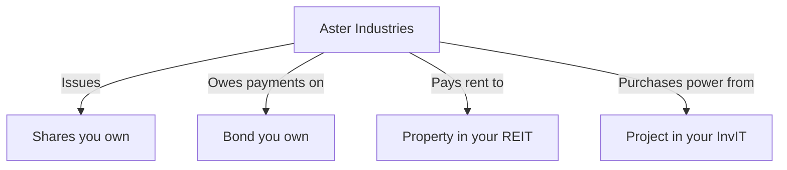
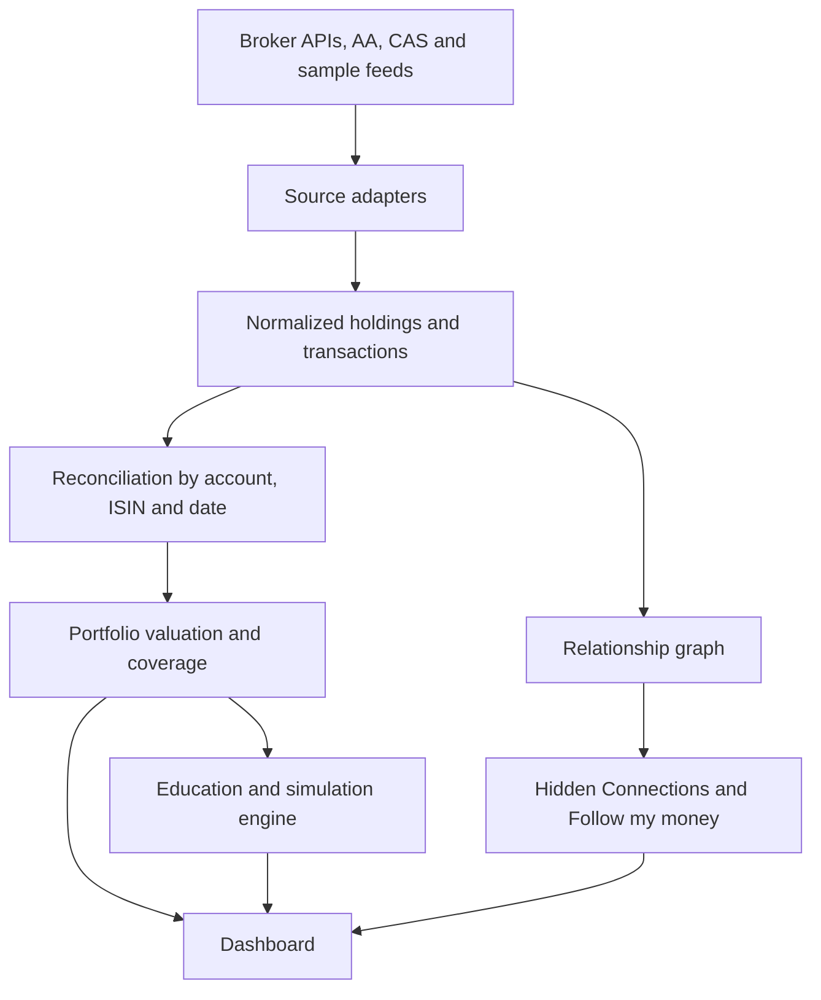

# OneView: One Clear View of Everything You Own

> **A consent-based, read-only investment dashboard that unifies holdings across brokers and depositories, explains discrepancies and missing coverage, and helps retail investors understand REITs, InvITs and bonds alongside their stocks.**

**Tagline:** *Know what you own, where you own it, and what it means.*

*(OneView is a working name. Replace it with your team's final product name.)*

---

## Table of Contents

1. [Problem Statement](#1-problem-statement)
2. [Understanding the Problem](#2-understanding-the-problem)
3. [Solution Overview](#3-solution-overview)
4. [Core Features](#4-core-features)
5. [Signature Feature: Hidden Connections](#5-signature-feature-hidden-connections)
6. [Data Integration Strategy](#6-data-integration-strategy)
7. [Reconciliation Engine](#7-reconciliation-engine)
8. [Education Engine](#8-education-engine)
9. [System Architecture](#9-system-architecture)
10. [Data Model](#10-data-model)
11. [Role of AI](#11-role-of-ai)
12. [Security, Privacy and Compliance](#12-security-privacy-and-compliance)
13. [Hackathon Scope](#13-hackathon-scope)
14. [Demo Script](#14-demo-script-3-minutes)
15. [Evaluation and Success Metrics](#15-evaluation-and-success-metrics)
16. [Differentiation and Honest Positioning](#16-differentiation-and-honest-positioning)
17. [Risks and Limitations](#17-risks-and-limitations)
18. [Future Roadmap](#18-future-roadmap)

---

## 1. Problem Statement

Give everyday investors one clear view of everything they own across brokers and depositories, and help them understand options beyond stocks, like REITs, InvITs and bonds.

Many everyday (retail) investors hold investments through more than one broker, and their holdings sit with different depositories. There is no single place that shows everything together.

Most people also invest only in stocks (equities). Options like REITs, InvITs and bonds exist, but they are poorly understood, so people stay away from them.

---

## 2. Understanding the Problem

The problem statement contains **two required outcomes**.

| Requirement in the PS | What the solution must demonstrate |
|---|---|
| **One clear view of everything owned across brokers and depositories** | Connect or import multiple accounts; combine holdings; show the account and depository for each holding; avoid counting the same holding twice when broker and depository data overlap. |
| **Help investors understand REITs, InvITs and bonds** | Explain how each works, where returns can come from, its main risks, and how it differs from a stock, in language a beginner can understand. |

### Key observations

- **A broker and a depository often describe the same asset.** A broker is where the investor trades; the demat account at a depository records settled securities. Their data must never simply be added together.
- **A total without context is misleading.** A figure like "₹8.4 lakh" is only useful if the user knows *as of when*, *from which accounts*, and *whether any accounts are missing*.
- **The education gap is real.** SEBI's Investor Survey 2025 reports about 10% household awareness of REITs/InvITs and about 10% awareness of corporate bonds, with household participation below 1% for each. These figures cover all surveyed households, not only existing investors.
- **Consolidated statements already exist in India.** The Consolidated Account Statement (CAS) covers demat accounts across CDSL and NSDL and mutual fund holdings. The opportunity is not to replace it but to make this information easy to explore, reconcile and understand, with fresher broker data where available.
- **Consent alone does not guarantee API access.** Each broker must offer an integration suitable for third-party apps, and the authorization method differs from broker to broker.

---

## 3. Solution Overview

The product is a **read-only investment map**. It:

1. Brings holdings from different brokers, depositories and statements into one view.
2. Shows where every number came from and how fresh it is.
3. Detects and explains overlaps and discrepancies instead of hiding them.
4. Explains REITs, InvITs and bonds in the context of what the investor already owns.

### Design principles

| Principle | What it means in practice |
|---|---|
| **Read-only** | The app never places orders or moves money. |
| **Consent-based** | Data is fetched only after the user authorizes it. |
| **Trust first** | Every number has a source, date and coverage note. |
| **Code for facts, AI for explanation** | Totals, classification and deduplication are deterministic; AI explains the results. |
| **Education, not advice** | The product explains investments. It does not tell individuals what to buy or sell. |

### What a first dashboard shows

- Total valued holdings
- Asset-class split (equity, ETF, mutual fund, REIT, InvIT, bond, unknown)
- Holdings by account and depository
- Missing or stale connections
- A "Learn beyond stocks" section

Clicking any number reveals its source and date.

---

## 4. Core Features

### 4.1 Connect and check coverage

Entry options: **Connect broker**, **Upload statement**, **Try sample portfolio**.

After import the app shows:

- **Accounts found**, e.g. two demat accounts and one mutual fund folio.
- **Last updated**, per account rather than one global timestamp.
- **Coverage**: which accounts are included; users can flag known missing accounts.
- **Issues**: unrecognized securities, missing prices and discrepancies.

If a broker cannot be connected for a user, the app says **"Groww account not connected"** instead of presenting the total as their complete wealth. One uploaded statement does not mean "everything" was found.

### 4.2 One portfolio with an audit trail

A holdings table with total valued holdings and asset allocation. Clicking a row opens the evidence:

> 20 units of Security X: 12 in Demat A, 8 in Demat B. Source: CAS dated 31 August. Broker A reports 12 units as of 29 September.

Banners explain when the total includes stale prices or excludes assets that cannot be valued reliably.

### 4.3 Account-level breakdown

The investor sees both "I own 25 units in total" and "15 are in Account A; 10 are in Account B". Securities are identified across sources by **ISIN**, while the **account ID** is retained.

### 4.4 Explain my holdings (reconciliation status)

Each holding carries a clear status.

| Status | Meaning |
|---|---|
| **Matched** | Comparable sources report the same position. |
| **Single source** | Only one source is available. |
| **Pending settlement** | Recent transaction evidence explains the pending quantity. |
| **Needs review** | Sources disagree and the available evidence does not explain why. |

Tapping a status opens the source records, dates, calculation and a plain-language explanation, with a **"Show evidence"** button.

### 4.5 Follow my money

Turns unfamiliar security names into a visual explanation of what the investment represents and where its cash flows come from. Users can switch between **Accounts** (where do I hold it), **Assets and issuers** (what am I exposed to) and **Cash flows** (how could money reach me).

| Investment | What opens when explored |
|---|---|
| Stock | Company, business activity, ownership relationship |
| Mutual fund / ETF | Underlying holdings, where disclosed |
| REIT | Properties, locations, tenant and rental activity, distributions |
| InvIT | Infrastructure assets and the relevant revenue arrangements |
| Bond | Issuer, lending relationship, coupon schedule, repayment terms |

Accuracy rules:

- REIT units give exposure through the trust; the investor is not the direct owner of a particular office.
- A company's stock and its bond represent different rights and risks.
- Underlying assets explain a holding; they must **not** be added again to portfolio value.

### 4.6 Learn by experimenting (guided simulations)

Interactive, clearly labeled **illustrative** simulations. No real investing happens; they exist only to teach how these instruments behave. These guided lessons are the foundation of the open-ended "What if?" investment lab in 4.10.

| Experiment | What the user learns |
|---|---|
| Change a bond's market yield | A fixed-coupon bond's price can change even when its coupon stays the same. |
| Reduce a REIT's assumed distribution | Regular distributions can vary. |
| Delay a bond payment | A payment schedule is different from a payment actually received. |
| Reduce an InvIT's assumed distribution | Infrastructure exposure does not guarantee a fixed payout. |
| Choose an earlier exit date | Selling before maturity, or selling an illiquid instrument, can change the outcome. |

Example: *"If my investment pays me cash, can I still lose money?"* Starting value ₹10,000; ending market value ₹9,000; distributions received ₹600; combined ending value ₹9,600. Receiving cash does not mean the investment made a profit. (Simplified: no other cash flows, fees or taxes.)

### 4.7 Cash-flow calendar (supporting)

Shows upcoming and historical cash flows across accounts: interest, dividends, principal repayment and REIT/InvIT distribution components. Each item is labeled **scheduled**, **announced**, **estimated** or **confirmed received**. An announced distribution never becomes "received" without evidence.

### 4.8 Understanding check (supporting)

After a simulation the app asks the user to explain the result in their own words, identifies misconceptions and gives a short explanation using the scenario's numbers. English first, with a carefully reviewed Hindi version. It measures **understanding of the lesson**, not investment suitability.

### 4.9 Portfolio concentration map

Shows exposure across **companies, sectors and asset classes**, even when holdings are spread across brokers and depositories. Because holdings are already merged and deduplicated by ISIN, the map reflects the investor's true position, not one account's view.

Example insight: *"42% of your imported portfolio is in banking."*

| View | What it answers |
|---|---|
| **By company** | Is a large share of my portfolio in one issuer? |
| **By sector** | Am I concentrated in one industry (e.g. banking, IT)? |
| **By asset class** | How much is equity vs ETF vs mutual fund vs REIT vs InvIT vs bond? |
| **By account** | Which broker or depository holds what? |

Design rules:

- Percentages are calculated on **valued holdings only**, and the banner states what was excluded (unpriced or unclassified assets).
- Every percentage shows its basis: "% of imported, valued portfolio as of [date]".
- Mutual fund and ETF look-through is used **only where underlying holdings are disclosed**; otherwise the fund is shown as a single line and labeled "look-through unavailable".
- Sector tags come from a documented classification source, with "unclassified" shown openly instead of guessed.
- The map describes concentration. It does not say whether a level is "too high"; it explains what concentration means and lets the user decide.

Concentration flags link to the explainer (4.11) and to Hidden Connections (Section 5): *"Why is my portfolio concentrated?"*

### 4.10 "What if?" investment lab

An experimentation space where the investor builds a **virtual allocation** and sees how portfolio value and cash flows change under different scenarios. No real orders are placed; the lab is read-only and educational. It extends the simulations in 4.6.

What the user can do:

- Start from a **copy of their imported portfolio** or from a blank virtual amount (e.g. ₹10,000).
- Add a sample stock, REIT, InvIT or bond to the virtual allocation and adjust the amount.
- Apply scenarios and watch value and cash flows update side by side with the original portfolio.

| Scenario | What changes | What the user learns |
|---|---|---|
| Market yields rise or fall | Bond prices move; coupons stay fixed | Price and coupon are different things |
| REIT / InvIT distribution reduced | Cash received drops | Distributions vary and are not guaranteed |
| Bond payment delayed or missed | Scheduled vs received cash flow diverges | A schedule is not a receipt |
| Equity prices fall by a chosen amount | Portfolio value and concentration shift | How diversification changes outcomes |
| Earlier exit date | Sale price or liquidity changes the result | Exit timing and liquidity matter |

Rules:

- A **deterministic calculation engine** produces every number; AI only explains the result.
- Every scenario is labeled **illustrative**, inputs are editable, and assumptions are visible.
- No precise price forecasts (for example, REIT price from occupancy) unless a validated model exists.
- Simplified examples state what is excluded (fees, taxes, other cash flows).

### 4.11 Multilingual portfolio explainer

A conversational assistant that answers questions about the user's portfolio and about REITs, InvITs and bonds, in the user's language.

Example questions:

- *"Why is my portfolio concentrated?"*
- *"Explain this bond in Hindi."*
- *"Which of my accounts holds this REIT?"*
- *"What could go wrong with this InvIT?"*

How it works:

- Numbers and facts come from the reconciled portfolio and the concentration and risk engines; the assistant **explains**, it does not calculate totals.
- Educational answers are grounded in reviewed content (SEBI investor material and issuer documents) and show their sources.
- If the data or documents do not contain an answer, the assistant says so.
- Launch languages: **English and Hindi**, with reviewed translations of core explanations and financial terms. Add more languages (e.g. Marathi) as reviewed content becomes available.
- Key terms (coupon, yield, distribution, ISIN) keep a consistent glossary across languages.
- It never invents a "safe" return or rating, and gives no personal buy/sell instructions.

### 4.12 Risk insights ("what could go wrong")

Helps the investor see the risks their current holdings carry and how those risks could play out in the future. It is built as **scenario-based, evidence-backed risk analysis**, not prediction: the app does not say what *will* happen, it shows what *could* happen under stated assumptions.

| Risk type | How it appears in the product |
|---|---|
| **Concentration risk** | From the concentration map: heavy exposure to one company or sector. |
| **Shared-dependency risk** | From Hidden Connections: several holdings depending on the same issuer or counterparty. |
| **Interest-rate risk** | For bonds: how price can change when market yields move (what-if lab). |
| **Credit / default risk** | For bonds: issuer and payment-delay scenarios; shows issuer disclosures and any available rating, with source and date. |
| **Liquidity risk** | For REITs, InvITs and bonds: how easily units can be sold, based on disclosed trading information where available. |
| **Distribution risk** | For REITs and InvITs: payouts can vary; shows historical distribution components. |
| **Data and coverage risk** | Missing accounts, stale prices or unresolved discrepancies that weaken the picture. |

What the user sees:

1. A **risk summary** on the dashboard listing the top observations, each linking to its evidence.
2. A **stress test**: choose a scenario (e.g. sector downturn, yield rise, payment delay) and see the illustrative effect on portfolio value and cash flows, reusing the What if? lab engine.
3. A **plain-language explanation** of each risk, available in English and Hindi.

Rules:

- Labels such as "High concentration" are based on transparent, displayed thresholds and are descriptive, not a judgement of suitability.
- No forecasts, no predicted returns or losses, and no "you should sell" messages.
- Every risk card shows its source, data date and assumptions.
- A note makes clear that risk analysis is educational and not investment advice.

---

## 5. Signature Feature: Hidden Connections

**Reveal the financial dependencies connecting seemingly separate investments.**

> *Which of my investments depend on the same company, even though they have different names, belong to different asset classes and sit in different accounts?*

### The "wow" moment (fictional demo portfolio)

| Holding across connected accounts | Connection the investor may not know |
|---|---|
| Aster Industries shares | The investor owns equity in Aster. |
| Aster Industries bond | Aster owes the investor interest and principal. |
| City Offices REIT units | Aster rents space in properties owned by the REIT. |
| Energy Infrastructure InvIT units | Aster buys power from one of the InvIT's projects under a disclosed contract. |

The dashboard first shows four holdings. The user clicks **"Reveal hidden connections"** and all four link to one company.



### Connecting an event to the whole portfolio

A clearly **simulated announcement**: *"Aster Industries announces a delay in the interest payment on the bond held in this portfolio."*

| Holding | What the platform explains |
|---|---|
| Bond | The announcement directly concerns your bond's payment. |
| Shares | You also own equity in the issuer; this is a relevant development. |
| REIT | The company is a disclosed tenant. There is no evidence here that its rent is delayed. |
| InvIT | The company is a disclosed power purchaser. The relationship is shown; an infrastructure payment delay has not been established. |

The app distinguishes a **confirmed event** from **other relevant connections**, and never invents a predicted loss.

### Why it fits the PS

| PS requirement | How this feature delivers |
|---|---|
| Across brokers and depositories | Connections emerge after holdings from separate accounts are combined. |
| One clear view of everything owned | The investor sees both account locations and relationships between holdings. |
| Understand bonds / REITs / InvITs | They learn lender, tenant and counterparty relationships through their own holdings. |

For users who own only stocks, a **Learn view** explains the same relationships with reference REITs, InvITs and bonds, kept separate from actual holdings.

### How it is built

1. Collect holdings via integrations and normalize by account and ISIN.
2. Maintain a small database of **documented relationships**:

| Relationship | Potential evidence |
|---|---|
| Security to issuer | Instrument master, issuer documents |
| Mutual fund to underlying security | Published fund portfolio |
| REIT to property to tenant | REIT reports and disclosures |
| InvIT to project to counterparty | InvIT reports, project disclosures, rating reports |

3. Store each relationship with entity identifiers, relationship type, source document and location, disclosure date, and percentage plus its basis **only where disclosed**.
4. A graph query (PostgreSQL relationship tables or NetworkX) finds counterparties connected to multiple holdings.
5. AI proposes relationships from documents and explains verified paths; deterministic rules decide what enters the trusted dataset.

**Rules:**

- If a report gives tenant-sector exposure but no named tenant, show the sector connection. Do not guess the company.
- ₹20,000 in a REIT whose tenant contributes 10% of rental revenue does **not** mean ₹2,000 is invested in that tenant. Keep investment amounts and revenue dependencies distinct.
- Every explanation has **"Show the connection"** and **"View source"**.

---

## 6. Data Integration Strategy

| Route | What it offers | Role in this solution |
|---|---|---|
| **Broker APIs** | Recent holdings, positions, average acquisition price | Primary live connection where third-party authorization exists |
| **Account Aggregator (AA)** | Consent-based access to depository holdings | Production direction for broad coverage |
| **CAS / statement upload** | Cross-account snapshot and transactions | Fallback for brokers that cannot be connected |
| **Manual entry / sample data** | Covers unsupported assets | Demo support, labeled as unverified |

### Broker integration status

| Broker | Holdings API | How a user connects |
|---|---|---|
| **Zerodha** | `GET /portfolio/holdings` | Kite Connect login redirect returns a `request_token`; backend exchanges it for an access token (expires 6 AM next day). |
| **Upstox** | `GET /v2/portfolio/long-term-holdings` | OAuth authorization-code flow; backend exchanges the code for a token. |
| **Groww** | `GET /v1/holdings/user` | Public docs describe user-generated API credentials with an active API subscription; access token expires daily. No public "redirect any customer" flow found. Confirm partner access before promising one-click connection. |
| **Dhan** | `GET /v2/holdings` | Documented partner login and consent flow for multi-customer platforms, subject to partner credentials. |

### How a connection works (Upstox example)

1. User clicks **Connect Upstox**.
2. App redirects to the Upstox login page.
3. User logs in there; the app never sees the password or OTP.
4. Upstox redirects to the backend with a short-lived code.
5. Backend exchanges the code for an access token.
6. Backend calls the holdings endpoint and stores a normalized snapshot.

### Adapter pattern

```ts
type Holding = {
  broker: string;
  accountId: string;
  isin: string;
  quantity: number;
  averagePrice?: number;
  asOf: string;
};

interface BrokerAdapter {
  getAuthorizationUrl(): string;
  exchangeCode(code: string): Promise<string>;
  fetchHoldings(accessToken: string): Promise<Holding[]>;
}
```

Each broker gets its own adapter (`ZerodhaAdapter`, `UpstoxAdapter`, ...) that returns the same `Holding[]` format to the portfolio engine. Tokens and API secrets live only on the backend.

### Account Aggregator

AA lets a user consent to share holdings from participating depositories, avoiding a separate integration per broker. CDSL documents account discovery, OTP linking, consent, and then access to profile, ISIN-wise holdings and transactions, covering equity, mutual funds, ETFs, REITs and InvITs. Its published list does not explicitly include bonds, so bond coverage must be validated per provider.

Access constraint: a student team cannot simply call an unrestricted "all demat accounts" API. Production AA access requires working with an eligible regulated FIU and an AA provider. The app must not present itself as an approved FIU.

### Honest integration answer

> **Direct broker APIs where third-party authorization is supported; AA consent for broad depository coverage in a production partnership; statement import for unsupported or disconnected accounts.**

---

## 7. Reconciliation Engine

This is the hardest and most valuable technical component.

**Core rule:** if a broker reports 10 shares and its depository reports the same 10 shares, the total is **10, not 20**. Two reports of one holding are not two holdings.

### Algorithm

1. Parse each input into account-level snapshots.
2. Normalize instrument names to **ISIN** and classify asset type.
3. Group observations by **account + ISIN + as-of date**.
4. Choose one authoritative observation for the displayed quantity; retain the others for comparison.
5. If dates or quantities differ, raise an issue. Never silently overwrite an observation.
6. Add quantities **across distinct accounts** to get the investor-level total.
7. Compute `value = quantity x applicable price`, with price date and source attached.

### Special cases

| Case | Handling |
|---|---|
| Recent purchase not yet settled | Show as **pending**, not as a missing asset. |
| Older statement uploaded after a newer broker feed | Preserve the timeline; explain why the older observation does not replace the newer one. |
| Stock split (100 shares become 200) | Link the quantity change to the corporate action; do not treat it as a purchase or sudden gain. |
| Broker average cost vs transferred shares | Mark cost basis and profit/loss **unavailable or incomplete**. |
| Bond without a dependable price | Show units/face amount and terms; do not invent a market value. |

### Demo example

- Broker A: 100 settled + 20 pending shares. Its depository: 100 settled.
- Broker B (another account): 50 settled shares.

Result: **150 settled + 20 pending**, with the account breakdown and evidence.

---

## 8. Education Engine

The differentiator is **contextual learning** rather than a generic article section.

### Structured content per instrument type

Definition, how returns arise, main risks, liquidity, questions to ask, and a source link. Content is reviewed, using SEBI investor material as a foundation.

| Asset | Simple explanation | What to inspect |
|---|---|---|
| **REIT** | Units linked to a portfolio of income-generating real estate | Underlying properties, distributions, market price, liquidity, fees, risks |
| **InvIT** | Units linked to infrastructure assets such as roads or transmission projects | Underlying assets, debt, distributions, market price, liquidity |
| **Bond** | Lending to an issuer under specified payment terms | Issuer, maturity, coupon vs yield, credit/default risk, interest-rate risk, liquidity |

Benefits and risks always appear on the **same card**.

### Comparison view

A side-by-side table of stock vs REIT vs InvIT vs bond across income, price changes, liquidity and risk.

### Contextual prompts (examples)

- "Most of the valued holdings in this imported portfolio are classified as equity. See how REITs, InvITs and bonds work."
- On a bond: "An 8% coupon describes payments relative to face value. Your return if you buy at today's price can differ."
- On an InvIT: "A distribution can vary. Examine the underlying projects and disclosures."

### Interactive explainer

*"If the price of a fixed-coupon bond rises, what happens to its yield?"* The user adjusts the price and watches the direction change. Labeled as an illustration; coupon rate and yield to maturity are different concepts.

---

## 9. System Architecture



### Suggested stack

| Layer | Choice |
|---|---|
| Frontend | React / Next.js |
| Backend | FastAPI or Node |
| Database | PostgreSQL |
| PDF parsing | PyMuPDF or pdfplumber |
| Graph (prototype) | Relationship tables or NetworkX |
| AI layer | LLM for explanation, grounded in data and reviewed content |

Start with JSON fixtures and add PDF parsing once the end-to-end UI works.

### Backend endpoints (example)

```text
GET  /connect/upstox/start
GET  /connect/upstox/callback
POST /connections/:id/sync
GET  /portfolio
```

---

## 10. Data Model

| Entity | Important fields | Why it exists |
|---|---|---|
| `source` | source_id, type, imported time, statement date | Provenance and freshness |
| `account` | internal ID, broker/DP label, depository, masked account ID | Keeps accounts separate |
| `instrument` | ISIN, display name, asset type, issuer, metadata source | Identifies the same asset across platforms |
| `holding_snapshot` | account ID, ISIN, quantity, settled/pending flag, as-of date, source ID | Records what a source actually said |
| `transaction` | account ID, ISIN, event type, quantity, amount, date | Explains changes and cost basis |
| `price` | ISIN, value, currency, price date, source | Makes valuation auditable |
| `reconciliation_issue` | sources involved, issue type, status | Makes discrepancies visible |
| `relationship` | entity A, entity B, type, source doc, disclosure date, disclosed % | Powers Hidden Connections |

**ISIN is the main security key**, not the ticker, because brokers display the same instrument differently. The account ID is kept too, since "total units" and "which account" are separate questions.

Conceptual chain for Follow my money:

```text
Instrument
  -> account observations
  -> issuer or trust
  -> disclosed underlying assets
  -> revenue sources
  -> distribution or repayment terms
  -> supporting documents
```

---

## 11. Role of AI

**Code decides facts. AI explains them.**

| Done by deterministic code | Done by AI |
|---|---|
| Totals and valuation | Explaining why the portfolio is mostly equity |
| Classification and ISIN matching | Comparing a bond with a REIT in simple language |
| Duplicate detection and reconciliation | Turning reconciliation results into plain explanations |
| Simulation calculations | Explaining simulation results and assumptions |
| Trusted relationship dataset rules | Proposing relationships from documents for review |
| Concentration percentages and risk thresholds | Explaining "Why is my portfolio concentrated?" in English or Hindi |
| Stress-test and What if? calculations | Explaining scenario results, e.g. "Explain this bond in Hindi" |

Guardrails:

- Answers are grounded in the imported data, reviewed educational content and cited instrument documents.
- Sources are displayed; the AI says so when documents do not contain an answer.
- The AI never manufactures a "safe" return or an instrument rating.
- AI predictions and buy/sell recommendations are **not required by the PS** and are excluded.

---

## 12. Security, Privacy and Compliance

### Security and privacy

- Read-only access only; no order placement.
- Broker credentials are never seen by the app (login happens on the broker's page).
- API secrets and tokens stay on the backend.
- Do not store CAS PDF passwords or full PAN.
- Encrypt retained financial data.
- Let users **delete** imported records at any time.
- Use **synthetic** names, account IDs and PANs in demos.

### Regulatory positioning

- The product is **education and portfolio facts**.
- Personal buy/sell instructions and individually tailored allocations fall into regulated investment-advice territory (registered investment advisers). Any future recommendation path should be built with an appropriately registered partner and proper suitability processes.
- The app must not present itself as an approved FIU under the AA framework.
- Simulations are labeled **illustrative** with editable, visible assumptions.

---

## 13. Hackathon Scope

### Must work in the final demo

1. Import a synthetic CAS-like PDF or CSV with two demat accounts.
2. Import a synthetic broker response that overlaps one of those accounts.
3. Show that an overlapping holding is counted **once**.
4. Display asset allocation and per-holding source/date.
5. Explain one REIT, one InvIT and one bond with benefits and risks.
6. Trigger a deliberate mismatch and explain it in a reconciliation panel.
7. Hidden Connections reveal on a curated sample (about 15 to 20 securities, one company linked across asset classes, one simulated announcement).
8. Portfolio concentration map with company, sector and asset-class views on the sample portfolio (for example, a banking-heavy example).
9. "What if?" lab with three carefully built scenarios (bond yield change, REIT/InvIT distribution cut, equity fall) on a virtual allocation.
10. Multilingual explainer in English and Hindi, grounded in the sample data and reviewed educational content.
11. Risk insights summary with one stress test, reusing the concentration and What if? engines.

### Recommended integration scope

**One genuine broker connection** (Upstox or Zerodha) plus a second adapter driven by a realistic mock API, with a visible "Connect another broker" flow. Add Dhan if time and access allow. For Groww, show the documented holdings response through an adapter and label live authorization as dependent on confirmed access. A correct two-source integration is stronger than three connections with untrusted totals.

### Curated content

Two REITs, two InvITs and a few bonds, with disclosure dates. Real issuer documents can demonstrate the extraction method; synthetic data can demonstrate the full event story. Label both clearly.

### If time remains

Parse a real CAS layout from a user-supplied test document; connect a broker sandbox; add the bond coupon-versus-price interactive; stock-split handling; cash-flow calendar; understanding check.

### Leave for after the hackathon

Production AA onboarding, every broker, automated statement retrieval, tax-grade profit/loss, order execution and personalized recommendations.

---

## 14. Demo Script (3 minutes)

| Time | Step | What the judge sees |
|---|---|---|
| 0:00 to 0:40 | **Establish trust** | Connect sample accounts; introduce an overlapping source; total stays correct; open the reconciliation evidence. |
| 0:40 to 1:25 | **Make the unfamiliar understandable** | Click a REIT or InvIT; see underlying assets and the route from operations to distributions. |
| 1:25 to 2:00 | **Hidden Connections** | Four separate holdings reveal a shared company; simulated announcement shows per-holding implications. |
| 2:00 to 2:20 | **Concentration and risk** | Concentration map shows a heavily banking-weighted sample; risk summary links to the evidence. |
| 2:20 to 2:40 | **What if? lab** | Run "cash received vs overall return" or a yield change; the judge edits a value and watches the outcome update. |
| 2:40 to 3:00 | **Ask in Hindi** | "Explain this bond in Hindi" answered with sources; return to the portfolio with a clearer view. |

**Memorable moment, double-counting correction:** 12 shares in Broker A and 8 in Broker B, plus a statement describing the same 20 shares. A naive aggregator shows 40. OneView shows 20, says where they are, then explains what a REIT, InvIT or bond would add.

---

## 15. Evaluation and Success Metrics

| Question | Evidence to collect |
|---|---|
| Are portfolio totals correct? | Reconciliation results on known test cases, including duplicates and pending settlement |
| Is classification good? | Percentage of imported holdings correctly classified |
| Are discrepancies handled? | Number of unexplained discrepancies |
| Can users understand their holdings? | Time taken to identify which accounts hold a selected security |
| Does the education work? | Comprehension before and after the simulation or explainer |
| Are explanations trustworthy? | Traceable sources; correct handling of missing information |
| Is the concentration map correct? | Percentages checked against hand-calculated results on test portfolios |
| Does the What if? lab compute correctly? | Scenario outputs verified against manual calculations |
| Do the Hindi explanations read correctly? | Review of translations by fluent Hindi speakers; user comprehension check |
| Are risk insights understood? | Whether users can correctly state the main risk in their own holdings after viewing it |

Run a small user test and report the **actual** sample size and results. Do not invent adoption numbers, accuracy percentages or learning improvements.

---

## 16. Differentiation and Honest Positioning

| Already exists | Our angle |
|---|---|
| Cross-broker stock tracking (e.g. Groww Stocks Track via AA) | A trustworthy **cross-asset** view, including REITs, InvITs and bonds |
| Returns, dividends, sector allocation, benchmarks (e.g. INDmoney) | Visible provenance, freshness and discrepancy explanations |
| Mutual fund look-through to underlying stocks | Dependency discovery across asset classes and accounts (Hidden Connections) |
| Standalone bond yield calculators (e.g. on SEBI's investor site) | A connected learning journey tied to the user's own portfolio |
| Institutional cross-asset analytics (e.g. BlackRock Aladdin) | An accessible, evidence-backed version for Indian retail investors that also teaches REITs, InvITs and bonds |

We do not claim nobody has built similar functionality. The proposed contribution is the **combination**: trustworthy aggregation, evidence-backed relationships, and education grounded in the user's own holdings.

**Technical contribution in one line:** connect account data, resolve legal entities, extract documented financial relationships, trace relevant events, and explain the different implications for each asset class.

---

## 17. Risks and Limitations

| Risk | Mitigation |
|---|---|
| Broker API access differs per broker | Adapter pattern; one real integration plus a mock; statement import fallback |
| AA access requires regulated FIU status | Treat as a production partnership path; do not claim FIU status |
| Incomplete coverage (missing accounts) | Coverage indicator; per-account timestamps; "not connected" messaging |
| Stale or missing prices | Price date shown; exclusions explained in banners |
| Relationship data must be accurate | Source-linked dataset; show only disclosed relationships; no guessing |
| AI hallucination | Ground in data and reviewed content; show sources; admit gaps |
| Regulatory boundary on advice | Education-only scope; illustrative labels; no personal recommendations |
| Sensitive financial data | Read-only, encryption, minimal storage, user deletion |
| Risk analysis read as a prediction or advice | Scenario-based wording, visible assumptions, no forecasts, educational disclaimer |
| Wrong sector or look-through data distorts concentration | Documented classification source; show "unclassified" and "look-through unavailable" openly |
| Translation errors in financial terms | Reviewed glossary and reviewed core content; AI answers cite sources |

---

## 18. Future Roadmap

1. **Production AA integration** through an eligible FIU and AA provider.
2. **More brokers** through partner programs.
3. **Automated statement retrieval** and broader CAS layout support.
4. **Mutual fund and ETF look-through** feeding the relationship graph.
5. **Tax-aware profit and loss** with complete cost-basis handling.
6. **Expanded cash-flow calendar** with confirmed-received tracking.
7. **More languages** with reviewed educational content.
8. **Regulated advisory partnership**, if personalized recommendations are ever pursued.

---

## Summary

> **A portfolio that investors can inspect, understand and experiment with.**

Trustworthy aggregation creates the context, visual explanations and Hidden Connections build understanding, and the simulation lets the investor test that understanding, all read-only, consent-based and evidence-backed.
