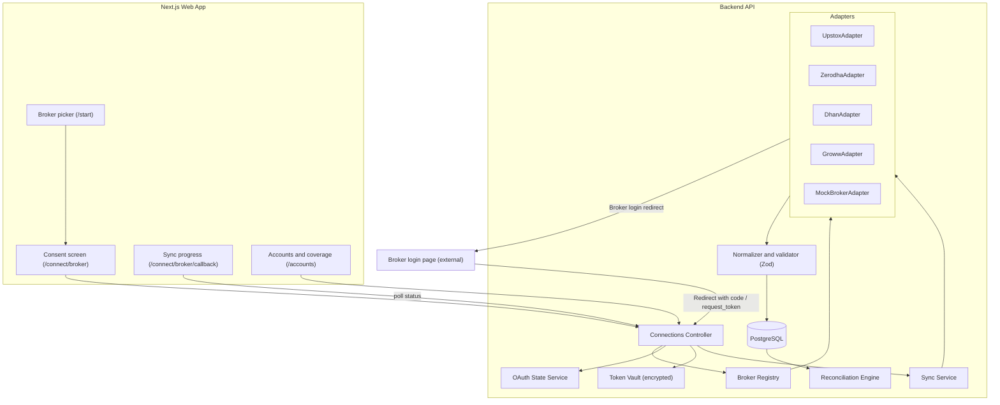
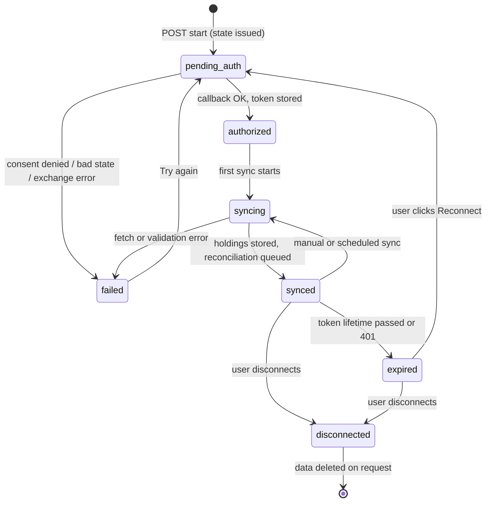
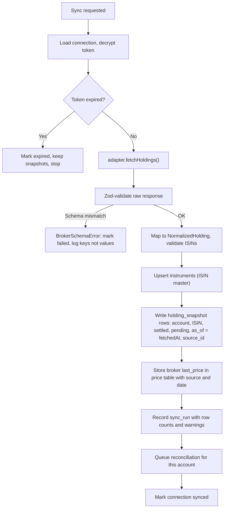
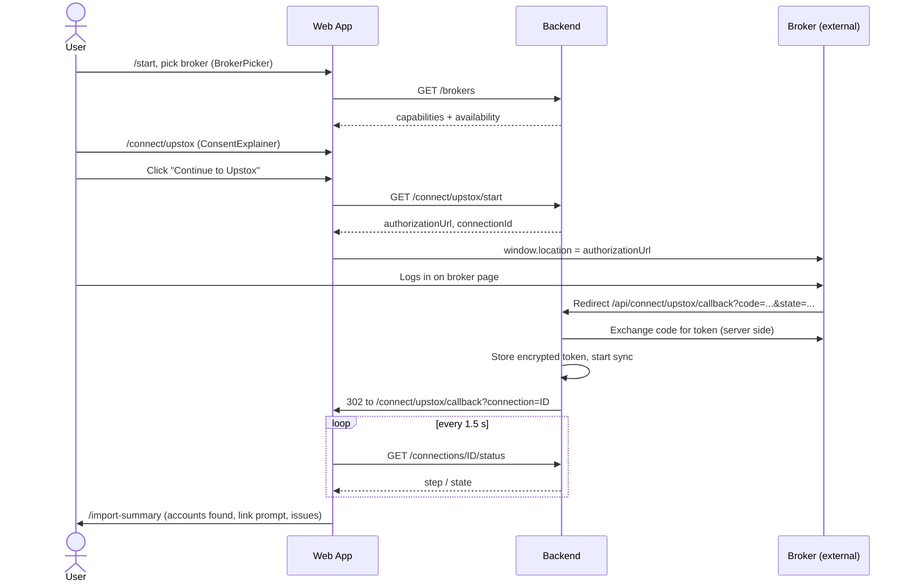

# DhanDrishti: Broker Integration Implementation Guide

> **How to connect brokers to the DhanDrishti web app: architecture, per-broker implementation, frontend flows, data handling, security, testing and rollout.**

**Companion documents:** `DhanDrishti_Solution.md` (product), `DhanDrishti_Web_Architecture.md` (web app, pages and flows).
**Broker facts last checked:** 1 October 2026, against public documentation and official SDK sources (see [Section 18](#18-sources-checked)).

---

## Table of Contents

1. [Scope and Goals](#1-scope-and-goals)
2. [Integration Strategy and Priority](#2-integration-strategy-and-priority)
3. [Broker Capability Matrix](#3-broker-capability-matrix)
4. [Architecture Overview](#4-architecture-overview)
5. [Directory Structure](#5-directory-structure)
6. [Core Contracts (Adapter, Session, Normalized Holding)](#6-core-contracts)
7. [Connection Lifecycle and State Machine](#7-connection-lifecycle-and-state-machine)
8. [Per-Broker Implementation](#8-per-broker-implementation)
   - [8.1 Upstox](#81-upstox-primary-live-connection)
   - [8.2 Zerodha (Kite Connect)](#82-zerodha-kite-connect)
   - [8.3 Dhan](#83-dhan)
   - [8.4 Groww](#84-groww)
   - [8.5 Demo Broker B (Mock)](#85-demo-broker-b-mock)
9. [Sync Pipeline and Reconciliation Hand-off](#9-sync-pipeline-and-reconciliation-hand-off)
10. [Account Linking (Broker Account to Statement Demat)](#10-account-linking)
11. [Database Schema](#11-database-schema)
12. [Backend API Contract](#12-backend-api-contract)
13. [Frontend Implementation](#13-frontend-implementation)
14. [Security and Privacy](#14-security-and-privacy)
15. [Error Handling Matrix](#15-error-handling-matrix)
16. [Testing Strategy](#16-testing-strategy)
17. [Rollout Plan and Acceptance Criteria](#17-rollout-plan-and-acceptance-criteria)
18. [Sources Checked](#18-sources-checked)
19. [Open Questions and Verification Log](#19-open-questions-and-verification-log)

---

## 1. Scope and Goals

### In scope

- Connecting broker accounts through **each broker's own authorization**, read-only.
- Fetching **holdings** (ISIN, quantity, settled vs pending, average price) and normalizing them for the reconciliation engine.
- Connection lifecycle: connect, sync, expire, reconnect, disconnect and delete.
- Web UI for picking a broker, consenting, tracking sync progress and handling expiry.
- A **mock broker** so the full flow works in demos without live credentials.

### Out of scope

- Order placement, funds transfer, or any write API. (No adapter implements them; see [Section 14](#14-security-and-privacy).)
- Production Account Aggregator onboarding (separate track).
- Tax-grade profit and loss. Broker average price is displayed only with an "incomplete cost basis" caveat when shares were transferred in.
- Mutual fund folios via broker APIs (future; Zerodha exposes a separate MF holdings endpoint).

### Honest integration statement (from the product doc)

> **Direct broker APIs where third-party authorization is supported; AA consent for broad depository coverage in a production partnership; statement import for unsupported or disconnected accounts.**

A correct two-source integration is stronger than three connections with untrusted totals.

---

## 2. Integration Strategy and Priority

| Priority | Broker | Mode for hackathon | Why |
|---|---|---|---|
| **P0** | **Upstox** | **Live** OAuth authorization-code flow | Standard redirect flow with a documented holdings endpoint. |
| **P0** | **Demo Broker B** | **Mock**, with a realistic OAuth-style flow | Guarantees the overlap and double-counting demo, and powers the visible "Connect another broker" flow. |
| **P1** | **Zerodha** | Live if Kite Connect app access is available, otherwise fixture | Login redirect with `request_token`; token expires next morning. |
| **P2** | **Dhan** | Live only with partner credentials; otherwise fixture | Partner consent flow needs credentials issued by Dhan. |
| **P3** | **Groww** | **Fixture** using the documented response shape; live labeled "depends on confirmed access" | No public redirect flow for third-party customers; credentials are user-generated. |

**Rules**

- Every broker appears in the picker with an honest **status chip** (`Live`, `Demo`, `Requires partner access`, `Fixture only`).
- Never label an adapter `Live` unless it has completed a real round trip in the current environment.
- Broker additions must not change the reconciliation engine. Only a new adapter plus a registry entry.

---

## 3. Broker Capability Matrix

| | **Upstox** | **Zerodha** | **Dhan** | **Groww** |
|---|---|---|---|---|
| **Third-party customer login** | Yes: OAuth authorization code | Yes: Kite login redirect | Yes, for **partners**: consent flow with partner credentials | **No public redirect flow found**: user generates credentials |
| **Auth entry** | `GET /v2/login/authorization/dialog` | Kite login URL with `api_key` | `POST auth.dhan.co/partner/generate-consent`, then `consent-login?consentId=` | User-generated access token, key+secret approval, or TOTP |
| **Return to app** | `?code=` on redirect URI | `?request_token=` on redirect URL | `tokenId` on redirect | None (no redirect) |
| **Token exchange** | `POST /v2/login/authorization/token` | `POST /session/token` with SHA-256 checksum | `POST auth.dhan.co/partner/consume-consent?tokenId=` | `POST api.groww.in/v1/token/api/access` (key flows) |
| **Holdings endpoint** | `GET /v2/portfolio/long-term-holdings` | `GET /portfolio/holdings` | `GET /v2/holdings` | `GET /v1/holdings/user` |
| **Auth header** | `Authorization: Bearer <token>` | `Authorization: token <api_key>:<access_token>` + `X-Kite-Version: 3` | `access-token: <token>` | `Authorization: Bearer <token>` + `X-API-VERSION: 1.0` |
| **Token lifetime** | Standard access token regenerated daily | Expires around 6 AM next day | About 24 hours, renewable | Daily (reported as 6:00 AM IST) |
| **ISIN in holdings** | Yes | Yes | Yes | Yes |
| **Pending / T+1 quantity** | `t1_quantity` | `t1_quantity` | `t1Qty` | `t1_quantity` (plus other locked and pledged fields) |
| **App registration needed** | Developer app (client id, secret, redirect URI) | Kite Connect app (api key, secret, redirect URL) | Partner onboarding (offline) | Active Trading API subscription on the user's account |
| **Reads need static IP?** | Not for standard OAuth read calls in our flow (verify) | No | Not for holdings (verify) | No, for read-only calls |
| **Hackathon mode** | Live | Live or fixture | Fixture unless partner access | Fixture |

> Values marked "verify" are tracked in the [Verification Log](#19-open-questions-and-verification-log). Quantity-field semantics in particular must be confirmed against a real or sandbox response before they are trusted (see Section 9).

---

## 4. Architecture Overview



### Design decisions

| Decision | Reason |
|---|---|
| **Broker redirects to the backend, not the browser page** | The backend holds the API secret and does the token exchange. The one-time code never needs to be placed back into a browser URL. The backend then redirects the browser to `/connect/[broker]/callback?connection=<id>`. *(This revises the callback behaviour described in Web Architecture section 6.5, where the page forwarded the code.)* |
| **Same-origin proxy** | Next.js rewrites `/api/*` to the backend, so the session cookie is first-party and the registered redirect URI sits on the app's own domain. |
| **Adapter per broker, one normalized shape** | The reconciliation engine never sees broker-specific fields. |
| **Sync is async and pollable** | The UI shows progress steps and survives slow broker APIs. |
| **Tokens never leave the backend** | The browser holds only an httpOnly session cookie. |
| **Expiry is a state, not data loss** | When a token expires, keep the last snapshots, mark the account **stale**, and offer **Reconnect**. |

---

## 5. Directory Structure

### 5.1 Backend (broker module)

The product doc allows FastAPI or Node. The code below uses **Node + TypeScript** so the adapter types are shared with the web app. A FastAPI port maps one-to-one (Pydantic models instead of Zod).

```text
dhandrishti-api/
├── src/
│   ├── modules/
│   │   ├── brokers/
│   │   │   ├── core/
│   │   │   │   ├── broker.types.ts          # BrokerId, BrokerSession, NormalizedHolding, HoldingsResult
│   │   │   │   ├── broker-adapter.ts        # BrokerAdapter interface
│   │   │   │   ├── capabilities.ts          # per-broker capability descriptors (status, auth mode)
│   │   │   │   ├── registry.ts              # id -> adapter, feature-flag aware
│   │   │   │   ├── errors.ts                # BrokerAuthError, BrokerRateLimitError, BrokerSchemaError ...
│   │   │   │   └── normalize.ts             # shared helpers (ISIN check, number coercion, masking)
│   │   │   │
│   │   │   ├── http/
│   │   │   │   └── broker-http-client.ts    # timeouts, retry with backoff, header redaction in logs
│   │   │   │
│   │   │   ├── adapters/
│   │   │   │   ├── upstox/
│   │   │   │   │   ├── upstox.adapter.ts
│   │   │   │   │   ├── upstox.schemas.ts    # Zod schemas for raw responses
│   │   │   │   │   ├── upstox.mapper.ts     # raw -> NormalizedHolding
│   │   │   │   │   └── fixtures/holdings.json
│   │   │   │   ├── zerodha/   (same four files)
│   │   │   │   ├── dhan/      (same four files)
│   │   │   │   ├── groww/     (same four files; fixture mode default)
│   │   │   │   └── mock/
│   │   │   │       ├── mock.adapter.ts
│   │   │   │       └── mock-broker.routes.ts   # /mock/broker-b/* simulated OAuth + holdings
│   │   │   │
│   │   │   ├── connections/
│   │   │   │   ├── connections.controller.ts   # /brokers, /connect/*, /connections/*
│   │   │   │   ├── connections.service.ts      # create, sync, expire, delete
│   │   │   │   ├── oauth-state.service.ts      # state issue / verify, TTL, session binding
│   │   │   │   ├── token-vault.ts              # AES-256-GCM encrypt/decrypt, key from env or KMS
│   │   │   │   ├── sync.service.ts             # fetch -> validate -> normalize -> persist -> reconcile
│   │   │   │   └── account-linking.service.ts  # suggest links to statement demat accounts
│   │   │   │
│   │   │   └── brokers.module.ts
│   │   │
│   │   └── reconciliation/                     # consumes holding_snapshot rows (existing)
│   │
│   ├── db/migrations/
│   │   ├── 0010_broker_connection.sql
│   │   ├── 0011_oauth_state.sql
│   │   ├── 0012_sync_run.sql
│   │   └── 0013_account_link.sql
│   └── config/env.ts                           # validated env (Zod)
│
├── tests/brokers/
│   ├── contract/        # Zod schemas vs recorded fixtures, per broker
│   ├── adapters/        # adapter tests with mocked HTTP
│   ├── sync/            # golden double-counting and pending-settlement cases
│   └── e2e/             # connect, sync, expire, reconnect against mock broker
└── .env.example
```

### 5.2 Frontend additions (to `dhandrishti-web`)

```text
src/
├── app/
│   ├── (onboarding)/
│   │   ├── connect/
│   │   │   ├── [broker]/page.tsx                 # consent screen (exists; now broker-aware)
│   │   │   └── [broker]/callback/page.tsx        # sync progress; receives ?connection=<id>
│   │   └── mock-broker/
│   │       └── authorize/page.tsx                # simulated broker login for Demo Broker B
│   └── api/                                      # optional BFF; primary path is next.config rewrites
│
├── features/
│   └── brokers/
│       ├── components/
│       │   ├── BrokerPicker.tsx
│       │   ├── BrokerCard.tsx
│       │   ├── BrokerStatusChip.tsx              # Live | Demo | Requires partner access | Fixture only
│       │   ├── ConsentExplainer.tsx
│       │   ├── PermissionList.tsx                # reads / never does
│       │   ├── RedirectStepper.tsx
│       │   ├── SyncProgress.tsx
│       │   ├── ReconnectBanner.tsx               # token expired
│       │   ├── ConnectionHealthChip.tsx          # fresh | stale | expired | error | not connected
│       │   ├── AccountLinkPrompt.tsx             # "Is this the same account as your statement?"
│       │   └── UserTokenDialog.tsx               # Groww advanced mode, feature-flagged
│       ├── hooks/
│       │   ├── useBrokers.ts
│       │   ├── useStartConnection.ts
│       │   ├── useConnectionStatus.ts            # polling
│       │   ├── useSyncConnection.ts
│       │   └── useDisconnect.ts
│       └── config/
│           └── broker-copy.ts                    # per-broker i18n keys, logo, docs link
│
├── lib/api/endpoints.ts                          # adds broker endpoints
└── types/broker.ts                               # BrokerInfo, Connection, SyncStatus (shared)
```

---

## 6. Core Contracts

### 6.1 Normalized holding

The product doc's `Holding` type is extended with settled and pending quantities, because reconciliation must distinguish them.

```ts
// core/broker.types.ts
export type BrokerId = 'upstox' | 'zerodha' | 'dhan' | 'groww' | 'mock_b';

export interface BrokerSession {
  accessToken: string;         // never leaves the backend
  expiresAt: Date;             // from broker response, or computed (e.g. next 6 AM IST)
  brokerUserId?: string;       // used only to derive a stable account reference
  displayName?: string;        // optional, never shown unmasked
}

export interface NormalizedHolding {
  isin: string;                // primary security key (validated 12-char ISIN)
  tradingSymbol?: string;
  name?: string;
  exchange?: string;
  settledQuantity: number;     // in demat and free/settled
  pendingQuantity: number;     // e.g. T+1, not yet delivered
  averagePrice?: number;       // broker-reported; cost basis caveats apply
  lastPrice?: number;          // broker-reported; stored as a price with source label
}

export interface HoldingsResult {
  holdings: NormalizedHolding[];
  fetchedAt: string;           // ISO timestamp of the fetch (used as as-of)
  warnings: string[];          // e.g. "3 rows skipped: invalid ISIN"
}
```

### 6.2 Adapter interface

The original interface (`getAuthorizationUrl`, `exchangeCode`, `fetchHoldings`) is kept in spirit and extended for `state`, redirect URI, session expiry and differing auth modes.

```ts
// core/broker-adapter.ts
export interface AuthContext {
  state: string;               // signed, single use, bound to the user's session
  redirectUri: string;         // registered with the broker; points to our backend
}

export interface BrokerAdapter {
  readonly id: BrokerId;
  readonly capabilities: BrokerCapabilities;

  /** Step 1: URL (or opaque handoff) the browser is sent to. */
  getAuthorizationUrl(ctx: AuthContext): Promise<string>;

  /** Step 2: broker redirected back. `params` = the raw query string. Returns a session. */
  completeAuthorization(params: Record<string, string>, ctx: AuthContext): Promise<BrokerSession>;

  /** Step 3: read-only holdings fetch, already validated and normalized. */
  fetchHoldings(session: BrokerSession): Promise<HoldingsResult>;
}

export interface BrokerCapabilities {
  id: BrokerId;
  displayName: string;
  authMode: 'oauth_redirect' | 'partner_consent' | 'user_token' | 'mock_redirect';
  availability: 'live' | 'mock' | 'requires_partner_access' | 'fixture_only';
  tokenLifetimeNote: string;   // shown in UI: "Reconnect needed every day"
  docsUrl: string;
}
```

**Why `completeAuthorization(params)` instead of `exchangeCode(code)`:** Zerodha returns `request_token`, Upstox returns `code`, Dhan returns `tokenId`. Each adapter reads the parameter it expects.

**What adapters must NOT do:** expose a method for orders, funds movement or any write call. The interface has none by design, and code review rejects additions.

### 6.3 Registry

```ts
// core/registry.ts
export function getAdapter(id: BrokerId): BrokerAdapter {
  const adapter = adapters[id];
  if (!adapter) throw new UnknownBrokerError(id);
  return adapter;
}

export function listBrokers(): BrokerCapabilities[] {
  return Object.values(adapters).map(a => ({
    ...a.capabilities,
    availability: resolveAvailability(a)   // downgrades to 'fixture_only' if credentials missing
  }));
}
```

`resolveAvailability` is what keeps the UI honest: if `UPSTOX_CLIENT_ID` is not set, Upstox is reported as `fixture_only`, not `live`.

---

## 7. Connection Lifecycle and State Machine



| State | Account card shows | Data kept? | Available actions |
|---|---|---|---|
| `pending_auth` | "Waiting for {Broker}" | No | Cancel |
| `syncing` | "Syncing..." with steps | Previous snapshot if any | None |
| `synced` | **Fresh** chip with last-updated time | Yes | Sync now, Disconnect |
| `expired` | **Session expired**, **Reconnect** button | **Yes** (marked stale) | Reconnect, Disconnect |
| `failed` | Error message in plain language | Previous snapshot if any | Try again, Upload statement instead |
| `disconnected` | Removed from coverage | Deleted if user chose delete | Connect again |

**Key behaviour:** Zerodha, Upstox, Dhan and Groww tokens are all short-lived (roughly daily). The product must treat "expired" as a normal daily state, not an error. The dashboard's coverage bar says, for example, "Zerodha data from yesterday 4:12 PM. Session expired."

**Sync throttling:** at most one manual sync per connection per 60 seconds (our own limit) to protect broker rate limits. Never run background polling that uses expired tokens.

---

## 8. Per-Broker Implementation

All adapters follow the same shape: build the auth URL, complete authorization, fetch holdings, validate with Zod, map to `NormalizedHolding`. A `BrokerSchemaError` is raised when the response does not match the expected schema, so API drift fails loudly instead of producing wrong totals.

---

### 8.1 Upstox (primary live connection)

| | |
|---|---|
| **Authorize** | `GET https://api.upstox.com/v2/login/authorization/dialog?client_id=<id>&redirect_uri=<uri>&response_type=code&state=<state>` |
| **Redirect back** | `<redirect_uri>?code=<code>&state=<state>` |
| **Token exchange** | `POST https://api.upstox.com/v2/login/authorization/token`, `application/x-www-form-urlencoded` with `code`, `client_id`, `client_secret`, `redirect_uri`, `grant_type=authorization_code` |
| **Holdings** | `GET https://api.upstox.com/v2/portfolio/long-term-holdings` with `Authorization: Bearer <token>` and `Accept: application/json` |
| **Token life** | Standard access token is regenerated every day. |
| **Config** | `UPSTOX_CLIENT_ID`, `UPSTOX_CLIENT_SECRET`, `UPSTOX_REDIRECT_URI` |

**Setup checklist**

1. Create an app in the Upstox developer console; register the redirect URI exactly (scheme, host, path).
2. Confirm whether the app can be used by users other than its owner in your plan. If not, the demo uses a team member's own account with consent (see Verification Log).
3. Redirect URIs to register: local `http://localhost:3000/api/connect/upstox/callback` (if the console allows http for localhost) and the deployed HTTPS URL.

**Adapter sketch**

```ts
// adapters/upstox/upstox.adapter.ts
export class UpstoxAdapter implements BrokerAdapter {
  readonly id = 'upstox' as const;
  readonly capabilities = {
    id: 'upstox', displayName: 'Upstox', authMode: 'oauth_redirect',
    availability: 'live', tokenLifetimeNote: 'Reconnect needed daily',
    docsUrl: 'https://upstox.com/developer/api-documentation/'
  } satisfies BrokerCapabilities;

  async getAuthorizationUrl({ state, redirectUri }: AuthContext) {
    const u = new URL('https://api.upstox.com/v2/login/authorization/dialog');
    u.searchParams.set('client_id', env.UPSTOX_CLIENT_ID);
    u.searchParams.set('redirect_uri', redirectUri);
    u.searchParams.set('response_type', 'code');
    u.searchParams.set('state', state);
    return u.toString();
  }

  async completeAuthorization(params: Record<string, string>, ctx: AuthContext) {
    if (params.error) throw new BrokerConsentDeniedError('upstox', params.error);
    if (!params.code) throw new BrokerAuthError('upstox', 'missing code');

    const body = new URLSearchParams({
      code: params.code,
      client_id: env.UPSTOX_CLIENT_ID,
      client_secret: env.UPSTOX_CLIENT_SECRET,
      redirect_uri: ctx.redirectUri,
      grant_type: 'authorization_code',
    });
    const res = await http.post('https://api.upstox.com/v2/login/authorization/token', body, {
      headers: { 'Content-Type': 'application/x-www-form-urlencoded', Accept: 'application/json' },
    });
    const t = UpstoxTokenSchema.parse(res.data);
    return {
      accessToken: t.access_token,
      expiresAt: nextDailyExpiryIST(),      // conservative; refine from token response if provided
      brokerUserId: t.user_id,
    };
  }

  async fetchHoldings(session: BrokerSession): Promise<HoldingsResult> {
    const res = await http.get('https://api.upstox.com/v2/portfolio/long-term-holdings', {
      headers: { Authorization: `Bearer ${session.accessToken}`, Accept: 'application/json' },
    });
    const raw = UpstoxHoldingsSchema.parse(res.data);
    return mapUpstoxHoldings(raw, new Date().toISOString());
  }
}
```

**Field mapping (verify against a real response before trusting)**

| Upstox field | Normalized field | Note |
|---|---|---|
| `isin` | `isin` | Validate as 12-character ISIN. |
| `trading_symbol` | `tradingSymbol` | Display only. |
| `company_name` | `name` | Display only. |
| `quantity` | `settledQuantity` | Confirm whether `quantity` already includes or excludes `t1_quantity`. |
| `t1_quantity` | `pendingQuantity` | Shares bought but not yet settled. |
| `average_price` | `averagePrice` | Caveat for transferred shares. |
| `last_price` | `lastPrice` | Stored as a price with source "Upstox holdings API" and fetch date. |

> An `analytics token` exists in Upstox's docs for read-only portfolio access from a registered static IP. It is meant for your own account, not for connecting other customers, so it is **not** used here.

---

### 8.2 Zerodha (Kite Connect)

| | |
|---|---|
| **Login URL** | `https://kite.zerodha.com/connect/login?v=3&api_key=<api_key>` |
| **Redirect back** | Registered redirect URL with `request_token`, `status`, `action` query parameters |
| **Token exchange** | `POST https://api.kite.trade/session/token` with `api_key`, `request_token`, `checksum`; header `X-Kite-Version: 3` |
| **Checksum** | `SHA-256( api_key + request_token + api_secret )`, hex |
| **Holdings** | `GET https://api.kite.trade/portfolio/holdings` |
| **Auth header** | `Authorization: token <api_key>:<access_token>` and `X-Kite-Version: 3` |
| **Token life** | Expires around 6 AM the next day |
| **Config** | `KITE_API_KEY`, `KITE_API_SECRET`, `KITE_REDIRECT_URI` |

**Notes**

- The session response also returns the user id, which feeds the stable account reference (masked in the UI).
- The `request_token` is one-time and short-lived; exchange it immediately in the callback handler, never in the browser.
- `state` handling: Kite's login supports passing extra parameters that come back on the redirect (`redirect_params`). If that is not available in your app setup, rely on the **session-bound pending connection** record instead (see [Section 14](#14-security-and-privacy)).
- Confirm Kite Connect subscription and multi-user terms before promising live connection to anyone other than the app owner.

**Adapter sketch**

```ts
import { createHash } from 'crypto';

async completeAuthorization(params, ctx) {
  const requestToken = params.request_token;
  if (params.status && params.status !== 'success') throw new BrokerConsentDeniedError('zerodha', params.status);
  if (!requestToken) throw new BrokerAuthError('zerodha', 'missing request_token');

  const checksum = createHash('sha256')
    .update(env.KITE_API_KEY + requestToken + env.KITE_API_SECRET)
    .digest('hex');

  const res = await http.post('https://api.kite.trade/session/token',
    new URLSearchParams({ api_key: env.KITE_API_KEY, request_token: requestToken, checksum }),
    { headers: { 'X-Kite-Version': '3', 'Content-Type': 'application/x-www-form-urlencoded' } });

  const s = KiteSessionSchema.parse(res.data).data;
  return { accessToken: s.access_token, expiresAt: nextSixAMIST(), brokerUserId: s.user_id };
}

async fetchHoldings(session) {
  const res = await http.get('https://api.kite.trade/portfolio/holdings', {
    headers: {
      'X-Kite-Version': '3',
      Authorization: `token ${env.KITE_API_KEY}:${session.accessToken}`,
    },
  });
  return mapKiteHoldings(KiteHoldingsSchema.parse(res.data), new Date().toISOString());
}
```

**Field mapping (verify)**

| Kite field | Normalized | Note |
|---|---|---|
| `isin` | `isin` | |
| `tradingsymbol`, `exchange` | `tradingSymbol`, `exchange` | |
| `quantity` | `settledQuantity` | Confirm whether it excludes `t1_quantity`. |
| `t1_quantity` | `pendingQuantity` | |
| `average_price`, `last_price` | `averagePrice`, `lastPrice` | |
| `collateral_quantity`, `authorised_quantity` | Not used for quantity | Record in warnings if non-zero; pledged shares are still owned. |

---

### 8.3 Dhan

Dhan has two flows. DhanDrishti, as a multi-customer platform, needs the **partner consent flow**, which requires partner credentials issued by Dhan after onboarding.

| | |
|---|---|
| **Step 1: generate consent** | `POST https://auth.dhan.co/partner/generate-consent` with `partner_id` and `partner_secret` headers. Returns a `consentId`. |
| **Step 2: user login** | Send the browser to `https://auth.dhan.co/consent-login?consentId=<consentId>` |
| **Redirect back** | Returns a `tokenId` |
| **Step 3: consume consent** | `POST https://auth.dhan.co/partner/consume-consent?tokenId=<tokenId>` with partner headers. Returns the access token (JWT) and client details. |
| **Holdings** | `GET https://api.dhan.co/v2/holdings` with header `access-token: <token>` |
| **Token life** | About 24 hours; a renew endpoint exists for active tokens |
| **Config** | `DHAN_PARTNER_ID`, `DHAN_PARTNER_SECRET` |

**Availability rule:** without `DHAN_PARTNER_ID`/`DHAN_PARTNER_SECRET`, the registry reports Dhan as `requires_partner_access` and the consent screen offers **Upload statement instead**. An individual API-key flow exists for a user's own account, but it is not suitable for connecting other customers.

**Adapter notes**

- `getAuthorizationUrl` is asynchronous because generating the consent is a server call; this is why the interface returns `Promise<string>`.
- Store the returned Dhan client id as `brokerUserId` (masked in the UI).
- Field mapping to verify: `isin`, `tradingSymbol`, `totalQty`, `dpQty`, `t1Qty`, `availableQty`, `collateralQty`, `avgCostPrice`. Decide and document which combination equals **settled** vs **pending** before shipping.

---

### 8.4 Groww

**Reality check.** Public documentation describes user-generated credentials tied to an active Trading API subscription. There is no documented "redirect any customer" flow. Do **not** promise one-click connection.

| | |
|---|---|
| **Holdings** | `GET https://api.groww.in/v1/holdings/user` with `Authorization: Bearer <token>`, `X-API-VERSION: 1.0`, `Accept: application/json` |
| **Documented response** | `{ "status": "SUCCESS", "payload": { "holdings": [ { "isin", "trading_symbol", "quantity", "average_price", "pledge_quantity", "demat_locked_quantity", "groww_locked_quantity", "repledge_quantity", "t1_quantity", "demat_free_quantity", "corporate_action_additional_quantity", "active_demat_transfer_quantity" } ] } }` |
| **Token paths** | Access token generated by the user; or key+secret with daily approval; or TOTP flow. Access tokens expire daily. |
| **Read-only calls** | Work without a static IP (only order placement needs one). |

**Two modes in DhanDrishti**

| Mode | What it does | When |
|---|---|---|
| **Fixture (default)** | `GrowwAdapter` reads `fixtures/holdings.json` (the documented response shape) and produces snapshots through the same mapper as live mode. UI label: **Fixture only. Live authorization depends on confirmed access.** | Hackathon demo |
| **User token (advanced, feature-flagged)** | The user pastes a short-lived **access token** into `UserTokenDialog`. Backend validates by calling holdings, encrypts and stores it until expiry. | Only after confirming the approach is acceptable to Groww and to the team |

**Rules for user-token mode**

- Accept **only the access token**. Never ask for or store the API secret or TOTP secret.
- Show a plain warning: the token gives read access to holdings and expires daily; generate a fresh one when needed.
- Never log the token; store encrypted; delete on disconnect.
- Hidden behind `FEATURE_GROWW_USER_TOKEN=false` by default.

**Field mapping (verify)**

| Groww field | Normalized | Note |
|---|---|---|
| `isin` | `isin` | |
| `trading_symbol` | `tradingSymbol` | |
| `quantity` | `settledQuantity` (provisional) | Groww reports several locked and pledged quantities; decide how each contributes before using the total. |
| `t1_quantity` | `pendingQuantity` | |
| `pledge_quantity`, `demat_locked_quantity`, `groww_locked_quantity`, `repledge_quantity` | Warnings only | Still owned; show as a note on the holding. |
| `average_price` | `averagePrice` | |

The dashboard text for an unconnected Groww account stays: **"Groww account not connected"**, never a total presented as complete wealth.

---

### 8.5 Demo Broker B (Mock)

Purpose: a deterministic second source that overlaps the first, so the **double-counting correction** always works in the demo.

**Mock server (inside the backend, not a separate service)**

| Route | Behaviour |
|---|---|
| `GET /mock/broker-b/authorize?state=...&redirect_uri=...` | Redirects to the web app's `/mock-broker/authorize` page. |
| Web page `/mock-broker/authorize` | Fake login: a single **Approve (demo)** button. Clearly marked **Demo**. Redirects to `redirect_uri?code=mock_code&state=...`. |
| `POST /mock/broker-b/token` | Accepts `mock_code`, returns a mock access token. |
| `GET /mock/broker-b/holdings` | Returns synthetic holdings with realistic field names. |

**Sample data (synthetic), matching the demo story**

```json
{
  "status": "SUCCESS",
  "payload": {
    "holdings": [
      { "isin": "INE000X01012", "trading_symbol": "SECX", "quantity": 8, "t1_quantity": 0, "average_price": 210.5 },
      { "isin": "INE000X01020", "trading_symbol": "ASTR", "quantity": 50, "t1_quantity": 0, "average_price": 1480.0 }
    ]
  }
}
```

Paired with Broker A (Upstox live or Upstox fixture) holding 12 units of `INE000X01012` and a CAS-like statement describing 20, the result is **20 units, not 40**.

A second fixture reproduces the pending-settlement case: Broker A `quantity: 100, t1_quantity: 20`, its depository 100 settled, Broker B 50 settled, giving **150 settled + 20 pending**.

---

## 9. Sync Pipeline and Reconciliation Hand-off



### Rules

1. **Snapshots are append-only observations.** A new sync adds new `holding_snapshot` rows; it never overwrites earlier ones. This preserves the timeline ("older statement does not replace a newer broker feed").
2. **`as_of` is the fetch time**, labeled "as of last sync". Broker holdings reflect settled positions from previous sessions; the UI says so in the Source Drawer.
3. **Settled vs pending** comes from each adapter's documented mapping, pinned by fixtures and tests. If the semantics of a field are not confirmed, the adapter emits a warning and the holding status becomes **Needs review**, not **Matched**.
4. **Invalid ISIN rows** are skipped and counted as a warning shown on the Import Summary ("2 securities could not be identified"). They are never silently dropped.
5. **Zero holdings** is a valid result but prompts a check: "This broker returned no holdings. Is this the right account?"
6. **Reconciliation** groups by account + ISIN + as-of date, adds quantities across distinct accounts only, and raises issues on disagreement. The adapters contribute observations; they do not decide totals.
7. **Broker-reported prices** are stored with source and date. A dependable price is required for valuation; bonds without one are shown as units and terms.

---

## 10. Account Linking

**Problem.** A broker account and a demat account on a CAS statement can be the *same* account seen from two sides. Broker APIs generally do not return the DP ID or client ID needed to match them automatically. Without linking, the reconciliation engine may treat them as two accounts and double-count.

**Approach**

1. After a broker sync, `account-linking.service.ts` compares the new account's ISIN and quantity set with existing statement-based demat accounts and scores overlap.
2. If overlap is high, the web app shows `AccountLinkPrompt` on the Import Summary: **"Does this look like the same account as Demat A (CDSL, statement dated 31 Aug)?"** with the overlapping holdings as evidence.
3. The user confirms **Same account** or **Different account**. The answer is stored in `account_link`.
4. Reconciliation treats linked accounts as one account with multiple sources (quantities compared, not added). Unlinked accounts are added.

**Rules**

- Never auto-merge on a guess. Suggestion only; the user decides.
- Show the evidence used for the suggestion.
- If the user skips, keep accounts separate and show a **Needs review** note on overlapping holdings.

> This is a product decision that directly affects total correctness. Confirm it with the team before the reconciliation work depends on it (see Verification Log).

---

## 11. Database Schema

```sql
-- 0010_broker_connection.sql
CREATE TABLE broker_connection (
  id                 UUID PRIMARY KEY DEFAULT gen_random_uuid(),
  user_id            UUID NOT NULL,
  broker_id          TEXT NOT NULL CHECK (broker_id IN ('upstox','zerodha','dhan','groww','mock_b')),
  account_id         UUID REFERENCES account(id),          -- set after first successful sync
  status             TEXT NOT NULL CHECK (status IN
                       ('pending_auth','authorized','syncing','synced','expired','failed','disconnected')),
  access_token_enc   BYTEA,                                -- AES-256-GCM ciphertext; NULL after disconnect
  token_iv           BYTEA,
  token_expires_at   TIMESTAMPTZ,
  broker_user_ref    TEXT,                                 -- HMAC(broker_id || broker_user_id), never raw
  masked_user_ref    TEXT,                                 -- e.g. '••1234' for UI
  last_synced_at     TIMESTAMPTZ,
  last_error_code    TEXT,
  created_at         TIMESTAMPTZ NOT NULL DEFAULT now(),
  updated_at         TIMESTAMPTZ NOT NULL DEFAULT now(),
  UNIQUE (user_id, broker_id, broker_user_ref)             -- reconnecting reuses the same row/account
);

-- 0011_oauth_state.sql
CREATE TABLE oauth_state (
  state_hash    TEXT PRIMARY KEY,                          -- hash of the state value
  user_id       UUID NOT NULL,
  session_id    TEXT NOT NULL,                             -- binds to the browser session
  broker_id     TEXT NOT NULL,
  connection_id UUID NOT NULL REFERENCES broker_connection(id),
  expires_at    TIMESTAMPTZ NOT NULL,                      -- now() + 10 minutes
  used_at       TIMESTAMPTZ                                -- single use
);

-- 0012_sync_run.sql
CREATE TABLE sync_run (
  id             UUID PRIMARY KEY DEFAULT gen_random_uuid(),
  connection_id  UUID NOT NULL REFERENCES broker_connection(id) ON DELETE CASCADE,
  started_at     TIMESTAMPTZ NOT NULL DEFAULT now(),
  finished_at    TIMESTAMPTZ,
  outcome        TEXT CHECK (outcome IN ('ok','failed','expired')),
  rows_received  INT,
  rows_skipped   INT,
  warnings       JSONB NOT NULL DEFAULT '[]',
  error_code     TEXT
);

-- 0013_account_link.sql
CREATE TABLE account_link (
  id                 UUID PRIMARY KEY DEFAULT gen_random_uuid(),
  user_id            UUID NOT NULL,
  broker_account_id  UUID NOT NULL REFERENCES account(id),
  statement_account_id UUID NOT NULL REFERENCES account(id),
  decision           TEXT NOT NULL CHECK (decision IN ('same','different')),
  evidence           JSONB NOT NULL,                       -- overlapping ISINs and quantities shown to the user
  decided_at         TIMESTAMPTZ NOT NULL DEFAULT now(),
  UNIQUE (broker_account_id, statement_account_id)
);
```

Existing tables from the product data model (`source`, `account`, `instrument`, `holding_snapshot`, `price`, `reconciliation_issue`) are reused. Each sync creates a `source` row (`type = 'broker_api'`, imported time) that `holding_snapshot.source_id` points to.

---

## 12. Backend API Contract

This extends the four example endpoints in the product doc.

| Method and path | Purpose | Notes |
|---|---|---|
| `GET /brokers` | List brokers with capabilities and honest availability | Drives `BrokerPicker` |
| `GET /connect/:broker/start` | Create `pending_auth` connection, issue `state`, return `{ authorizationUrl, connectionId }` | Requires a session |
| `GET /connect/:broker/callback` | **Broker redirect target.** Verifies `state`, exchanges the code, stores the encrypted token, starts sync, then `302` to `/connect/:broker/callback?connection=<id>` | Browser never sees the code after this |
| `POST /connect/groww/token` | User-token mode only (feature-flagged) | Body: `{ accessToken }` |
| `GET /connections` | List connections with health | |
| `GET /connections/:id/status` | Sync progress and state | Polled by the UI |
| `POST /connections/:id/sync` | Manual sync | 60-second throttle |
| `DELETE /connections/:id?deleteData=true` | Disconnect, wipe token, optionally delete snapshots | |
| `GET /accounts/link-suggestions` | Suggested account links | |
| `POST /accounts/links` | Save a link decision | `{ brokerAccountId, statementAccountId, decision }` |

### Response shapes

```ts
interface BrokerInfo {
  id: BrokerId;
  displayName: string;
  availability: 'live' | 'mock' | 'requires_partner_access' | 'fixture_only';
  authMode: 'oauth_redirect' | 'partner_consent' | 'user_token' | 'mock_redirect';
  tokenLifetimeNote: string;
  readScope: string[];        // ["Holdings", "Quantities", "Average price"]
  docsUrl: string;
}

interface ConnectionStatus {
  id: string;
  brokerId: BrokerId;
  state: 'pending_auth' | 'syncing' | 'synced' | 'expired' | 'failed' | 'disconnected';
  step?: 'verifying' | 'fetching' | 'normalizing' | 'reconciling';
  lastSyncedAt?: string;
  expiresAt?: string;
  maskedUserRef?: string;
  rowsReceived?: number;
  warnings?: string[];
  error?: { code: string; message: string; canRetry: boolean };
}
```

Error `message` values are human-readable, translatable strings, never raw broker errors.

---

## 13. Frontend Implementation

### 13.1 Flow across pages



### 13.2 Page and component behaviour

| Page | Change for brokers |
|---|---|
| `/start` | `BrokerPicker` shows a card per broker from `GET /brokers` with `BrokerStatusChip`. Live, Demo, and fixture brokers are visually distinct. Groww card says "Live authorization depends on confirmed access". Always shows **Connect another broker** after the first connection. |
| `/connect/[broker]` | `ConsentExplainer` with `PermissionList`: **We will read** holdings, quantities, average price. **We will never** place orders, move money, or see your password or OTP. `RedirectStepper` shows the four steps. `tokenLifetimeNote` tells the user a daily reconnect may be needed. Unavailable brokers show an **Upload statement instead** button. |
| `/connect/[broker]/callback` | Reads `?connection=`; shows `SyncProgress` (Verifying, Fetching holdings, Normalizing by ISIN, Reconciling); on `synced` routes to `/import-summary`; on `failed` shows a plain message with **Try again** and **Upload a statement instead**. Shows no code or token in the URL. |
| `/mock-broker/authorize` | Demo login for Demo Broker B with a visible **Demo** banner and an **Approve (demo)** button. |
| `/import-summary` | Lists accounts per source with their own timestamps; shows `AccountLinkPrompt` where suggestions exist; shows warnings (skipped ISINs). |
| `/accounts` | `AccountCard` with `ConnectionHealthChip`; `ReconnectBanner` when `expired`; **Sync now**; **Disconnect and delete**. |
| `/dashboard` | `CoverageBar` counts expired and not-connected accounts and states the oldest data date. |
| `/settings` | Connected sources list with disconnect and delete. |

### 13.3 Key hooks

```ts
// features/brokers/hooks/useConnectionStatus.ts
export function useConnectionStatus(id: string) {
  return useQuery({
    queryKey: ['connection', id],
    queryFn: () => api.connections.status(id),
    refetchInterval: (q) => {
      const s = q.state.data?.state;
      return s === 'syncing' || s === 'pending_auth' ? 1500 : false;   // stop polling when settled
    },
  });
}

// features/brokers/hooks/useStartConnection.ts
export function useStartConnection() {
  return useMutation({
    mutationFn: (brokerId: BrokerId) => api.connect.start(brokerId),
    onSuccess: ({ authorizationUrl }) => { window.location.assign(authorizationUrl); },
  });
}
```

### 13.4 Copy and i18n

Per-broker text lives in `features/brokers/config/broker-copy.ts` and `messages/{en,hi}.json` under `brokers.*`. Keys include consent bullets, token-expiry note, error messages and the status-chip labels. Hindi strings for permission bullets and error messages are reviewed before release.

### 13.5 Next.js proxy configuration

```js
// next.config.mjs
export default {
  async rewrites() {
    return [{ source: '/api/:path*', destination: `${process.env.API_BASE_URL}/:path*` }];
  },
};
```

This keeps the session cookie first-party and lets the broker redirect URI sit on the app's own domain.

### 13.6 Fixtures mode

With `NEXT_PUBLIC_DATA_MODE=fixtures`, `useBrokers` returns a static list, `start` returns a link to `/mock-broker/authorize`, and the status hook returns scripted progress. The full onboarding flow can be built and demoed before any backend exists.

---

## 14. Security and Privacy

| Area | Requirement |
|---|---|
| **Read-only by construction** | Adapters implement only holdings-read methods. No order, funds or transfer call exists in the codebase. A CI grep fails the build on known write endpoints (for example `/orders`, `place_order`). |
| **Credentials never seen** | Login happens on the broker's page. DhanDrishti never asks for broker passwords, PINs or OTPs. |
| **Secrets** | Broker client secrets and partner secrets live only in backend environment variables or a secret manager. Never in the repo, never in `NEXT_PUBLIC_*`. |
| **Token storage** | Encrypt access tokens with AES-256-GCM (key from KMS or env), unique IV per record. Decrypt only inside `sync.service`. |
| **Token lifetime** | Delete the ciphertext at expiry or disconnect. Do not retain long-lived refresh credentials for these brokers. |
| **OAuth `state`** | Random, single use, 10-minute TTL, stored hashed, bound to the user's session. Reject missing, reused, expired or mismatched state. |
| **Session-bound callback** | The callback handler also confirms the pending connection belongs to the session cookie, so a stolen `code` cannot be attached to another user (covers brokers where `state` cannot be round-tripped). |
| **Redirect URI** | Exact match, HTTPS in production. |
| **Logging** | Redact `Authorization`, `access-token`, `client_secret`, `checksum`, `request_token`, `code`. On schema errors log field names, not values. |
| **Identifiers** | Store a keyed hash (HMAC) of the broker user id for matching; store a masked form for display. Never display full ids. Demos use synthetic ids. |
| **No PII in URLs** | After the callback, the browser only sees `?connection=<uuid>`. |
| **Data deletion** | `DELETE /connections/:id?deleteData=true` removes token, snapshots, sync runs and links for that connection. |
| **Transport** | HTTPS only; timeouts on every broker call; no following redirects to other hosts. |
| **Regulatory wording** | The app does not present itself as an approved FIU under the AA framework, and uses broker APIs only as each broker authorizes. |

---

## 15. Error Handling Matrix

| Situation | Detected by | Connection state | User sees | Next action |
|---|---|---|---|---|
| User denies consent at broker | `error` param or `status != success` | `failed` | "You chose not to share access with {Broker}. Nothing was imported." | Try again, Upload statement |
| Invalid, reused or expired `state` | `oauth-state.service` | `failed` | "This connection attempt expired. Please start again." | Try again |
| Code or request token expired or already used | Exchange returns auth error | `failed` | "The login step timed out. Please try again." | Try again |
| Wrong checksum or bad client credentials (config bug) | Exchange returns auth error with our credentials | `failed` | Generic "Couldn't connect right now" (ops alert) | Upload statement |
| Broker returns 401 on holdings | `BrokerAuthError` on fetch | `expired` | "{Broker} session expired. Reconnect to refresh." Last data kept and marked stale. | Reconnect |
| Broker 429 | `BrokerRateLimitError` | unchanged | "{Broker} is busy. Try again in a minute." | Retry later |
| Broker 5xx or timeout | Retry with backoff (up to 2 times), then fail | `failed` (previous snapshot kept) | "{Broker} didn't respond." | Try again |
| Response schema mismatch | Zod failure | `failed` | "{Broker} returned data in an unexpected format." (ops alert) | Upload statement |
| Some rows have invalid ISIN | Normalizer | `synced` with warnings | "2 securities could not be identified." | Review in Import Summary |
| Zero holdings | Mapper | `synced` with a notice | "No holdings returned. Is this the right account?" | Add another source |
| Unconfirmed quantity semantics | Adapter flag | `synced`, holding = **Needs review** | "Quantities differ between sources and can't be explained yet." | Show evidence |
| Partner credentials missing (Dhan) | `resolveAvailability` | n/a | Card says "Requires partner access" | Upload statement |
| Double click or repeated callback | `oauth_state.used_at` | unchanged | Existing connection status | None |

All user-facing messages are translatable and avoid raw broker text.

---

## 16. Testing Strategy

| Level | What | How |
|---|---|---|
| **Contract** | Raw response shapes | Zod schemas validated against recorded, sanitized fixtures per broker (`fixtures/holdings.json`). Re-record from sandbox or live accounts when docs change. |
| **Adapter unit** | Auth URL building, checksum, header formats, token parsing, mappers | Mocked HTTP (`nock` or `msw`). Assert exact URLs, headers and form bodies (for example the Kite checksum, the Upstox form body). |
| **Sync golden cases** | Correct totals | 12 + 8 + statement(20) gives **20**; Broker A 100 settled + 20 pending, depository 100, Broker B 50 gives **150 settled + 20 pending**; reconnect reuses the same account (no duplicate). |
| **State and security** | OAuth state | Missing, reused, expired, cross-session state all rejected; callback for another user's connection rejected. |
| **Lifecycle** | Expiry | Token passes expiry: state becomes `expired`, snapshots remain, UI shows Reconnect, sync refuses to run. |
| **Redaction** | Logs | A test captures logs during a sync and asserts no token, secret, code or checksum appears. |
| **No-write guard** | CI | Static check that no adapter references order or transfer endpoints. |
| **E2E (Playwright)** | Full UI | Demo Broker B: connect, progress, import summary, link prompt, dashboard shows 20 not 40. Expired-token path shows the Reconnect banner. |
| **Live smoke (manual)** | Real broker | One real Upstox round trip with a team member's own account; screenshots with masked ids; no real data committed. |

---

## 17. Rollout Plan and Acceptance Criteria

### Phases

| Phase | Goal | Deliverables |
|---|---|---|
| **B0** | Contracts and mock | `broker.types`, `BrokerAdapter`, registry, Zod helpers, `MockBrokerAdapter`, mock routes, fixtures; frontend picker, consent and callback working in fixtures mode |
| **B1** | First live broker | `UpstoxAdapter` live, token vault, `oauth_state`, sync service, status polling |
| **B2** | Overlap demo | Demo Broker B end to end, account-link prompt, golden double-count test passing |
| **B3** | Second real broker | `ZerodhaAdapter` (live if app access, otherwise fixture mode with the same mapper) |
| **B4** | Partner broker | `DhanAdapter` if partner credentials exist; else the honest "requires partner access" card |
| **B5** | Groww | Fixture adapter and honest labeling; user-token mode only if approved |
| **B6** | Hardening | Expiry and reconnect polish, redaction tests, error matrix copy in English and Hindi, live smoke test |

**Priority cut line:** B0 to B2 are required for the demo. B3 to B5 are added as access allows.

### Acceptance criteria

- [ ] Broker picker shows every broker with an **honest** status chip; no broker is labeled Live without a real round trip.
- [ ] One genuine broker connection completes: login on the broker's page, token exchange on the backend, holdings stored as snapshots.
- [ ] Demo Broker B flow works with a visible "Connect another broker" entry.
- [ ] Overlapping holding across two brokers and a statement is counted **once** (20, not 40), with the account breakdown visible.
- [ ] Pending shares appear as **pending**, not missing (150 settled + 20 pending case).
- [ ] The browser never holds a broker token; the URL never contains a code after the callback.
- [ ] Token expiry shows **Session expired, Reconnect** with previous data kept and marked stale.
- [ ] Reconnecting the same broker account updates the existing account; it does not create a duplicate.
- [ ] Unconnected brokers display "{Broker} account not connected" and the coverage bar reflects it.
- [ ] Disconnect with delete removes token and snapshots.
- [ ] Logs contain no tokens, secrets, codes or checksums (verified by test).
- [ ] No write or order endpoint exists in the codebase (verified by CI check).

---

## 18. Sources Checked

Public documentation and official SDK sources consulted on 1 October 2026:

| Broker | Sources |
|---|---|
| **Upstox** | Upstox developer documentation (Get Holdings; API overview) and the official Upstox Python and Node SDK documentation, which list `GET /login/authorization/dialog`, `POST /login/authorization/token` and `GET /portfolio/long-term-holdings`. |
| **Zerodha** | Kite Connect v3 documentation (user / login flow: request token, SHA-256 checksum, `POST /session/token`) and the official `pykiteconnect` and `kiteconnectjs` clients (`/portfolio/holdings`, login URL, token exchange). |
| **Dhan** | DhanHQ v2 authentication documentation (partner consent: generate-consent, consent-login, consume-consent; individual consent app flow) and the DhanHQ v1 introduction for partners. Holdings endpoint per the product doc (`GET /v2/holdings`) and client library documentation. |
| **Groww** | Groww Trading API documentation (Introduction, Python SDK auth approaches, Portfolio: `GET /v1/holdings/user` and its documented response) plus community write-ups on token expiry and read-only calls not needing a static IP. |

Third-party library and community sources were used only to cross-check; **official documentation and live or sandbox responses win** wherever they differ.

---

## 19. Open Questions and Verification Log

Nothing below should be treated as settled until a status is recorded.

| # | Item | Why it matters | Owner | Status |
|---|---|---|---|---|
| 1 | Can our Upstox app be used by users other than the app owner on our plan, and is an http localhost redirect URI accepted? | Decides whether the live demo uses a team member's own account | Backend | Open |
| 2 | Exact meaning of `quantity` vs `t1_quantity` for Upstox, Kite and Groww (is T+1 included in or excluded from `quantity`)? | Determines settled vs pending mapping and avoids wrong totals | Backend | Open, confirm with a real or sandbox response |
| 3 | Dhan holdings fields: which combination of `totalQty`, `dpQty`, `t1Qty`, `availableQty`, `collateralQty` equals settled vs pending? | Same as above | Backend | Open |
| 4 | Do Kite holdings include pledged or collateral shares in `quantity`? | Pledged shares are still owned and must not vanish or double count | Backend | Open |
| 5 | Kite Connect plan and multi-user terms for third-party use; does `redirect_params` round-trip our `state`? | Decides live vs fixture mode and the CSRF approach | Backend | Open |
| 6 | Dhan partner onboarding: do we have, or can we obtain, `partner_id` and `partner_secret`? | Live Dhan depends on it | Product | Open |
| 7 | Groww: is user-token mode acceptable to Groww and to the team? Is partner access available? | Decides whether user-token mode is ever enabled | Product | Open, default off |
| 8 | Account linking UX (Section 10): approve the "same account?" prompt as the way to prevent double counting | Directly affects total correctness | Product and Reconciliation | Open, needs decision |
| 9 | Do broker APIs return DP ID or client ID that could improve automatic linking? | Could reduce prompts | Backend | Open |
| 10 | Actual token lifetimes per broker (verify `expiresAt` computation, including Upstox and Groww times) | Drives expiry UI and reconnect timing | Backend | Open |
| 11 | Mutual fund holdings via broker APIs (for example Kite's MF endpoint) | Coverage for folios; future work | Product | Deferred |
| 12 | Hindi review of consent bullets and error messages | Required before release | Content | Open |

**Process:** when an item is resolved, record the date, the evidence (doc link or sanitized response), and update the matching adapter mapper and fixture in the same change.

---

*End of document.*
