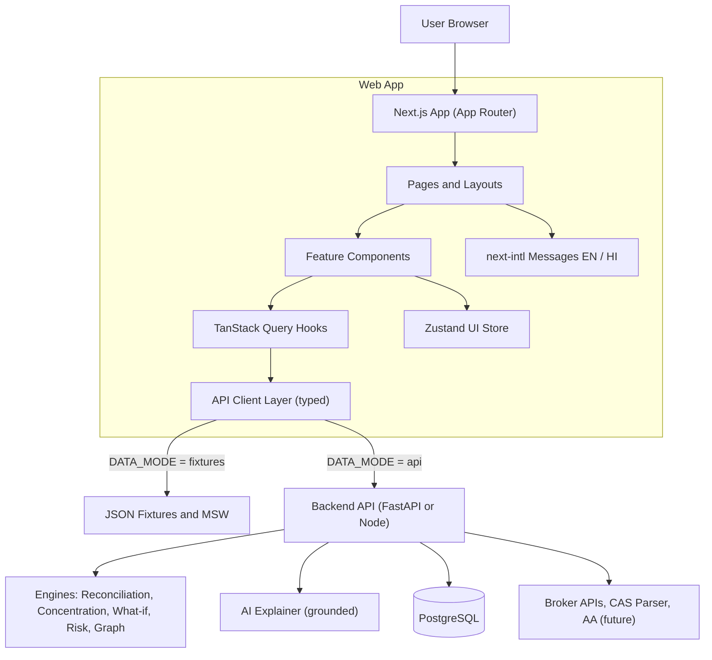
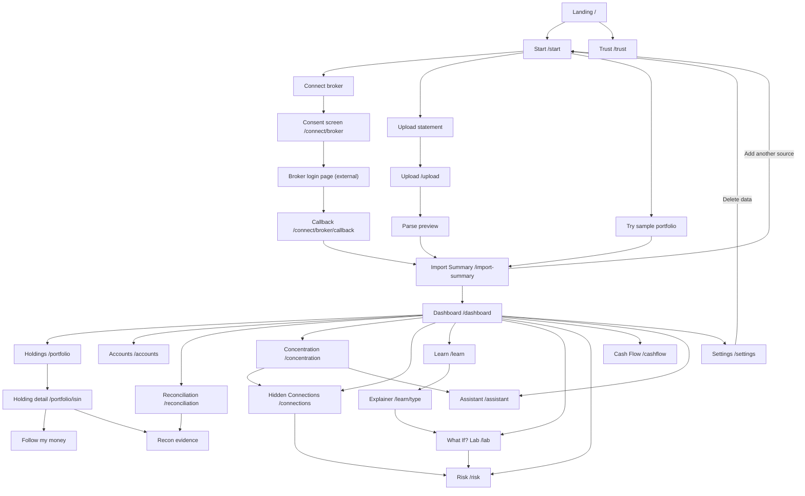
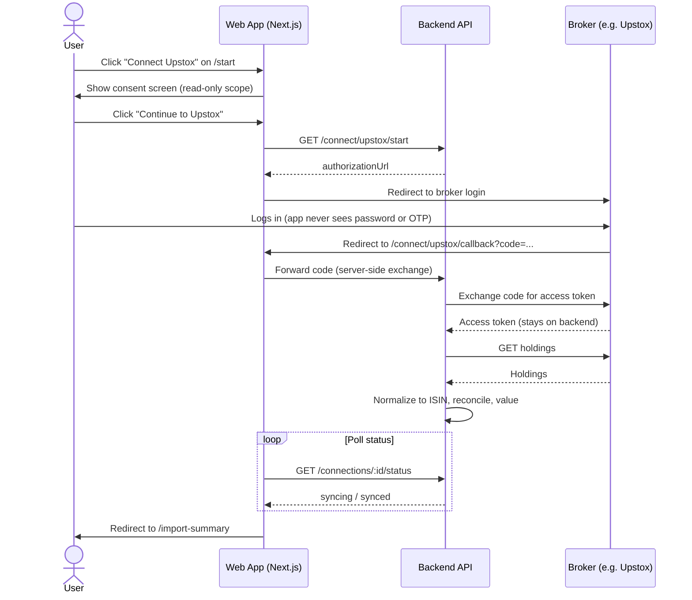
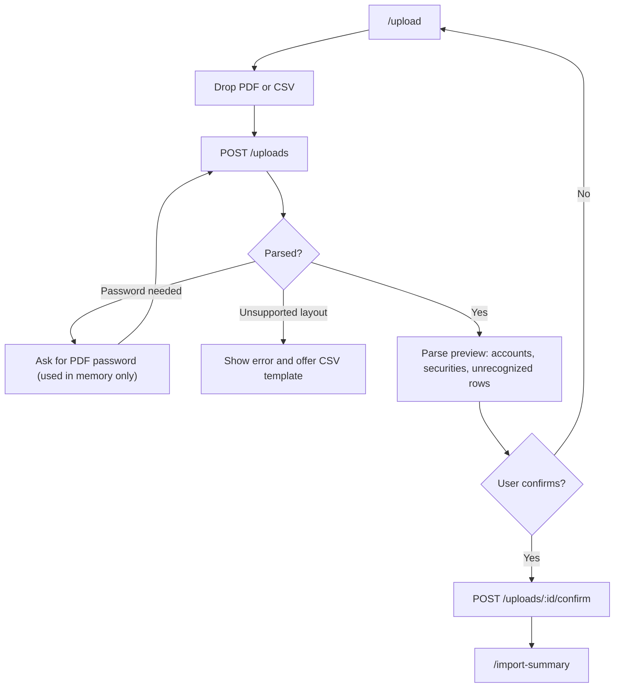
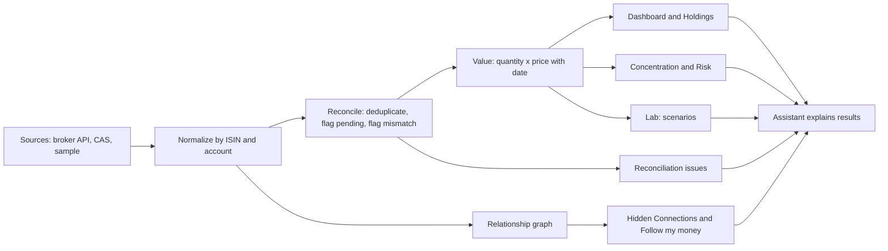
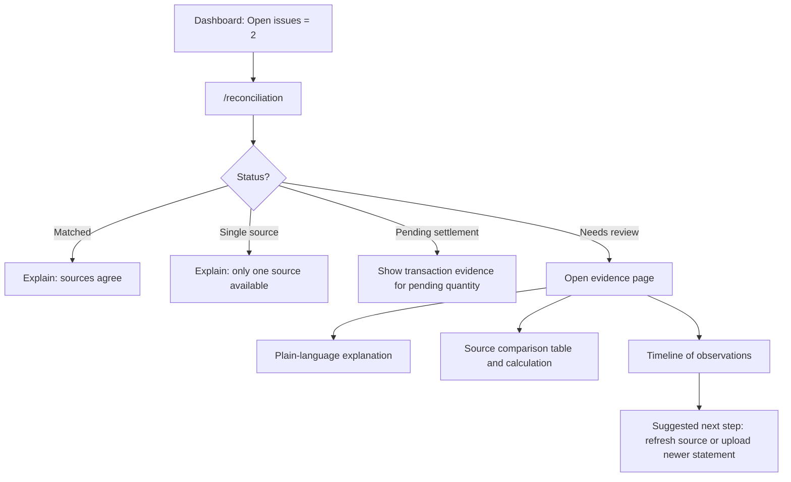
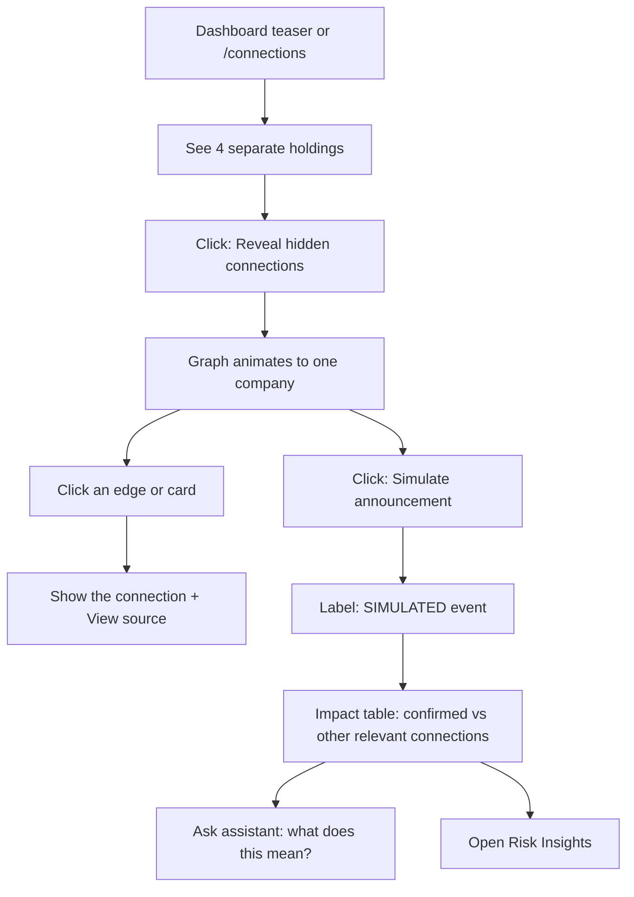
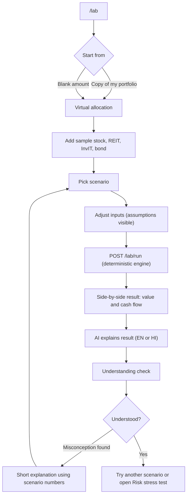
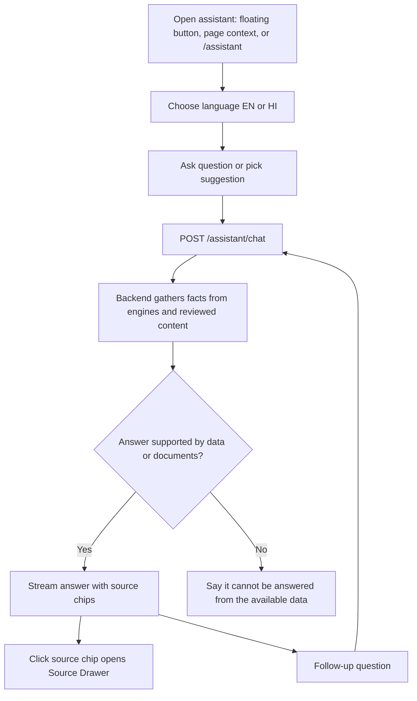
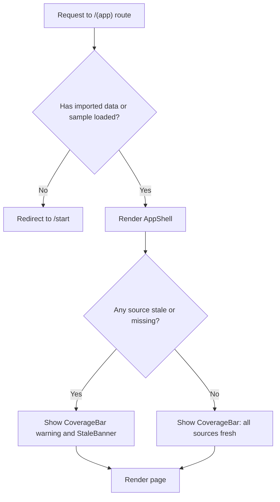

# DhanDrishti: Web Architecture

> **Frontend architecture, directory structure, page specifications and app flow for DhanDrishti, a consent-based, read-only investment dashboard.**

**Tagline:** *Know what you own, where you own it, and what it means.*

**Source of truth:** `DhanView_Solution.md` (product solution). This document translates it into a buildable web architecture. *(The solution document uses the working name "OneView"; DhanDrishti is used here.)*

---

## Table of Contents

1. [Architecture Goals and Principles](#1-architecture-goals-and-principles)
2. [Tech Stack](#2-tech-stack)
3. [High-Level Web Architecture](#3-high-level-web-architecture)
4. [Directory Structure](#4-directory-structure)
5. [Route Map](#5-route-map)
6. [Page Specifications](#6-page-specifications)
7. [Shared Components](#7-shared-components)
8. [State, Data Fetching and Types](#8-state-data-fetching-and-types)
9. [Backend API Contract Used by the Web App](#9-backend-api-contract-used-by-the-web-app)
10. [App Flow](#10-app-flow)
11. [Trust UI Conventions](#11-trust-ui-conventions)
12. [Internationalization (English and Hindi)](#12-internationalization-english-and-hindi)
13. [Loading, Empty and Error States](#13-loading-empty-and-error-states)
14. [Security and Compliance in the Frontend](#14-security-and-compliance-in-the-frontend)
15. [Build Phases (Hackathon Plan)](#15-build-phases-hackathon-plan)
16. [Testing Strategy](#16-testing-strategy)

---

## 1. Architecture Goals and Principles

| Principle | How it shows up in the web app |
|---|---|
| **Read-only** | No order, buy, sell or transfer UI anywhere. No "Invest now" buttons. |
| **Consent-based** | Data appears only after the user connects, uploads or chooses the sample portfolio. |
| **Trust first** | Every number is clickable and opens a **Source Drawer** with source, as-of date and coverage note. |
| **Code for facts, AI for explanation** | The frontend never calculates totals, percentages or scenario results. It renders what the backend engines return. AI text is displayed beside the numbers, never instead of them. |
| **Education, not advice** | Persistent disclaimers; illustrative labels on all simulations; no "you should sell" language. |
| **Show gaps honestly** | "Groww account not connected", "look-through unavailable", "unclassified" are first-class UI states. |
| **Fixtures first** | The app runs fully on JSON fixtures (`DATA_MODE=fixtures`) so the UI works end to end before real integrations exist. |

---

## 2. Tech Stack

| Concern | Choice | Notes |
|---|---|---|
| Framework | **Next.js 14+ (App Router)** with **TypeScript** | Server components for static content, client components for interactive pages |
| Styling | **Tailwind CSS** + **shadcn/ui** | Accessible primitives (dialog, drawer, tabs, table) |
| Data fetching | **TanStack Query** | Caching, refetch, sync status polling |
| Client state | **Zustand** (small UI state only) | Selected accounts filter, language, drawer state |
| Charts | **Recharts** (donut, bar, treemap) | Concentration and allocation |
| Graph view | **React Flow** (or `@xyflow/react`) | Hidden Connections and Follow my money |
| Forms and validation | **React Hook Form + Zod** | Shared schemas with API types |
| i18n | **next-intl** | English and Hindi message catalogs |
| Chat streaming | Server-Sent Events via `fetch` | Assistant responses |
| Upload | `react-dropzone` | CAS PDF / CSV upload |
| Testing | **Vitest**, **React Testing Library**, **Playwright** | Unit, component, end-to-end |
| Mocking | **MSW** (Mock Service Worker) + JSON fixtures | Mock broker and backend |

---

## 3. High-Level Web Architecture



**Layering rule:** `Page -> Feature component -> Query hook -> API client -> Backend`. Pages never call `fetch` directly and never compute financial numbers.

---

## 4. Directory Structure

```text
dhandrishti-web/
├── public/
│   ├── brand/                        # logo, favicon, og-image
│   ├── illustrations/                # REIT, InvIT, bond explainer art (SVG)
│   └── samples/                      # downloadable sample CAS CSV / PDF for upload demo
│
├── messages/
│   ├── en.json                       # English UI + reviewed educational strings
│   └── hi.json                       # Hindi (reviewed translations + glossary)
│
├── fixtures/                         # JSON fixtures powering DATA_MODE=fixtures
│   ├── portfolio.sample.json
│   ├── accounts.sample.json
│   ├── reconciliation.sample.json    # includes deliberate mismatch + pending settlement
│   ├── relationships.sample.json     # Aster Industries graph (15-20 securities)
│   ├── education/
│   │   ├── reit.json
│   │   ├── invit.json
│   │   └── bond.json
│   ├── scenarios.sample.json
│   ├── risk.sample.json
│   └── cashflows.sample.json
│
├── src/
│   ├── app/                          # ---- ROUTES (App Router) ----
│   │   ├── layout.tsx                # root layout: fonts, providers, i18n
│   │   ├── globals.css
│   │   ├── not-found.tsx
│   │   ├── error.tsx
│   │   │
│   │   ├── (marketing)/              # public pages, no sidebar
│   │   │   ├── layout.tsx
│   │   │   ├── page.tsx                          # /  Landing
│   │   │   └── trust/page.tsx                    # /trust  How we handle data
│   │   │
│   │   ├── (onboarding)/             # focused flow, minimal chrome
│   │   │   ├── layout.tsx
│   │   │   ├── start/page.tsx                    # /start  Connect / Upload / Sample
│   │   │   ├── connect/
│   │   │   │   ├── [broker]/page.tsx             # /connect/upstox  pre-redirect consent screen
│   │   │   │   └── [broker]/callback/page.tsx    # /connect/upstox/callback  OAuth return
│   │   │   ├── upload/page.tsx                   # /upload  Statement upload + parse preview
│   │   │   └── import-summary/page.tsx           # /import-summary  Accounts found, issues
│   │   │
│   │   ├── (app)/                    # authenticated-ish app shell (sidebar + topbar)
│   │   │   ├── layout.tsx                        # AppShell, CoverageBar, DisclaimerFooter
│   │   │   ├── dashboard/page.tsx                # /dashboard
│   │   │   ├── portfolio/
│   │   │   │   ├── page.tsx                      # /portfolio  Holdings table
│   │   │   │   └── [isin]/page.tsx               # /portfolio/INE...  Holding detail + audit trail
│   │   │   ├── accounts/
│   │   │   │   ├── page.tsx                      # /accounts
│   │   │   │   └── [accountId]/page.tsx          # /accounts/:id
│   │   │   ├── reconciliation/
│   │   │   │   ├── page.tsx                      # /reconciliation  Issues list
│   │   │   │   └── [issueId]/page.tsx            # /reconciliation/:id  Evidence view
│   │   │   ├── concentration/page.tsx            # /concentration
│   │   │   ├── connections/
│   │   │   │   ├── page.tsx                      # /connections  Hidden Connections
│   │   │   │   └── learn/page.tsx                # /connections/learn  Learn view (reference data)
│   │   │   ├── follow-money/[isin]/page.tsx      # /follow-money/INE...
│   │   │   ├── learn/
│   │   │   │   ├── page.tsx                      # /learn  Hub
│   │   │   │   ├── compare/page.tsx              # /learn/compare  Stock vs REIT vs InvIT vs Bond
│   │   │   │   └── [type]/page.tsx               # /learn/reit | /learn/invit | /learn/bond
│   │   │   ├── lab/
│   │   │   │   ├── page.tsx                      # /lab  What if? lab
│   │   │   │   └── lessons/[lessonId]/page.tsx   # /lab/lessons/bond-yield  Guided simulation
│   │   │   ├── risk/page.tsx                     # /risk  Risk insights + stress test
│   │   │   ├── cashflow/page.tsx                 # /cashflow  Cash-flow calendar
│   │   │   ├── assistant/page.tsx                # /assistant  Multilingual explainer (full page)
│   │   │   └── settings/page.tsx                 # /settings  Language, data, delete
│   │   │
│   │   └── api/                      # thin Next route handlers (BFF), optional
│   │       ├── chat/route.ts                     # SSE proxy to backend assistant
│   │       └── session/route.ts                  # session cookie helpers
│   │
│   ├── features/                     # ---- FEATURE MODULES (UI + hooks per domain) ----
│   │   ├── onboarding/
│   │   │   ├── components/   (EntryOptionCard, BrokerPicker, ConsentExplainer, UploadDropzone, ParsePreview)
│   │   │   └── hooks/        (useConnectBroker, useUploadStatement, useSampleLoader)
│   │   ├── portfolio/
│   │   │   ├── components/   (HoldingsTable, TotalValueCard, AllocationDonut, HoldingRow, AuditTrailPanel)
│   │   │   └── hooks/        (usePortfolio, useHolding)
│   │   ├── accounts/
│   │   │   ├── components/   (AccountCard, CoverageList, MissingAccountFlag, AccountBreakdownBar)
│   │   │   └── hooks/        (useAccounts, useSyncConnection)
│   │   ├── reconciliation/
│   │   │   ├── components/   (StatusBadge, IssueList, EvidencePanel, SourceComparisonTable, PendingSettlementNote)
│   │   │   └── hooks/        (useReconciliationIssues, useIssueEvidence)
│   │   ├── concentration/
│   │   │   ├── components/   (ConcentrationTabs, TreemapView, SectorBars, AssetClassDonut, ExclusionBanner)
│   │   │   └── hooks/        (useConcentration)
│   │   ├── connections/
│   │   │   ├── components/   (RevealButton, RelationshipGraph, ConnectionCard, AnnouncementSimulator, ImpactTable)
│   │   │   └── hooks/        (useConnections, useSimulatedEvent)
│   │   ├── follow-money/
│   │   │   ├── components/   (ViewSwitcher, AccountsView, AssetsIssuersView, CashFlowsView, FlowDiagram)
│   │   │   └── hooks/        (useFollowMoney)
│   │   ├── learn/
│   │   │   ├── components/   (InstrumentCard, BenefitsRisksCard, ComparisonTable, ContextualPrompt, BondYieldExplainer)
│   │   │   └── hooks/        (useEducationContent)
│   │   ├── lab/
│   │   │   ├── components/   (VirtualAllocationBuilder, ScenarioPicker, ScenarioControls, SideBySideResult, AssumptionsPanel, UnderstandingCheck)
│   │   │   └── hooks/        (useRunScenario, useLessons)
│   │   ├── risk/
│   │   │   ├── components/   (RiskSummaryList, RiskCard, StressTestPanel, ThresholdLegend)
│   │   │   └── hooks/        (useRiskInsights, useStressTest)
│   │   ├── cashflow/
│   │   │   ├── components/   (CashflowCalendar, CashflowList, CashflowStatusTag)
│   │   │   └── hooks/        (useCashflows)
│   │   ├── assistant/
│   │   │   ├── components/   (ChatWindow, MessageBubble, SourceChips, LanguageToggle, SuggestedQuestions, AssistantDrawer)
│   │   │   └── hooks/        (useChatStream)
│   │   └── settings/
│   │       ├── components/   (LanguageSelect, DataControls, DeleteDataDialog, ConnectedSourcesList)
│   │       └── hooks/        (useDeleteData)
│   │
│   ├── components/                   # ---- SHARED UI ----
│   │   ├── ui/                       # shadcn primitives (button, dialog, drawer, tabs, table, tooltip ...)
│   │   ├── layout/                   # AppShell, Sidebar, Topbar, MobileNav, PageHeader
│   │   ├── trust/                    # SourceDrawer, AsOfBadge, CoverageBar, SourceLink, DisclaimerBanner, IllustrativeTag
│   │   ├── data/                     # MoneyText, PercentText, QuantityText, AssetClassBadge, StatusBadge
│   │   ├── feedback/                 # EmptyState, ErrorState, Skeletons, StaleBanner, ExclusionBanner
│   │   └── charts/                   # DonutChart, BarList, Treemap, LineScenarioChart
│   │
│   ├── lib/
│   │   ├── api/
│   │   │   ├── client.ts             # typed fetch wrapper (base URL, errors, auth cookie)
│   │   │   ├── endpoints.ts          # path constants
│   │   │   ├── fixtures-adapter.ts   # DATA_MODE=fixtures implementation
│   │   │   └── index.ts              # picks adapter by env
│   │   ├── format/                   # INR formatting (lakh/crore), dates (IST), units
│   │   ├── i18n/                     # next-intl config, glossary helpers
│   │   ├── query/                    # QueryClient config, query keys
│   │   ├── constants/                # asset classes, status enums, thresholds text
│   │   └── utils/
│   │
│   ├── types/                        # domain types shared across features
│   │   ├── portfolio.ts              # Holding, HoldingSnapshot, Account, Instrument, Price
│   │   ├── reconciliation.ts         # ReconStatus, ReconIssue, Evidence
│   │   ├── graph.ts                  # Entity, Relationship, ConnectionPath
│   │   ├── scenario.ts               # Scenario, ScenarioResult, Assumption
│   │   ├── risk.ts                   # RiskType, RiskCard
│   │   ├── education.ts              # InstrumentContent
│   │   └── api.ts                    # envelopes, error shapes
│   │
│   ├── store/
│   │   ├── ui.store.ts               # sidebar, drawers, selected account filter
│   │   └── language.store.ts         # current language (mirrors cookie)
│   │
│   ├── providers/                    # QueryProvider, I18nProvider, ThemeProvider
│   ├── mocks/                        # MSW handlers (mock broker, mock backend)
│   └── middleware.ts                 # language cookie, route guard for (app) without a session
│
├── tests/
│   ├── unit/
│   ├── component/
│   └── e2e/                          # demo-script Playwright flows
│
├── .env.example                      # NEXT_PUBLIC_API_BASE_URL, NEXT_PUBLIC_DATA_MODE
├── next.config.mjs
├── tailwind.config.ts
├── tsconfig.json
└── package.json
```

### Conventions

- **`app/`** holds only routing and composition. Pages stay thin: fetch via hooks, arrange feature components.
- **`features/`** holds everything domain-specific. A feature may import from `components/` and `lib/`, but features never import each other's internals (use `types/` or shared components).
- **`components/trust/`** is the most important shared folder. It enforces the "every number has a source" rule.
- **No financial math in the frontend.** Formatting only.

---

## 5. Route Map

| # | Route | Page | Group | Needs data? |
|---|---|---|---|---|
| 1 | `/` | Landing | marketing | No |
| 2 | `/trust` | Trust and Privacy | marketing | No |
| 3 | `/start` | Start (Connect / Upload / Sample) | onboarding | No |
| 4 | `/connect/[broker]` | Broker Consent Screen | onboarding | Broker metadata |
| 5 | `/connect/[broker]/callback` | OAuth Callback | onboarding | Yes |
| 6 | `/upload` | Statement Upload | onboarding | Yes |
| 7 | `/import-summary` | Import Summary | onboarding | Yes |
| 8 | `/dashboard` | Dashboard | app | Yes |
| 9 | `/portfolio` | Holdings | app | Yes |
| 10 | `/portfolio/[isin]` | Holding Detail and Audit Trail | app | Yes |
| 11 | `/accounts` | Accounts and Coverage | app | Yes |
| 12 | `/accounts/[accountId]` | Account Detail | app | Yes |
| 13 | `/reconciliation` | Reconciliation Issues | app | Yes |
| 14 | `/reconciliation/[issueId]` | Reconciliation Evidence | app | Yes |
| 15 | `/concentration` | Concentration Map | app | Yes |
| 16 | `/connections` | Hidden Connections | app | Yes |
| 17 | `/connections/learn` | Connections Learn View | app | Reference data |
| 18 | `/follow-money/[isin]` | Follow My Money | app | Yes |
| 19 | `/learn` | Learn Hub | app | Content |
| 20 | `/learn/[type]` | REIT / InvIT / Bond Explainer | app | Content |
| 21 | `/learn/compare` | Comparison View | app | Content |
| 22 | `/lab` | What If? Lab | app | Yes |
| 23 | `/lab/lessons/[lessonId]` | Guided Simulation | app | Content |
| 24 | `/risk` | Risk Insights and Stress Test | app | Yes |
| 25 | `/cashflow` | Cash-Flow Calendar | app | Yes |
| 26 | `/assistant` | Multilingual Explainer | app | Yes |
| 27 | `/settings` | Settings and Data Controls | app | Yes |

**Global overlays (not routes):** Source Drawer, Assistant Drawer (floating button on every app page), Delete Data dialog.

**Sidebar navigation (app shell):**

```text
Dashboard
Portfolio
Accounts
Reconciliation
Concentration
Hidden Connections
Learn
What If? Lab
Risk Insights
Cash Flow
Assistant
Settings
```

---

## 6. Page Specifications

Each page lists: **Route, Purpose, Layout sections, Components, Data, Interactions, States, Rules, Acceptance criteria.**

---

### 6.1 Landing Page

| | |
|---|---|
| **Route** | `/` |
| **Purpose** | Explain the product in 10 seconds, build trust, send the user to `/start`. |
| **Audience** | First-time visitor, hackathon judge. |

**Layout sections**

1. **Hero:** headline "One clear view of everything you own", tagline, primary CTA **Get started** (`/start`), secondary CTA **Try sample portfolio**.
2. **Problem strip:** three cards: multiple brokers, separate depositories, unfamiliar REITs/InvITs/bonds.
3. **How it works:** 4 steps (Connect, Combine, Understand, Experiment).
4. **Double-counting moment:** a small animated graphic: 12 + 8 + statement = naive total 40 vs DhanDrishti 20.
5. **Trust strip:** Read-only, Consent-based, Source on every number, Not investment advice. Link to `/trust`.
6. **Footer:** disclaimer, links.

**Components:** `Hero`, `StepsRow`, `DoubleCountDemo`, `TrustStrip`, `DisclaimerBanner`.

**Data:** none (static, server-rendered, i18n messages).

**Rules:** no return claims, no adoption numbers, no "best" language.

**Acceptance:** CTA reaches `/start` in one click; page renders in English and Hindi.

---

### 6.2 Trust and Privacy Page

| | |
|---|---|
| **Route** | `/trust` |
| **Purpose** | State plainly how data is handled. |

**Sections:** What "read-only" means; How consent works (login happens on the broker's page; we never see your password or OTP); What we store and for how long; We do not store CAS PDF passwords or full PAN; Delete your data any time; How numbers are calculated (code decides facts, AI explains); What this product is not (not advice, not an approved FIU).

**Components:** `TrustSection`, `DataHandlingTable`, `FAQAccordion`.

**Acceptance:** every claim on this page matches the Security section of the solution document.

---

### 6.3 Start Page (Entry Options)

| | |
|---|---|
| **Route** | `/start` |
| **Purpose** | Let the user pick how to bring data in. |

**Layout:** three large option cards.

| Card | Action | Notes |
|---|---|---|
| **Connect broker** | Opens broker picker, then `/connect/[broker]` | Zerodha, Upstox (live), Dhan, Groww (label: "Live authorization depends on confirmed access"), Mock Broker B |
| **Upload statement** | `/upload` | CAS PDF or CSV |
| **Try sample portfolio** | Loads the fixture portfolio, goes to `/import-summary` | Clearly labeled **synthetic data** |

**Components:** `EntryOptionCard`, `BrokerPicker`, `SampleBadge`.

**Data:** `GET /brokers` (supported brokers and their status: `live`, `mock`, `requires_partner_access`).

**States:** if the user already has imported data, show a **Continue to dashboard** banner.

**Rules:** the broker picker shows an honest status chip per broker. Never imply a broker is live if it is not.

**Acceptance:** each card leads to a working next step; sample loads in under 2 seconds in fixture mode.

---

### 6.4 Broker Consent Screen

| | |
|---|---|
| **Route** | `/connect/[broker]` (e.g. `/connect/upstox`) |
| **Purpose** | Explain what will happen before redirecting to the broker. |

**Layout:**

1. Broker logo and name.
2. **What we will read:** holdings, quantities, average price. **What we will not do:** place orders, move money, see your password or OTP.
3. 4-step visual: Redirect, You log in on the broker's site, Broker sends us a short-lived code, We fetch your holdings.
4. Buttons: **Continue to {Broker}** (calls `GET /connect/{broker}/start`, then redirects), **Go back**.

**Components:** `ConsentExplainer`, `PermissionList`, `RedirectStepper`.

**Data:** `GET /connect/:broker/start` returns the authorization URL.

**States:** broker unsupported or `requires_partner_access`: show a notice and offer **Upload statement** instead. Mock broker: an in-app simulated login screen.

**Acceptance:** the user sees read-only scope before any redirect; unsupported brokers give a fallback rather than a dead end.

---

### 6.5 OAuth Callback Page

| | |
|---|---|
| **Route** | `/connect/[broker]/callback` |
| **Purpose** | Receive the code or token from the broker, trigger the first sync, show progress. |

**Flow on the page:**

1. Read `code` / `request_token` from the query string and forward it to the backend (the backend exchanges it for an access token; the browser never holds the token).
2. Poll `GET /connections/:id/status` until `synced` or `failed`.
3. Redirect to `/import-summary`.

**Components:** `SyncProgress` (steps: Verifying, Fetching holdings, Normalizing by ISIN, Reconciling).

**States:** *Error*: denied consent, expired code, broker API down. Each gives a human message and **Try again** / **Upload a statement instead**.

**Acceptance:** failure never leaves the user on a blank page; the raw code is removed from the URL after handoff.

---

### 6.6 Statement Upload Page

| | |
|---|---|
| **Route** | `/upload` |
| **Purpose** | Import a CAS-like PDF or CSV as a fallback or an additional source. |

**Layout:**

1. Dropzone (PDF, CSV) with a **Download sample file** link.
2. Statement type hint: CAS (CDSL/NSDL), broker CSV, generic CSV template.
3. **Parse preview table:** detected accounts, securities found, unrecognized rows highlighted.
4. Buttons: **Confirm import**, **Cancel**.

**Components:** `UploadDropzone`, `ParsePreview`, `UnrecognizedRowsList`, `StatementTypeSelector`.

**Data:** `POST /uploads` (multipart), `GET /uploads/:id/preview`, `POST /uploads/:id/confirm`.

**Rules:**

- Do not ask for or store PDF passwords; if a password is needed, it is used in-memory by the parser only (state this on screen).
- Show **statement date** prominently. A statement is a snapshot, not "everything".

**States:** password-protected PDF, unsupported layout, zero holdings found, partially parsed.

**Acceptance:** unrecognized securities are listed, never silently dropped.

---

### 6.7 Import Summary Page

| | |
|---|---|
| **Route** | `/import-summary` |
| **Purpose** | Confirm what was found before the user sees totals (coverage check). |

**Layout:**

1. **Accounts found** cards: e.g. "Demat A (CDSL) · Upstox · as of 29 Sep", "Demat B (NSDL) · statement · as of 31 Aug", "Mutual fund folio".
2. **Last updated** per account (not one global time).
3. **Coverage checklist:** *Are any accounts missing?* The user can add flags like "Groww account (not connected)".
4. **Issues found:** unrecognized securities, missing prices, discrepancies (counts, link to `/reconciliation`).
5. CTA: **Go to dashboard**; secondary: **Add another source**.

**Components:** `AccountCard`, `CoverageList`, `MissingAccountFlag`, `IssueCountChips`.

**Data:** `GET /accounts`, `GET /coverage`, `GET /reconciliation/summary`.

**Rules:** wording must not claim completeness ("We found 3 accounts from the sources you gave us", not "We found all your investments").

**Acceptance:** flagged missing accounts carry through to the dashboard's CoverageBar.

---

### 6.8 Dashboard

| | |
|---|---|
| **Route** | `/dashboard` |
| **Purpose** | The first dashboard: total, allocation, accounts, gaps, and a learning entry point. |

**Layout (top to bottom):**

1. **CoverageBar** (sticky): "Based on 3 of your accounts · 1 not connected · oldest data 31 Aug". Clicking opens `/accounts`.
2. **Banners:** `StaleBanner` (stale prices included), `ExclusionBanner` (assets not valued).
3. **KPI row:**
   - **Total valued holdings** (`TotalValueCard`): clicking opens the Source Drawer.
   - **Holdings count**, **Accounts count**, **Open issues** (links to `/reconciliation`).
4. **Asset allocation donut** (equity, ETF, mutual fund, REIT, InvIT, bond, unknown).
5. **Holdings by account and depository** (`AccountBreakdownBar`).
6. **Hidden Connections teaser:** "4 of your holdings depend on the same company" with **Reveal hidden connections**.
7. **Risk summary** (top 3 observations, each links to evidence on `/risk`).
8. **Learn beyond stocks** (REIT, InvIT, Bond cards with a contextual prompt such as "Most of your valued holdings are equity").
9. **Top holdings table** (5 rows) with link to `/portfolio`.

**Components:** `CoverageBar`, `TotalValueCard`, `AllocationDonut`, `AccountBreakdownBar`, `RevealConnectionsTeaser`, `RiskSummaryList`, `LearnBeyondStocks`, `HoldingsTable (compact)`.

**Data:** `GET /portfolio/summary`, `GET /risk/summary`, `GET /connections/summary`, `GET /coverage`.

**Interactions:**

- Every number: click opens **Source Drawer** (source, as-of date, coverage note).
- Donut slice click filters `/portfolio` by asset class.
- Account bar segment click opens `/accounts/[accountId]`.

**Acceptance (demo):** overlapping holding appears once; total matches test case; every KPI opens a source drawer.

---

### 6.9 Holdings Page

| | |
|---|---|
| **Route** | `/portfolio` |
| **Purpose** | Full deduplicated holdings table. |

**Layout:**

1. Filters: asset class, account, reconciliation status, valued / unvalued. URL-synced query params.
2. **Holdings table** columns: Name, ISIN, Asset class, Total quantity, Accounts (chips), Price (with date), Value, Status badge (Matched, Single source, Pending settlement, Needs review).
3. Table footer: totals and exclusion note.

**Components:** `HoldingsTable`, `HoldingRow`, `AssetClassBadge`, `StatusBadge`, `FilterBar`, `AccountChips`.

**Data:** `GET /portfolio?assetClass=&accountId=&status=`.

**Interactions:**

- Row click: `/portfolio/[isin]`.
- Status badge click: opens evidence for that holding.
- Price cell click: Source Drawer with price source and date.
- Bonds without a dependable price display "Price unavailable" with units/face amount (never an invented value).

**Acceptance:** quantity column equals the sum across distinct accounts, not across sources.

---

### 6.10 Holding Detail and Audit Trail

| | |
|---|---|
| **Route** | `/portfolio/[isin]` |
| **Purpose** | The evidence for one holding: where it sits, what each source said, and how the total was reached. |

**Layout:**

1. **Header:** name, ISIN, asset class, issuer, status badge.
2. **Account breakdown:** "You own 20 units: 12 in Demat A, 8 in Demat B" (stacked bar plus table).
3. **Audit trail panel:** ordered list of source observations (source, date, quantity, settled/pending), with the chosen authoritative observation marked.

   > Example: *20 units of Security X: 12 in Demat A, 8 in Demat B. Source: CAS dated 31 August. Broker A reports 12 units as of 29 September.*

4. **Pending settlement** note (if any): recent transaction evidence explaining the pending quantity.
5. **Valuation:** quantity x price, price date and source.
6. **Cost basis:** shown only if complete; otherwise "Cost basis unavailable or incomplete" with reason.
7. **Actions:** **Show evidence**, **Follow my money** (`/follow-money/[isin]`), **Explain this** (opens the assistant with this holding preloaded), **Learn about {REIT/InvIT/Bond}** (for those types).
8. **Related connections:** link to Hidden Connections filtered to this issuer.

**Components:** `HoldingHeader`, `AccountBreakdownBar`, `AuditTrailPanel`, `SourceComparisonTable`, `ValuationCard`, `CostBasisNotice`.

**Data:** `GET /portfolio/:isin` (snapshots, transactions, price, recon status).

**Acceptance:** stock split shows a corporate-action link instead of a fake purchase or gain.

---

### 6.11 Accounts and Coverage Page

| | |
|---|---|
| **Route** | `/accounts` |
| **Purpose** | Show every connected or imported source, freshness, and what is missing. |

**Layout:**

1. **Account cards:** broker/DP label, depository (CDSL/NSDL), masked account ID, source type (live API, statement, sample, manual), **last updated**, status chip (Fresh, Stale, Not connected, Error).
2. **Coverage panel:** accounts included vs flagged missing.
3. **Add source** button (back to `/start`).
4. Per card actions: **Sync now**, **View holdings**, **Disconnect and delete**.

**Components:** `AccountCard`, `CoverageList`, `SyncButton`, `FreshnessChip`, `MissingAccountFlag`.

**Data:** `GET /accounts`, `POST /connections/:id/sync`, `DELETE /connections/:id`.

**States:** "Groww account not connected" shown as a first-class card rather than hidden.

**Acceptance:** each card shows its own timestamp; sync updates status without a full reload.

---

### 6.12 Account Detail Page

| | |
|---|---|
| **Route** | `/accounts/[accountId]` |
| **Purpose** | Holdings and issues for a single account. |

**Sections:** account header (source, depository, masked ID, as-of); holdings in this account; reconciliation issues involving this account; transactions (if available).

**Components:** `AccountHeader`, `HoldingsTable (account scoped)`, `IssueList (scoped)`.

**Data:** `GET /accounts/:id`, `GET /accounts/:id/holdings`.

---

### 6.13 Reconciliation Issues Page

| | |
|---|---|
| **Route** | `/reconciliation` |
| **Purpose** | "Explain my holdings": list every status and discrepancy in one place. |

**Layout:**

1. **Status summary tiles:** Matched, Single source, Pending settlement, Needs review (counts, clickable filters).
2. **Issue list:** holding, issue type, sources involved, status, date detected.
3. **How reconciliation works** collapsible explainer: "Two reports of one holding are not two holdings."

**Components:** `StatusSummaryTiles`, `IssueList`, `StatusBadge`, `ReconExplainer`.

**Data:** `GET /reconciliation/issues`.

**Acceptance:** the deliberate demo mismatch appears as **Needs review**; pending settlement appears as **Pending**, not missing.

---

### 6.14 Reconciliation Evidence Page

| | |
|---|---|
| **Route** | `/reconciliation/[issueId]` |
| **Purpose** | Open the source records, dates, calculation and a plain-language explanation. |

**Layout:**

1. **Plain-language explanation** (AI-written from the engine's structured result, English/Hindi toggle). Labeled "Explanation".
2. **Source comparison table:** source, account, as-of date, quantity, settled/pending.
3. **Calculation block:** e.g. "Broker A: 100 settled + 20 pending. Depository: 100 settled. Broker B: 50 settled. Result: 150 settled + 20 pending."
4. **Timeline:** observations on a date axis (shows why an older statement does not replace a newer broker feed).
5. **Show evidence** expands raw records (masked).
6. **What you can do:** refresh the source, upload a newer statement, mark as reviewed. (No "fix" that alters source data.)

**Components:** `EvidencePanel`, `SourceComparisonTable`, `CalculationBlock`, `ObservationTimeline`, `ExplanationCard`.

**Data:** `GET /reconciliation/issues/:id`.

**Rules:** the app never silently overwrites an observation; wording never blames the user.

---

### 6.15 Concentration Map Page

| | |
|---|---|
| **Route** | `/concentration` |
| **Purpose** | Show exposure by company, sector, asset class and account. |

**Layout:**

1. **Tabs:** By company, By sector, By asset class, By account.
2. **Visualization:** treemap or bar list per tab.
3. **Insight card:** e.g. "42% of your imported portfolio is in banking." with its basis: "% of imported, valued portfolio as of {date}".
4. **ExclusionBanner:** what was excluded (unpriced, unclassified) and "look-through unavailable" funds.
5. **Explainer link:** **Why is my portfolio concentrated?** (opens assistant) and **See hidden connections** (links to `/connections`).
6. **Threshold legend:** transparent thresholds behind any "High concentration" label; text says labels are descriptive, not a judgement of suitability.

**Components:** `ConcentrationTabs`, `TreemapView`, `SectorBars`, `AssetClassDonut`, `ExclusionBanner`, `ThresholdLegend`, `InsightCard`.

**Data:** `GET /concentration?view=company|sector|assetClass|account`.

**Rules:** show "Unclassified" openly; look-through only where underlying holdings are disclosed; do not say a level is "too high".

**Acceptance:** percentages equal hand-calculated results on test portfolios.

---

### 6.16 Hidden Connections Page (Signature Feature)

| | |
|---|---|
| **Route** | `/connections` |
| **Purpose** | Reveal financial dependencies linking seemingly separate holdings. |

**Layout:**

1. **Before state:** the four separate holdings as plain cards (Aster shares, Aster bond, City Offices REIT, Energy Infrastructure InvIT) with their accounts.
2. **Primary button:** **Reveal hidden connections.**
3. **After state (animated):** `RelationshipGraph` with Aster Industries at the centre and edges labeled *Issues*, *Owes payments on*, *Pays rent to*, *Purchases power from*.
4. **Connection cards** beside the graph. Each card has **Show the connection** and **View source** (document, location, disclosure date, disclosed % only where available).
5. **Announcement simulator:** button "Simulate announcement" showing the labeled **Simulated** event: *"Aster Industries announces a delay in the interest payment on the bond held in this portfolio."*
6. **Impact table** after the simulation:

| Holding | Displayed explanation |
|---|---|
| Bond | Directly concerns your bond's payment. |
| Shares | You also own equity in the issuer; this is a relevant development. |
| REIT | The company is a disclosed tenant. No evidence here that its rent is delayed. |
| InvIT | The company is a disclosed power purchaser. The relationship is shown; a payment delay has not been established. |

**Components:** `RevealButton`, `RelationshipGraph`, `ConnectionCard`, `AnnouncementSimulator`, `ImpactTable`, `ConfirmedVsRelevantLegend`, `SimulatedTag`.

**Data:** `GET /connections`, `GET /connections/:entityId/paths`, `POST /connections/simulate-event`.

**Rules:**

- Distinguish **confirmed event** from **other relevant connections**; never show a predicted loss.
- If a report lists tenant sector but no tenant name, show the sector connection, never guess a company.
- Keep investment amounts and revenue dependencies visually and textually distinct (₹20,000 in a REIT with a 10% tenant does not mean ₹2,000 invested in that tenant).
- Every explanation has **Show the connection** and **View source**.

**States:** no connections found: friendly empty state plus link to `/connections/learn`.

---

### 6.17 Connections Learn View

| | |
|---|---|
| **Route** | `/connections/learn` |
| **Purpose** | For stock-only users (or no hits): explain the same relationships with **reference** REITs, InvITs and bonds, separate from actual holdings. |

**Sections:** reference graph (Aster example), "What is a lender / tenant / counterparty?" cards, links to `/learn/*`.

**Rules:** a persistent **Reference example, not your holdings** tag on every visual.

---

### 6.18 Follow My Money Page

| | |
|---|---|
| **Route** | `/follow-money/[isin]` |
| **Purpose** | Turn an unfamiliar security name into a visual explanation of what it represents and where cash comes from. |

**Layout:**

1. **Header:** security name, ISIN, type.
2. **ViewSwitcher** (tabs):

| Tab | Question | Content |
|---|---|---|
| **Accounts** | Where do I hold it? | Accounts and quantities |
| **Assets and issuers** | What am I exposed to? | Underlying structure by type |
| **Cash flows** | How could money reach me? | Flow diagram to the investor |

3. **Flow diagram (by instrument type):**

| Instrument | What opens |
|---|---|
| Stock | Company, business activity, ownership relationship |
| Mutual fund / ETF | Underlying holdings, where disclosed |
| REIT | Properties, locations, tenant and rental activity, distributions |
| InvIT | Infrastructure assets and relevant revenue arrangements |
| Bond | Issuer, lending relationship, coupon schedule, repayment terms |

4. **Accuracy notes** (always visible):
   - REIT units give exposure through the trust; you are not the direct owner of a particular office.
   - A company's stock and its bond represent different rights and risks.
   - Underlying assets explain a holding; they are **not** added again to portfolio value.
5. Source documents list (disclosure dates).

**Components:** `ViewSwitcher`, `AccountsView`, `AssetsIssuersView`, `CashFlowsView`, `FlowDiagram`, `AccuracyNotes`.

**Data:** `GET /follow-money/:isin`.

---

### 6.19 Learn Hub

| | |
|---|---|
| **Route** | `/learn` |
| **Purpose** | Entry to the Education Engine, with contextual prompts based on the user's holdings. |

**Layout:** contextual banner (for example "Most valued holdings in this imported portfolio are classified as equity"); three instrument cards (REIT, InvIT, Bond), each with a one-line definition and **Your exposure** (if they hold it); link to Compare; link to guided lessons in the Lab.

**Components:** `ContextualPrompt`, `InstrumentCard`, `YourExposureChip`.

**Data:** `GET /education`, `GET /portfolio/summary`.

---

### 6.20 Instrument Explainer (REIT / InvIT / Bond)

| | |
|---|---|
| **Route** | `/learn/[type]` where `type` is `reit`, `invit` or `bond` |
| **Purpose** | Reviewed, structured explanation with benefits and risks on the **same card**. |

**Structured content (per type):** Definition; How returns arise; Main risks; Liquidity; Questions to ask; What to inspect (table); Source link (SEBI investor material, issuer documents).

| Asset | Simple explanation | What to inspect |
|---|---|---|
| REIT | Units linked to a portfolio of income-generating real estate | Underlying properties, distributions, market price, liquidity, fees, risks |
| InvIT | Units linked to infrastructure assets such as roads or transmission projects | Underlying assets, debt, distributions, market price, liquidity |
| Bond | Lending to an issuer under specified payment terms | Issuer, maturity, coupon vs yield, credit/default risk, interest-rate risk, liquidity |

**Extra blocks:**

- **Your holdings of this type** (if any) with links to `/portfolio/[isin]`.
- **Contextual prompt**, e.g. bond: "An 8% coupon describes payments relative to face value. Your return if you buy at today's price can differ."
- **Interactive explainer (bond):** `BondYieldExplainer`: "If the price of a fixed-coupon bond rises, what happens to its yield?" with a price slider. Labeled **Illustration**; coupon rate and yield to maturity are distinct.
- **Language toggle** (English / Hindi).
- **Ask the assistant** button.

**Components:** `BenefitsRisksCard`, `InstrumentTabs`, `InspectTable`, `BondYieldExplainer`, `SourceLink`, `IllustrativeTag`.

**Data:** `GET /education/:type`.

**Rules:** content is reviewed; no "safe return" claims; no rating invented.

---

### 6.21 Comparison View

| | |
|---|---|
| **Route** | `/learn/compare` |
| **Purpose** | Side-by-side: stock vs REIT vs InvIT vs bond. |

**Layout:** table with rows *Income, Price changes, Liquidity, Risk, What you own*; columns per instrument; cell tooltips link to sources; highlight "instruments you hold".

**Components:** `ComparisonTable`, `HeldInstrumentHighlight`.

**Data:** `GET /education/compare`.

---

### 6.22 What If? Investment Lab

| | |
|---|---|
| **Route** | `/lab` |
| **Purpose** | Build a **virtual allocation** and watch value and cash flows change under scenarios. Read-only, educational, no real orders. |

**Layout (three columns on desktop, stacked on mobile):**

1. **Virtual allocation builder:**
   - Start from **Copy of my imported portfolio** or **Blank amount** (e.g. ₹10,000).
   - Add sample stock, REIT, InvIT, bond; adjust amounts.
2. **Scenario picker and controls:**

| Scenario | Control | Lesson |
|---|---|---|
| Market yields rise or fall | Yield slider | Price and coupon are different things |
| REIT / InvIT distribution reduced | Percent reduction | Distributions vary; not guaranteed |
| Bond payment delayed or missed | Delay months / miss toggle | A schedule is not a receipt |
| Equity prices fall | Percent fall | How diversification changes outcomes |
| Earlier exit date | Date picker | Exit timing and liquidity matter |

3. **Side-by-side result:** original vs scenario (value, cash received, combined ending value), with a line chart.
4. **AssumptionsPanel:** editable inputs and "what is excluded (fees, taxes, other cash flows)".
5. **Explanation card:** AI explains the result in English/Hindi, using the engine's numbers.
6. **Understanding check** (after the run): "Explain the result in your own words" text box, misconception feedback with the scenario's numbers. Measures understanding of the lesson, not suitability.

**Worked example always available:** Start ₹10,000, ending market value ₹9,000, distributions received ₹600, combined ending value ₹9,600. "Receiving cash does not mean the investment made a profit." (Simplified: no other cash flows, fees or taxes.)

**Components:** `VirtualAllocationBuilder`, `ScenarioPicker`, `ScenarioControls`, `SideBySideResult`, `LineScenarioChart`, `AssumptionsPanel`, `UnderstandingCheck`, `IllustrativeTag`.

**Data:** `POST /lab/run` (scenario + allocation in, deterministic results out), `GET /lab/scenarios`.

**Rules:** every number comes from the backend engine; every scenario tagged **Illustrative**; no precise price forecasts.

**Acceptance:** scenario outputs equal manual calculations for the three demo scenarios (bond yield, REIT/InvIT distribution cut, equity fall).

---

### 6.23 Guided Simulation (Lesson)

| | |
|---|---|
| **Route** | `/lab/lessons/[lessonId]` (e.g. `bond-yield`, `reit-distribution`, `payment-delay`, `invit-distribution`, `early-exit`) |
| **Purpose** | Step-by-step lesson that feeds the open-ended lab. |

**Layout:** lesson title and goal; 3 to 5 steps, each with a short explanation, a control, and a live result; closing summary; **Understanding check**; **Open in What If? lab** button.

**Components:** `LessonStepper`, `ScenarioControls`, `SideBySideResult`, `UnderstandingCheck`.

**Data:** `GET /lab/lessons/:id`, `POST /lab/run`.

---

### 6.24 Risk Insights Page

| | |
|---|---|
| **Route** | `/risk` |
| **Purpose** | "What could go wrong": scenario-based, evidence-backed, not a prediction. |

**Layout:**

1. **Risk summary:** top observations as `RiskCard`s. Each shows risk type, plain-language explanation (EN/HI), source, data date, assumptions, and a link to evidence.

| Risk type | Evidence it links to |
|---|---|
| Concentration risk | `/concentration` |
| Shared-dependency risk | `/connections` |
| Interest-rate risk (bonds) | `/lab` (yield scenario) |
| Credit / default risk (bonds) | Issuer disclosures, rating with source and date |
| Liquidity risk (REIT/InvIT/bond) | Disclosed trading information |
| Distribution risk (REIT/InvIT) | Historical distribution components |
| Data and coverage risk | `/accounts`, `/reconciliation` |

2. **Stress test panel:** choose a scenario (sector downturn, yield rise, payment delay) and see the illustrative effect on portfolio value and cash flows (reuses the Lab engine via `POST /lab/run`).
3. **ThresholdLegend:** displayed thresholds behind any label.
4. **Disclaimer:** "Risk analysis is educational and not investment advice."

**Components:** `RiskSummaryList`, `RiskCard`, `StressTestPanel`, `ThresholdLegend`, `DisclaimerBanner`.

**Data:** `GET /risk`, `POST /lab/run`.

**Rules:** no forecasts, no predicted returns or losses, no "you should sell"; labels such as "High concentration" are descriptive, not a judgement of suitability.

---

### 6.25 Cash-Flow Calendar

| | |
|---|---|
| **Route** | `/cashflow` |
| **Purpose** | Upcoming and historical cash flows across accounts. *(Supporting feature.)* |

**Layout:** month calendar plus list view toggle; filters by type (interest, dividend, principal repayment, REIT/InvIT distribution component) and account.

**Status tag per item:** `Scheduled`, `Announced`, `Estimated`, `Confirmed received`, each with a tooltip and legend.

**Components:** `CashflowCalendar`, `CashflowList`, `CashflowStatusTag`, `StatusLegend`.

**Data:** `GET /cashflows?from=&to=&type=&accountId=`.

**Rules:** an announced distribution never displays as received without evidence.

---

### 6.26 Assistant (Multilingual Explainer)

| | |
|---|---|
| **Route** | `/assistant` (full page) plus an **Assistant Drawer** on every app page |
| **Purpose** | Conversational explanations about the portfolio and about REITs, InvITs and bonds. |

**Layout:**

1. **Language toggle:** English / Hindi.
2. **Suggested questions:** "Why is my portfolio concentrated?", "Explain this bond in Hindi", "Which of my accounts holds this REIT?", "What could go wrong with this InvIT?"
3. **Chat window:** streaming answers; each answer has **Source chips** (portfolio data, reviewed content, issuer document) that open the Source Drawer.
4. **Context chip:** when launched from a page (e.g. a holding), shows "Discussing: {holding}".
5. **Gap handling:** if data or documents do not contain the answer, the assistant says so.
6. **Footer note:** "Explains your data. Does not give personal buy/sell advice."

**Components:** `ChatWindow`, `MessageBubble`, `SourceChips`, `SuggestedQuestions`, `LanguageToggle`, `AssistantDrawer`, `ContextChip`.

**Data:** `POST /assistant/chat` (SSE stream) with `{ question, language, context }`.

**Rules:** the assistant explains numbers produced by engines; it never calculates totals; never invents a "safe" return or rating; glossary terms (coupon, yield, distribution, ISIN) stay consistent across languages.

---

### 6.27 Settings and Data Controls

| | |
|---|---|
| **Route** | `/settings` |
| **Purpose** | Language, connected sources, and deletion. |

**Sections:** Language (English / Hindi); Connected sources (list, sync, disconnect); **Delete my imported data** (confirmation dialog listing what will be removed); About (version, disclaimer, link to `/trust`).

**Components:** `LanguageSelect`, `ConnectedSourcesList`, `DeleteDataDialog`.

**Data:** `DELETE /data`, `GET /connections`.

**Acceptance:** after deletion the user returns to `/start` with an empty state.

---

### 6.28 System Pages

| Page | Behaviour |
|---|---|
| `not-found.tsx` | Friendly 404 with a link to `/dashboard` or `/`. |
| `error.tsx` | Generic error boundary with **Try again**; never shows raw stack traces. |
| Empty app state | If `(app)` is opened without data, redirect to `/start` via middleware or a guard component. |

---

## 7. Shared Components

| Component | Folder | Purpose |
|---|---|---|
| `SourceDrawer` | `trust/` | Opens from any number; shows source, as-of date, coverage note, link to evidence. |
| `AsOfBadge` | `trust/` | "as of 29 Sep" chip, turns amber when stale. |
| `CoverageBar` | `trust/` | Sticky "Based on X accounts, Y not connected". |
| `DisclaimerBanner` | `trust/` | Education-not-advice notice. |
| `IllustrativeTag` | `trust/` | Applied to all simulations. |
| `SimulatedTag` | `trust/` | Applied to demo announcements. |
| `SourceLink` | `trust/` | Document name, location, disclosure date. |
| `StatusBadge` | `data/` | Matched / Single source / Pending settlement / Needs review. |
| `AssetClassBadge` | `data/` | Equity, ETF, mutual fund, REIT, InvIT, bond, unknown. |
| `MoneyText`, `PercentText`, `QuantityText` | `data/` | Formatting only (INR, lakh/crore, IST dates). |
| `StaleBanner`, `ExclusionBanner` | `feedback/` | Explain stale prices and excluded assets. |
| `EmptyState`, `ErrorState`, Skeletons | `feedback/` | Consistent state handling. |
| `AssistantDrawer` | `features/assistant` | Global floating entry to the assistant. |

**Rule for `MoneyText` and `PercentText`:** they accept an optional `sourceRef` prop. If provided, the value renders as a button that opens the `SourceDrawer`. This makes "every number has a source" the default rather than an afterthought.

---

## 8. State, Data Fetching and Types

### 8.1 Data flow

```text
Page (server or client)
  -> feature component
    -> useXxx() hook (TanStack Query)
      -> lib/api/index.ts (adapter chosen by NEXT_PUBLIC_DATA_MODE)
          -> fixtures-adapter.ts   (DATA_MODE=fixtures)
          -> client.ts -> Backend  (DATA_MODE=api)
```

### 8.2 Query keys

```ts
export const qk = {
  portfolio: (f?: PortfolioFilters) => ['portfolio', f] as const,
  holding:   (isin: string) => ['holding', isin] as const,
  accounts:  () => ['accounts'] as const,
  coverage:  () => ['coverage'] as const,
  issues:    () => ['recon', 'issues'] as const,
  issue:     (id: string) => ['recon', 'issue', id] as const,
  concentration: (view: string) => ['concentration', view] as const,
  connections: () => ['connections'] as const,
  risk:      () => ['risk'] as const,
  cashflows: (q: CashflowQuery) => ['cashflows', q] as const,
  education: (type: string) => ['education', type] as const,
};
```

### 8.3 Client state (Zustand, UI only)

| Store | Holds |
|---|---|
| `ui.store` | Sidebar open, Source Drawer target, Assistant Drawer open, account filter |
| `language.store` | `en` or `hi` (mirrors a cookie so server components render in the right language) |

Server data stays in TanStack Query, never duplicated in Zustand.

### 8.4 Core types (abridged)

```ts
type AssetClass = 'equity' | 'etf' | 'mutual_fund' | 'reit' | 'invit' | 'bond' | 'unknown';
type ReconStatus = 'matched' | 'single_source' | 'pending_settlement' | 'needs_review';
type CashflowStatus = 'scheduled' | 'announced' | 'estimated' | 'confirmed_received';

interface SourceRef {
  sourceId: string;
  type: 'broker_api' | 'statement' | 'sample' | 'manual';
  label: string;          // "Upstox holdings API"
  asOf: string;           // ISO date
  note?: string;          // coverage note
}

interface Holding {
  isin: string;
  name: string;
  assetClass: AssetClass;
  totalQuantity: number;
  pendingQuantity?: number;
  accounts: { accountId: string; quantity: number; pending?: number; source: SourceRef }[];
  price?: { value: number; currency: 'INR'; priceDate: string; source: SourceRef };
  value?: number;         // undefined when it cannot be valued reliably
  status: ReconStatus;
}

interface Account {
  id: string;
  label: string;          // "Demat A"
  depository?: 'CDSL' | 'NSDL';
  maskedId: string;
  sourceType: SourceRef['type'];
  lastUpdated: string;
  state: 'fresh' | 'stale' | 'not_connected' | 'error';
}
```

The same Zod schemas validate API responses at the boundary, so a malformed backend response fails loudly in development.

---

## 9. Backend API Contract Used by the Web App

| Area | Method and path | Used by |
|---|---|---|
| Brokers | `GET /brokers` | `/start` |
| Connect | `GET /connect/:broker/start` | `/connect/[broker]` |
| Connect | `GET /connect/:broker/callback` (backend) | `/connect/[broker]/callback` |
| Connections | `POST /connections/:id/sync`, `GET /connections/:id/status`, `DELETE /connections/:id` | callback, `/accounts`, `/settings` |
| Upload | `POST /uploads`, `GET /uploads/:id/preview`, `POST /uploads/:id/confirm` | `/upload` |
| Sample | `POST /sample/load` | `/start` |
| Portfolio | `GET /portfolio`, `GET /portfolio/summary`, `GET /portfolio/:isin` | dashboard, holdings |
| Accounts | `GET /accounts`, `GET /accounts/:id`, `GET /accounts/:id/holdings`, `GET /coverage` | accounts, import summary |
| Reconciliation | `GET /reconciliation/summary`, `GET /reconciliation/issues`, `GET /reconciliation/issues/:id` | reconciliation |
| Concentration | `GET /concentration?view=` | concentration |
| Connections graph | `GET /connections`, `GET /connections/:entityId/paths`, `POST /connections/simulate-event` | Hidden Connections |
| Follow money | `GET /follow-money/:isin` | follow-money |
| Education | `GET /education`, `GET /education/:type`, `GET /education/compare` | learn |
| Lab | `GET /lab/scenarios`, `GET /lab/lessons/:id`, `POST /lab/run` | lab, risk stress test |
| Risk | `GET /risk`, `GET /risk/summary` | risk, dashboard |
| Cash flow | `GET /cashflows` | cashflow |
| Assistant | `POST /assistant/chat` (SSE) | assistant |
| Data | `DELETE /data` | settings |

**Response envelope:**

```ts
interface ApiResponse<T> {
  data: T;
  meta?: { asOf?: string; coverage?: { included: string[]; missing: string[] }; exclusions?: string[] };
}
```

The `meta.coverage` and `meta.exclusions` fields feed `CoverageBar` and `ExclusionBanner` automatically.

---

## 10. App Flow

### 10.1 Master user journey



### 10.2 Onboarding and connection flow (broker OAuth)



### 10.3 Statement upload flow



### 10.4 Data pipeline as the user experiences it



### 10.5 Reconciliation reading flow



### 10.6 Hidden Connections flow



### 10.7 What If? lab flow



### 10.8 Assistant flow



### 10.9 Navigation and state guard logic



### 10.10 Demo script mapped to routes (3 minutes)

| Time | Step | Route(s) |
|---|---|---|
| 0:00 to 0:40 | Establish trust: connect sample accounts, add an overlapping source, total stays correct, open reconciliation evidence | `/start`, `/import-summary`, `/dashboard`, `/reconciliation/[issueId]` |
| 0:40 to 1:25 | Make the unfamiliar understandable: click a REIT or InvIT, see the route from operations to distributions | `/portfolio/[isin]`, `/follow-money/[isin]`, `/learn/reit` |
| 1:25 to 2:00 | Hidden Connections: four holdings reveal a shared company; simulated announcement | `/connections` |
| 2:00 to 2:20 | Concentration and risk | `/concentration`, `/risk` |
| 2:20 to 2:40 | What if? lab: judge edits a value and sees the outcome update | `/lab` |
| 2:40 to 3:00 | Ask in Hindi: "Explain this bond in Hindi" | `/assistant` |

---

## 11. Trust UI Conventions

These rules apply to every page.

1. **Every number is inspectable.** Numbers render through `MoneyText`/`PercentText`/`QuantityText` with a `sourceRef`; click opens the Source Drawer.
2. **Every percentage states its basis:** "% of imported, valued portfolio as of {date}".
3. **Freshness is per source,** shown with `AsOfBadge`, never a single global timestamp.
4. **Gaps are visible:** "not connected", "unclassified", "look-through unavailable", "price unavailable".
5. **Labels for non-real data:** `Sample data`, `Illustrative`, `Simulated`, `Reference example`, `Unverified (manual)`.
6. **Language rules:** no "safe", "guaranteed", "best", "you should buy/sell". Use "could", "under these assumptions", "according to {source}".
7. **Color is never the only signal:** status badges include an icon and text. Meets WCAG AA contrast.
8. **Footer disclaimer on every app page:** "DhanDrishti explains your investments. It is not investment advice."

### Status badge reference

| Status | Suggested color | Icon | Short text |
|---|---|---|---|
| Matched | Green | Check | Sources agree |
| Single source | Grey | Dot | Only one source |
| Pending settlement | Blue | Clock | Settling |
| Needs review | Amber | Alert | Sources disagree |

---

## 12. Internationalization (English and Hindi)

- **Library:** `next-intl`; locale stored in a cookie (no URL prefix) so routes stay identical.
- **Catalogs:** `messages/en.json`, `messages/hi.json`, grouped by page (`dashboard.*`, `lab.*`, `risk.*`).
- **Glossary:** a single `glossary` namespace (coupon, yield, distribution, ISIN, REIT, InvIT, settlement, look-through) used by every page and by the assistant, so terms are consistent.
- **Reviewed content:** education and risk explanations in Hindi are reviewed by fluent speakers before release. Machine-generated Hindi (assistant output) is labeled "AI-generated explanation, based on the sources shown".
- **Formatting:** INR with lakh/crore grouping; dates in IST; Devanagari-capable font (for example Noto Sans Devanagari) loaded via `next/font`.
- **Toggle locations:** Topbar, `/settings`, and inside the assistant.
- **Fallback:** missing Hindi key falls back to English and is logged in development.

---

## 13. Loading, Empty and Error States

| Situation | UI behaviour |
|---|---|
| First load | Skeletons shaped like the final content (no spinners on full pages). |
| Sync in progress | `SyncProgress` with steps; cards show "Syncing..." chip. |
| No data yet | Redirect to `/start` with an explanatory message. |
| No holdings of a type | "You do not hold any REITs in the imported data. Explore how they work." with link to `/learn/reit`. |
| Partial failure (one source failed) | Dashboard still renders; CoverageBar and the affected `AccountCard` show the error; totals state the exclusion. |
| Stale prices | `StaleBanner` lists which prices are stale and their dates. |
| Unpriced bond | "Price unavailable. Showing units and terms." No invented value. |
| API error | `ErrorState` with **Try again**; no raw errors. |
| Assistant cannot answer | Explicit "not available in the data or documents provided" message. |
| Offline | Toast with retry; cached data marked with as-of time. |

---

## 14. Security and Compliance in the Frontend

- **No tokens in the browser:** broker access tokens and API secrets live only on the backend. The browser holds only an httpOnly session cookie.
- **No sensitive data in logs or URLs:** remove `code` / `request_token` from the URL after handoff; never log holdings.
- **Mask identifiers:** account IDs and PANs are masked in the UI (for example `XXXX1234`); demos use **synthetic** names, account IDs and PANs.
- **Do not store** CAS PDF passwords or full PAN (client and server).
- **Read-only UI:** no components that initiate orders or transfers.
- **Delete control:** `/settings` offers full deletion of imported records with confirmation.
- **Content Security Policy** and strict `SameSite` cookies; dependencies pinned and audited.
- **Regulatory wording:** education and portfolio facts only; not presented as an approved FIU under the AA framework; all simulations labeled illustrative with visible, editable assumptions.

---

## 15. Build Phases (Hackathon Plan)

| Phase | Goal | Deliverables |
|---|---|---|
| **0. Foundation** | App boots with fixtures | Project scaffold, Tailwind, shadcn, `DATA_MODE=fixtures`, types, AppShell, i18n skeleton |
| **1. Core trust loop** | "Double-counting moment" works | `/start` (sample), `/import-summary`, `/dashboard`, `/portfolio`, `/portfolio/[isin]`, Source Drawer, `/reconciliation` + evidence |
| **2. Integrations** | Real plus mock sources | Broker consent and callback (one live broker + mock broker B), `/upload` with CSV first, then PDF |
| **3. Signature feature** | Hidden Connections | `/connections`, graph, announcement simulator, Follow my money |
| **4. Understanding** | Education and concentration | `/learn`, `/learn/[type]`, compare, `/concentration` |
| **5. Experiment** | What if? lab and risk | `/lab` with three scenarios, `/risk` with one stress test |
| **6. Language** | Hindi and assistant | `hi.json`, `/assistant`, `AssistantDrawer`, source chips |
| **7. Polish** | Demo readiness | Empty/error states, accessibility pass, Playwright demo script, `/trust`, `/settings` |
| **If time remains** | Nice-to-haves | `/cashflow`, understanding check refinements, stock-split handling UI, bond coupon-vs-price interactive |

**Priority cut line for the hackathon:** Phases 0 to 3 are the minimum for a convincing demo; Phases 4 to 6 complete the required scope; Phase 7 is polish.

---

## 16. Testing Strategy

| Level | Tool | What to test |
|---|---|---|
| Unit | Vitest | Formatters (INR lakh/crore), query key builders, status mapping helpers |
| Component | React Testing Library | `StatusBadge`, `SourceDrawer`, `HoldingsTable` (deduplicated quantity display), `ExclusionBanner` |
| Contract | Zod schemas against fixtures | Every fixture and API response validates against shared schemas |
| End to end | Playwright | The full demo script: sample load, double-count check (20 not 40), open evidence, reveal connections, run a What if? scenario, ask in Hindi |
| Accessibility | axe + keyboard pass | Drawer focus trapping, tab order, color-independent status |
| Visual sanity | Manual checklist | Each page in English and Hindi; mobile and desktop widths |

**Acceptance checklist mirrored from the solution's "Must work in the final demo":**

- [ ] Overlapping holding counted **once**; account breakdown visible.
- [ ] Every number opens a source/date drawer.
- [ ] Deliberate mismatch appears as **Needs review** with an explanation panel.
- [ ] One REIT, one InvIT and one bond explained with benefits and risks on the same card.
- [ ] Hidden Connections reveal on the curated sample with a simulated announcement.
- [ ] Concentration map with company, sector and asset-class views.
- [ ] What if? lab runs three scenarios; values match manual calculations.
- [ ] English and Hindi explainer grounded in sample data.
- [ ] Risk summary with one stress test.
- [ ] "Not connected" and "unclassified" states display honestly.

---

*End of document.*
